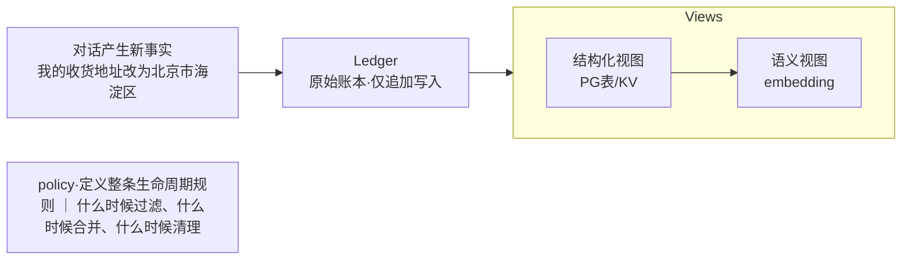
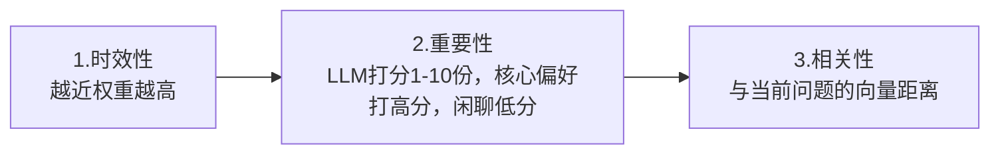
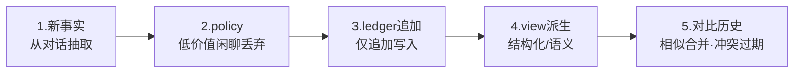
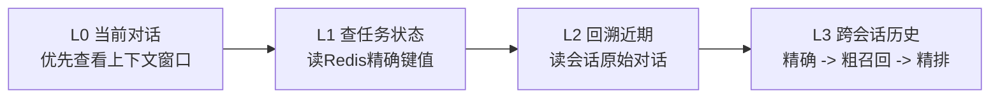

# Agent记忆管理

```
# 场景
面试官：你做过Agent记忆管理吗，怎么做？
候选人：接向量数据库，做RAG
面试官：用户改了收货地址，旧地址怎么失效？订单状态这种精确数据存哪？
候选人: ...
```

## 为什么向量库+RAG不够

### 四个致命缺陷

1. 分不清重要程度
   > 向量只有相似度，没有重要度打分，核心偏好和闲聊一视同仁
   > 坑一：语义飘移（向量检索看语义距离，对否定不敏感）

```
“支持退款” vs “不支持退款”  score:0.96
两个相反的事实，向量距离却非常近
```

2. 没有时间纬度
   > 没有原生有效期标记，旧事实不会自动失效，冲突数据共存
   > 坑二：没有时间纬度(向量数据库没有原生的有效时间标记)

```
写入地址A -> 用户改成地址B -> 发起检索（用户地址是？）
向量空间，两条记录都存在，检索时完全可能召回旧地址。新旧冲突数据共存，这是大忌。
```

3. 做不了精确检索
   > 订单ID，手机号这类精确字段，向量做不了高效等值查询
   > 坑三：做不了精确检索（向量做不了高效等值查询）

```
精确字段：
- 订单ID
- 用户手机号
- 配置参数(eg.lang = zh-cn)

纯向量库查[订单号 ID = 123] -> 退化为全量语义扫描·线上性能差
```

4. 没有准入和清理
   > 所有对话无差别入库，冗余/过时/低置信度记忆全是噪声
   > 坑四：没有准入和清理（无差别写入->数据煽增->核心事实淹没

```
所有对话无差别写入 -> Lost in the Middle

在上下文，模型的开头和结尾记得住，中间几乎“看不见”
```

## 正解

结构化存储 + 向量数据库

结构化：负责精确[订单、状态、手机、用户画像---等值查询、一条命中]

向量数据库：只兜底模糊[语义片段、模糊描述---只做召回候选、不做事实判断]

### 四层冷热分层 + 治理机制
> L1 主要保存当前任务的临时状态，例如当前订单号、工具调用结果和流程变量，但订单和地址这类业务事实不能只依赖 Redis，应该以业务数据库为准。L2 保存当前会话的原始消息和摘要，摘要通常在上下文接近上限、会话阶段结束或异步定时任务中生成。摘要不一定进入 L3，只有对未来跨会话仍然有价值、稳定且允许持久化的信息才应该进入长期记忆。
> 每次对话不会全部写入长期记忆，而是先保存 L2，再通过规则或模型抽取长期记忆候选。结构化事实放 PostgreSQL，语义记忆片段才生成 Embedding 写入向量库。三天后 Redis 过期，重新打开会话时，应从持久化会话存储恢复 L2，从 PostgreSQL 查询结构化长期记忆，从向量库按当前 Query 检索相关语义记忆，再重新构造 L0 上下文。
> L0-L3,从热到冷、各司其职

- L0: 上下文窗口[LLM 原生上下文] - 单会话临时、超token滑动淘汰
- L1: 工作记忆（Redis + TTL）- 缓存任务状态/工作结果、精确键值存储
- L2: 会话短期记忆（Redis Stream/关系库） - 滚动保留原始会话、异步生成摘要
- L3: 长期冷记忆（PostgreSQL+向量库） - 结构化画像/语义片段、跨会话永久

#### 热层：L0与L1

滑动窗口负责当下，Redis负责精确

L0:上下文窗口+滑动淘汰

```
用户：我要改地址
助手：请问新地址？
---------------- 超出token上限，老对话自动滑出
用户：北京海淀...
助手：已更新
用户：订单到哪了
助手：查询中...
```

L1:工作记忆·Redis+TTL

```
order:123 ｜订单季度：已出库，在途 ｜ TTL：30min
param：cache｜本次会话临时配置｜TTL：10min
tool:result:7f ｜ 上次工具调用返回 ｜ TTL：5min

精确键值查询，配TTL自动过期
```

#### 冷层：L2与L3

原始对话留底、长期记忆混合存储

L2:会话短期记忆

```
用户：我要改收货地址
助手：请提供新地址
用户：北京市海淀区
助手：已为你更新

⬇️ 异步生成摘要
会话摘要：用户主动修改地址为北京市海淀区，订单进度敏感
```

L3:长期冷记忆·混合存储
|PostgreSQL|向量库|
|---|---|
|结构化用户画像 稳定事实/双时态字段|语义片段 只能兜底语义召回|


写入必须经过准入过滤，只留高置信度的稳定事实，绝不无脑全存

#### 四层记忆的正确定位
```
L0:当前上下文
   只服务于一次LLM调用
L1:工作记忆
   当前任务的状态、临时变量、工具结果
L2:会话记忆
   当前会话的消息历史、会话摘要
L3:长期记忆
   跨会话仍然有价值的用户事实、偏好、经验、知识
```
可以类比
```
L0 = 你脑子里当前正在想的内容
L1 = 当前任务的草稿纸
L2 = 这次聊天的聊天记录
L3 = 你的长期档案和知识库
```

Q.什么时候生成L2摘要？
```
1. Token接近上下文上限时
例如：近20条保存，远50条压缩为摘要
2. 会话阶段结束时
3. 定时异步生成
例如：10分钟、1小时、每天
4. 重要事件发生时
- 用户确认了一个方案
- 订单状态发生变化
- Agent完成了一个任务
```

Q.L2的摘要要不要进L3？
> 关键判断：在未来会话是否有价值；可以进L3的内容：用户长期偏好、确认的个人事实、跨对话反复有用的个人习惯、长期有效的业务配置、经过验证的用户画像

#### 候选记忆策略
```
候选事实
 ↓
是否长期有效
 ↓
是否跨会话有用？
 ↓
是否用户明确表达？
 ↓
是否涉及敏感信息？
 ↓
是否允许保存？  
 ↓
写入 L3
```

#### 一个会话，三天后再次打开正确流程
```
打开会话
  ↓
根据 conversation_id 从持久化存储恢复会话
  ↓
读取会话摘要（conversation_summaries表）
  ↓
读取最近若干条消息（可基于covered_until_message_id）
  ↓
根据当前问题检索相关长期记忆
  ↓
重新构造 L0 上下文

其中：
L2 原始会话：
从关系库、对象存储或会话归档中恢复

L3 结构化记忆：
从 PostgreSQL 查询

L3 语义记忆：
从向量库查询

L1：
重新放入 Redis，恢复当前任务状态
```

## 治理

### 治理三件套
光分层还不够，还得有人管
|name|ledger|views|policy|
|---|---|---|---|
|含义|原始账本|派生视图|策略规则|
|解决|溯源|冲突|生命周期|
|解读|仅追加写入，保留每一次事实变更的完整轨迹、可审计、可回放|从账本派生出结构化视图和寓意视图，多格式并存互不干扰|定义什么时候过滤、合并、清理，管住整条记忆链路|

### 数据怎么流
对话->ledger->views,policy管全局

### view进阶招式·反思
把零散规则升华为经验规则
```
用户第1次比价后才下单
用户第2次比价后才下单   -> reflection  [这个用户价格敏感]
用户第3次比价后才下单

触发时机：会话结束时、记忆条数超阈值 定时批跑
```

### 双时态模型解决冲突
real time x transaction time

transaction time
|FACT|REAL_START|REAL_END|TX_TIME|状态|
|---|---|---|---|---|
|地址A|03-01|03-18（回填）|03-01|已失效|
|地址B|03-08|NULL|03-18|生效中|

冲突时按“哪个版本当前生效”判定，而不是谁先写；检索只召回生效中的事实

### 检索排序：三维加权
不能只看语义相似度


```
score = w1 * recency + w2 * importance + w3 * relevance
```
重要性打分必须异步批量预打分 --- 每轮都让LLM打分，等于每轮烧Token

## 读写策略
八个字：写入过滤，读取分层

### 写入分层

### 读取分层
反过来读：从热到冷、逐级命中

L3 跨会话历史事实的检索链路：
```
结构化精确匹配 -> 向量语义粗召回 -> 三维加权精排 -> 过滤过期/低重要性 -> 注入模型
```


## 总结
整流程为记忆流程为

冷热分层存储 -> 三件套治理 -> 双时态冲突解决 -> 生命周期管控
