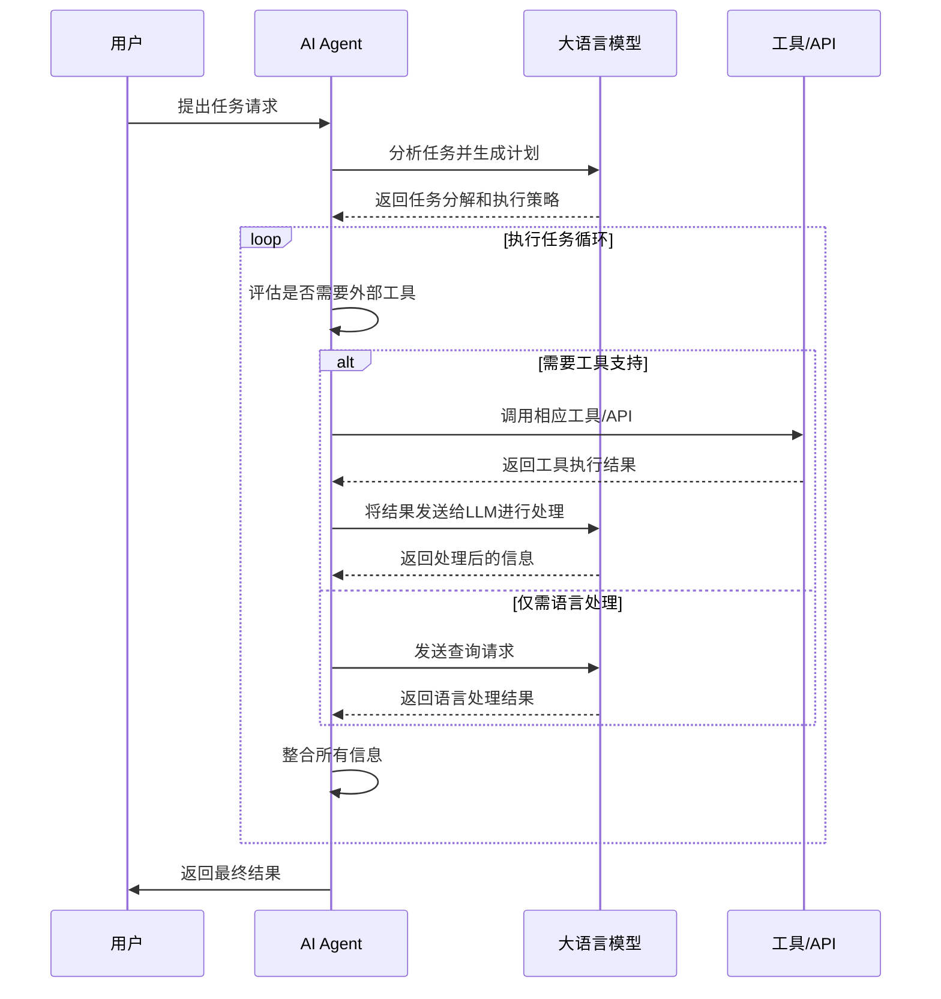
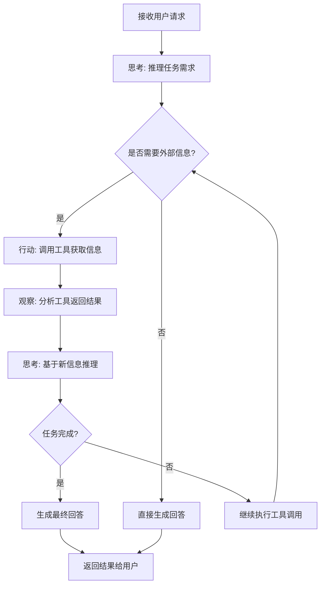
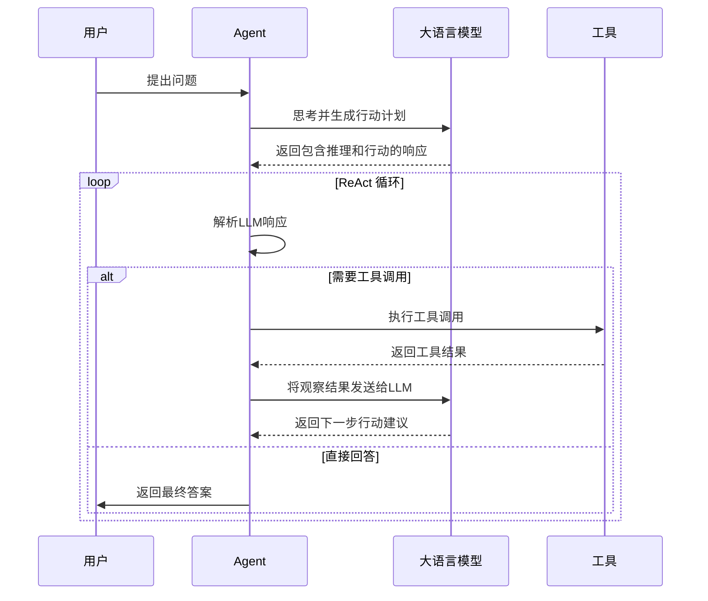
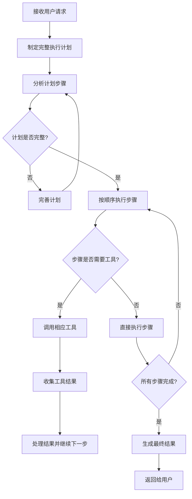
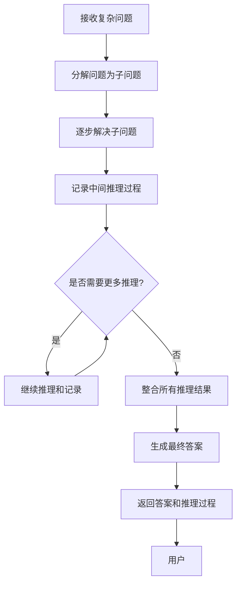
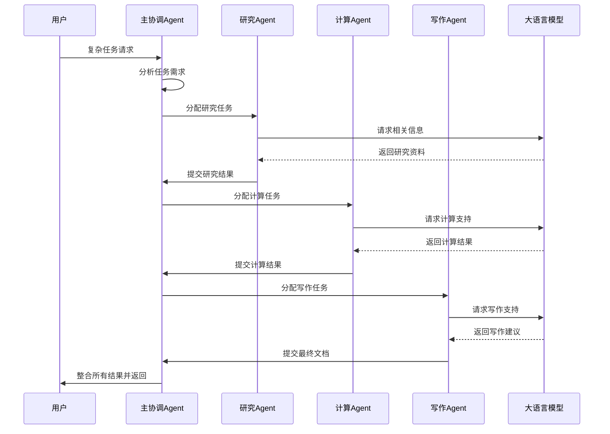
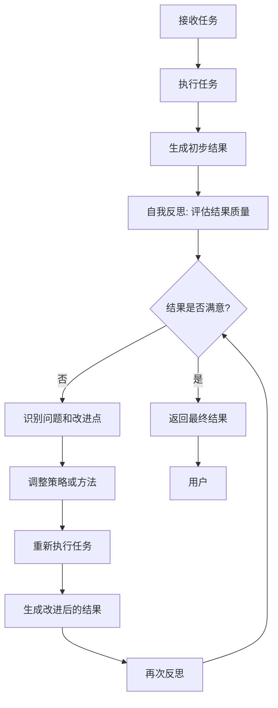

# Transformer
## 是什么？
专业解释：Transformer 是 2017 年 Google 在论文 Attention Is All You Need 中提出的神经网络架构，完全摒弃了 RNN/LSTM 的循环结构和 CNN 的卷积结构，仅依靠自注意力机制（Self-Attention）建模序列依赖。

## 组成
它由编码器和解码器两部分堆叠而成：
- 自注意力：让序列中每个 token 直接并行计算与其他所有 token 的关联权重，一步到位捕捉长距离依赖；
- 多头注意力：多组注意力头并行工作，各自学习不同语义子空间的关系（句法、指代、因果等）；
- 位置编码：因无循环 / 卷积天然不带顺序信息，需显式注入位置向量；
- 前馈网络 + 残差连接 + LayerNorm：逐层非线性变换并稳定深层训练；
- 编码 - 解码注意力：解码器在生成时交叉关注编码器的输出。

## 直白解释
把 Transformer 想象成一个开大会的翻译 / 写作团队：
1. 词变数字 + 排座位：每个词先变成一串数字（词嵌入），再贴上 "我在第几个位置" 的标签（位置编码）—— 模型既懂词义，也懂语序。
2. 全员同时开会（自注意力）：句子里每个词都同时 "看" 向其他所有词，判断谁跟自己最相关。比如 "小明把书给了小红，他很开心" 里的 "他"，会重点盯住 "小明"。而且同时开好几个分会场（多头注意力），有的盯 "谁做的动作"，有的盯 "动作给了谁"，各抓各的重点。
3. 各自消化（前馈网络）：开完会后每个词自己再琢磨一轮，把信息整理一下。
4. 反复开 N 轮：上面两步重复多层，越靠后理解越深入、越抽象。
5. 逐字输出（解码器）：写答案时，解码器一边看已经写出的字（掩码注意力，不许偷看后面），一边参考原文理解（编码 - 解码注意力），一个字一个字往外蹦。
一句话对比 RNN：RNN 像一个人逐字读句子，慢且容易忘前面的；Transformer 像全员同时开会，一眼看全句，又快又能抓住远距离关系。

## 大模型本质
根据上文，预测下一个词

## 架构
主要有三种形态：
- Encoder-only纯编码器：靠双向注意力、同时看见上下文前后内容、只做“理解”不做生成。适合文本分类、嵌入向量、重排序这类任务
- Decoder-only纯解码器：靠单向掩码注意力、只能看已生成的上文，专门做“续写/生成”，是当前对话模型的绝对主流。
- Encoder-Decoder组合架构：编码器理解输入、解码器生成输出、适合翻译、摘要这类“序列到序列”转换任务。

## 处理过程
1. 原始文本。我们输入到自然语言文本，比如“今天天气不错、我们去公园散步吧！”，模型是没法直接处理的，必须先转换成它能理解的格式。
2. 分词（Tokenizer）。第一步就是吧橘子拆成一个个最小单元，也就是Token
3. Token -> ID 映射。 每个Token都会对应词表（Vocabulary）里的唯一整数ID，比如“今天天气”对应4521，“不”对应1043。这一步相当于给每一个Token分配一个“编号” 方便模型后续查找和计算。
4. Embedding查表。模型会通过一个embedding矩阵，把每一个Token的ID转化成一个高纬向量表示。这个向量可以理解为Token的“语义坐标”。语义相近的词，向量在空间中的位置也会更接近，模型就是靠这种向量来理解语义的。
5. 加上位置编码。自注意力机制本身不包含位置信息，模型不知道词的先后顺序，所以需要额外加入位置编码，和Token Embedding相加，得到最终的输入向量。
6. 之后这些向量就会进入Encoder或者Decoder层，通过注意力机制和前馈网络，一步步完成语义理解或文本生成。（每一层Decoder处理完后、都会输出一组向量、这些就是“隐藏状态” 到最后一层的隐藏状态，就是模型结合了所有上文，注意力权重后，最终形成的“上下文理解结果”。它本身不是词，也不是概率，只是模型内部的高维“语义向量”

隐藏状态 = 模型的 想法/理解

输出投影 = 把 想法 翻译成 “每个词的候选得分”

Softmax = 把“得分”变成“下一个词的概率”

## 自回归生成的过程
自回归指：在生成序列时，模型在每一个时间步t只利用已生成的内容（包括输入和之前生成的内容来预测下一个token），然后将该token追加到序列末尾，继续生成后续内容。

## Decoder的两个独立阶段
### 训练阶段
统一训练任务： 全程都是下一个词预测，拿完整句子遮住末尾Token，强制模型凭千问预测被遮挡的真实词汇/

前向计算流程： 和推理的计算路径完全一致，文本经过分词，Embedding，位置编码送入多层Decoder，依靠因果自注意力、前馈网络算出隐藏状态，再经过输出投影、Softmax得出每一个候选Token的概率分布。

反向更新参数：模型预测出的Token大概率和原文真实Token存在偏差，此时会通过损失函数计算预测值与标准答案的差距，再用反向传播算法。迭代更新模型内部全部参数。

最终模型在海量数据汇总自动学习到词语语义、语序逻辑、上下文关联、各类行业知识

#### 预训练
目标：从零开始，让模型掌握语言能力（语法、语义、逻辑）和世界知识（事实、常识、专业领域）。
数据：海量无标注原始文本 —— 网页、书籍、代码、论文、对话等，动辄万亿 Token。不求精，但求广和多。
任务：就是你上面说的 "下一个词预测"（因果语言建模）。给一段文本，遮住后面的词让模型猜，反复迭代。

特点：
算力消耗最大，通常占整个训练成本的 90% 以上
参数从随机初始化开始学
学完后模型 "博学" 但 "不听话"—— 你问它问题，它可能续写、反问、跑题，因为它只学会了 "文本接龙"，没学会 "按用户指令直接回答"
> 类比：一个人读遍了图书馆所有书，知识渊博，但你问他问题，他可能自顾自往下写文章，不知道要直接回答你。

#### 后训练
在预训练权重基础上，用小而精的数据进一步调教，核心分两步：
1. 监督微调 SFT（Supervised Fine-Tuning）
- 数据：高质量的 "指令 → 回答" 对（如用户问 "写个快排"，标准答案是代码 + 解释），通常几万到几十万条。
- 任务：还是下一个词预测，但只在回答部分计算损失，教模型 "看到指令后应该这样答"。
- 效果：从 "文本接龙机" 变成 "能按指令回答的助手"。
2. 人类偏好对齐（RLHF / DPO）
- 数据：同一个问题让模型生成多个回答，人类标注哪个更好（偏好对比）。
- RLHF：先训一个奖励模型学人类偏好，再用强化学习让生成结果往高分走。
- DPO：更简洁的替代方案，直接用偏好数据优化策略，省去单独的奖励模型。
- 效果：让回答更符合 有用、诚实、无害（Helpful, Honest, Harmless），减少胡说八道、拒绝有害请求、语气更自然。
> SFT = 上岗培训，给你看优秀客服的问答记录，教你 "用户这么问你就这么答"。
> RLHF/DPO = 师傅在旁边打分，答得好鼓励，答得差纠正，慢慢让你越来越符合用户期望。

#### 计算损失和反向传播
- 计算损失：把模型的输出结果和真实结果做比较，看看差得有多远
- 反向传播：这个差距的信号从后往前传回去。告诉模型里每一层该怎么调参数，才能做得更好。

大模型训练 = 【准备数据集 + 数据处理 + 大模型初始化 + 开始训练 + 评估验证】 + 保存模型参数

#### 采样策略
Top-p核采样： 从最高概率开始累加树枝，选出累计概率达到阈值P的所有词语作为候选，再再词池中随机采样。会根据概率分布自动增减候选词数量。

Temperature：低温会放大高频率词汇优势，随机性大幅减弱，回答保守规整；高温抹平概率差距、冷门词更容易被选中，内容更发散、创意更强。温度趋于0近似贪心策略。

### 推理阶段
参数状态永久冻结： 模型训练完后，所有权重固定不练，无论调用多少次接口、允许多少轮Agent循环、参数都不会发生任何修改、模型不会单独记住某个用户的对话、也无法自动学习新知识。

前向计算流程： Token编码、多层Decoder、隐藏状态、输出投影、Softmax这套计算逻辑和训练完全相同、但只执行前向前向计算，不会计算损失、不会做方向传播更新参数。

自回归循环生成： 模型每次只预测单个Token、把生成的新词追加到原本上文末尾、拼接出新的完整上下文、再次送入模型重复计算、循环往复知道生成结束符、终止输出。我们的Agent所有历史对话、工具返回内容、检索文档，都会统一拚进这段输入上文。也正因为只做单向前向计算，不保存梯度数据，推理阶段显存占用更低、响应延迟更小。

### 完整链路
1. 输入文本
2. token拆分
3. 词向量嵌入
4. QKV自注意层。得出所有权重加权融合全部Token的V向量。【唯一作用：聚拢全文所有上下文信息，让当前文字能看懂整段文本里的关联语义】
5. FFN前馈网络（语言特征加工）。 对聚拢的上下文信息作深度整理，提炼词汇搭配，语法逻辑、常识规律，让向量具备完整的语言表达特征。
6. 线性输出层。 给词库里每一个可能出现的字词打出原始匹配分数，此时分数没有归一化，不代表概率。
7. Softmax，对上一步全部字词的原始分数作Softmax归一化，把所有数值转为0-1，总和为1的概率分布。
8. 通过贪心、Top-p等采样规则，挑取概率最高/匹配度最合适的文字，作为模型本轮输出的下一个Token

## 支撑 Decoder 自回归逐字生成的的底层计算单元，Q、K、V
- Q(查询): 代表当前这个词的检索诉求、相当于我们带着问题去上下文寻找关键信息
- K(键): 是每个文字自带的语义标签、仅用来和Q计算相似度，判断两端内容的相关程度、只参与打分环节、打分完成后不再参加后续运算。
- V（值）：承载文字真实的完整的语义内容，也是唯一会被加权融合、最终输出的信息载体。

第一步，拿当前词的Q，遍历全部文字对应的K -- 匹配，算出两两之间的相关分数；

第二步：分数经过归一化处理，得到一组注意力权重，色块越深代表对应位置语义相关性越大。

第三步：以“我喜欢苹果”的喜欢的Q为例。会与所有字词的K进行计算算出权重，用得到的所有权重，分别乘以每一个位置的V，再把全部加权后的V累加求和。最终生成融合了整段上下文信息的新向量，作为当前【喜欢】这个位置的输出。 （全部V会参与加权求和）

拿到新向量之后呢？
FFN前馈网络，把注意力融合号的上下文向量、深度加工、提炼词汇搭配、语法逻辑、常识关联。

有了这个向量，下一步自然去词表里选词输出了
【线性输出层】- 【Softmax归一化】-【采样/选择】-【输出下一个token】

- 线性输出层：把高维语义向量映射到词表，为每一词生成一个“原始分数”
- Softmax归一化，把所有分数变成概率分布。概率越高，越可能被选中
- 采样选择。根据概率选择下一个词，作为模型输出的token

### KV cache
美输出一个字，就从头到位跑QKV，会产生海量重复计算，浪费算力。解决方法是首次处理用户上下文，走完QKV计算，K向量、V向量存入显存缓存。后续每一轮新增待预测token，仅计算这个位置的Q，不需要重复计算历史文本的K、V。  本轮预测出下一个文字后，再把这个新的Token的K、V追加写入缓存。扩充Cache的内容

# AI Agent 与大模型协作详解 🤖

在人工智能领域，AI Agent 和大语言模型 (LLM) 正在改变我们与技术交互的方式。本文将详细介绍这些概念以及它们如何协同工作。

## 什么是大语言模型 (LLM)？ 🧠

大语言模型是基于大量文本数据训练的深度学习模型，能够理解和生成人类语言。它们具有以下特点：

- **大规模参数**：通常包含数十亿甚至数千亿参数
- **上下文理解**：能够理解复杂的语言上下文和语义
- **多任务能力**：可以执行多种自然语言处理任务
- **生成能力**：能够生成高质量的文本内容

## 什么是 AI Agent？ 🤖

AI Agent 是构建在大语言模型之上的智能实体，具有以下特征：

- **目标导向**：为特定目标或任务而设计
- **自主性**：能够在最少人工干预下执行任务
- **交互性**：能够与用户、环境和其他系统交互
- **工具使用**：可以调用各种工具和API来完成复杂任务

## Agent 的核心组件 ⚙️

一个典型的 AI Agent 通常包含以下几个核心组件：

### 1. 规划 (Planning)
- 子目标分解：将复杂任务分解为更小的子任务
- 推理与决策：基于当前状态做出决策

### 2. 记忆 (Memory)
- 短期记忆：当前任务的上下文信息
- 长期记忆：历史交互和知识存储

### 3. 工具 (Tools)
- API 调用：访问外部服务和数据
- 代码执行：运行代码片段处理数据
- 文件操作：读写文件和处理文档

### 4. 执行 (Execution)
- 动作执行：执行计划中的具体步骤
- 结果反馈：将执行结果反馈给用户或系统

## 协作流程时序图 📊

下面的时序图展示了用户、AI Agent、大语言模型和工具之间的协作流程：

## Agent 工作流程详解 🔍

### 1. 任务接收与理解
当用户提出请求时，Agent 首先需要理解任务的具体要求：
- 解析用户意图
- 识别关键信息和约束条件
- 确定任务的复杂度和所需资源

### 2. 计划制定
基于对任务的理解，Agent 制定执行计划：
- 将复杂任务分解为可执行的子任务
- 确定执行顺序和依赖关系
- 选择合适的工具和资源

### 3. 工具调用与执行
在执行过程中，Agent 可能需要调用各种工具：
- 搜索引擎：获取最新信息
- 计算工具：执行数学运算
- 文件系统：读写文件
- API接口：与其他服务交互

### 4. 结果整合与反馈
Agent 将所有执行结果整合并反馈给用户：
- 验证结果的准确性和完整性
- 以用户友好的方式呈现结果
- 根据需要提供进一步的建议或操作

## Agent 的运行模式 🔄

AI Agent 有多种运行模式，每种模式都有其特定的应用场景和优势。下面我们详细介绍几种主要的运行模式。

### 1. ReAct 模式 (Reasoning + Acting) 🤔+⚡

ReAct 模式结合了推理 (Reasoning) 和行动 (Acting)，是目前最流行的 Agent 运行模式之一。

#### ReAct 模式流程图：

#### ReAct 模式时序图：

#### ReAct 模式的优点：
- 结合了推理和行动能力
- 能够处理需要外部信息的复杂任务
- 具有良好的可解释性
- 可以动态调整执行策略

### 2. Plan-and-Execute 模式 📋+▶️

这种模式首先制定完整的计划，然后按计划执行。

#### Plan-and-Execute 流程图：

### 3. Chain-of-Thought (CoT) 模式 🔗

Chain-of-Thought 模式通过展示推理过程来提高复杂任务的准确性。

#### CoT 模式流程图：

### 4. Multi-Agent 协作模式 👥

多个 Agent 协同工作，各自负责不同的任务或专业领域。

#### Multi-Agent 协作时序图：

### 5. Reflection 模式 🪞

Agent 在执行任务后会反思自己的表现，并进行自我改进。

#### Reflection 模式流程图：

## Agent 的应用场景 💼

### 1. 智能助手
- 日程管理
- 信息查询
- 邮件撰写

### 2. 客服机器人
- 自动回答常见问题
- 处理客户投诉
- 订单跟踪

### 3. 数据分析师
- 数据收集与清洗
- 统计分析
- 报告生成

### 4. 内容创作者
- 文章撰写
- 图像生成
- 视频编辑

## 技术挑战与未来发展 🚀

### 当前挑战
1. **可靠性**：确保 Agent 的决策和执行准确可靠
2. **安全性**：防止恶意使用和数据泄露
3. **可解释性**：让用户理解 Agent 的决策过程
4. **效率优化**：减少响应时间和资源消耗

### 发展趋势
1. **多模态能力**：结合文本、图像、语音等多种模态
2. **个性化定制**：根据用户偏好和习惯定制服务
3. **持续学习**：从交互中不断学习和改进
4. **协作网络**：多个 Agent 之间的协同工作

## 总结 📝

AI Agent 与大语言模型的结合为人工智能应用开辟了新的可能性。通过合理的架构设计和工具集成，Agent 能够执行越来越复杂的任务，为用户提供更加智能和便捷的服务。

随着技术的不断发展，我们可以期待看到更多创新的 Agent 应用场景，以及更加智能和高效的协作模式。🚀

> 💡 **小贴士**：在设计和使用 AI Agent 时，始终要考虑用户体验、数据安全和系统可靠性，这样才能真正发挥 AI 技术的价值。

## 1.7 智能体的核心要素
1. 大模型（LLM）
2. 记忆（Memory）
3. 工具使用（Tool Use）
4. 规划决策（Planning）
5. 行动（Action）

## 2.个人知识库
### 2.2 平台支持知识库
- AnythingLLM
- Dify
- MaxKB
- 秘塔搜索在线： https://metaso.cn/
- 知乎直达：https://zhida.zhihu.com/pro

### 2.3 Cherry-Studio搭建个人知识库
- 支持客户端
- 支持满血DS-R1
- 无需本地部署
- 响应块

### 2.4 ima搭建个人知识库
- 支持多端
- 支持满血ds-r1
- 通过微信提问，模型给予知识库生成答案
