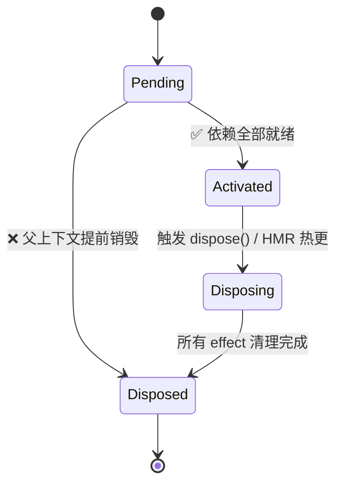

# Cordis
> 面向时空可组合性的Typescript元框架。它只解决插件热重载、依赖编排、可逆副作用、生命周期、热重载；
>
> 一句话，它是插件运行时底座，不是业务框架。

## 核心理念
一、时空可组合性

- **空间（Coeffect / 协效应）**：插件声明**自己需要什么服务**（`inject`），环境必须提供，依赖自动解析；不需要硬编码 import 其他插件。
- **时间（Effect / 效应）**：插件做的所有副作用（监听事件、起服务、定时器、连接）都附带**撤销函数**；卸载时自动逆序清理，保证干净回滚，无资源泄漏。

二、一切皆插件

服务、能力、事件处理器、适配器全部封装成插件；插件之间不相互import，只通过ctx访问服务、事件通信。
- 关注点分离：Cordis 只管生命周期 + 依赖 + 副作用；业务逻辑交给插件。
- 可替换：同一个服务接口，可以随时换不同实现，上游插件无感（比如换 LLM 后端、换数据库）。

三、显示生命周期、自动安全清理

反对隐式全局状态；所有外部资源都被框架追踪，**卸载 = 自动回滚全部 effect**，而不是靠开发者手动写清理。

四、类型优先、TS原生友好。

利用 TS 声明合并，`ctx.xxx` 天然带类型；事件、配置 Schema 都可以强类型校验。

## 架构
```
Root Context（根上下文）
├─ Registry（插件注册中心，依赖图、Fiber 调度）
├─ Events（类型化事件总线）
└─ 挂载若干 Service / Plugin（每个插件派生子 Context，形成树）
```
### 1.context 上下文 - 最核心载体  只是挂载fiber上的插座

### 2.plugin 插件三种形态
1.函数插件 `apply(ctx,config)`最常用
2.类 `new (ctx,config)`
3.对象`{apply,name,inject,provide}`

元字段（可选）

- `name`：插件名
- `inject: string[]`：依赖的服务名，**依赖不全时插件不会启动**
- `provide: string[]`：本插件对外提供的服务
- `Config`：schemastery schema，校验配置cordis.moe    

### 3.service(服务)
Service 是挂载在 ctx 上的长驻能力，是插件对外暴露能力的标准形式（继承 `Service`）

服务会被注册到 registry；其他插件通过 `inject` 声明依赖，等待服务就绪。

服务本身也是插件，拥有自己的生命周期、effect。

不是传统 DI：**不是构造器注入，是上下文属性访问 + 运行时依赖图调度**

### 4.fiber（内部状态机）= 插件树
Fiber 是 Cordis 内部管理插件实例的轻状态机，每个插件对应一个 Fiber：
`Pending（等待依赖） → Activated（运行） → Disposing → Disposed（销毁）`

- 依赖缺失时保持 pending；依赖就绪自动激活；父 fiber 销毁，子 fiber 级联销毁。
- 支撑 HMR：热更新等价于销毁旧 Fiber、拉起新 Fiber，自动迁移依赖。


### 5.Event（类型化事件）
支持 4 种分发模式：

- `emit`：并行广播
- `parallel`：并行，等待全部完成
- `serial`：串行依次执行
- `waterfall`：链式传递结果（管道）
事件同样属于 effect，ctx 销毁时自动 off，不会残留监听。

### 6.Registry
维护整张插件依赖 DAG，自动拓扑排序，解决加载顺序；监听服务的提供 / 消失，驱动插件自动启停。**全局唯一 Registry**，统一维护 DAG 依赖图、所有 Fiber；

### 骨架
```ts
import { Context, Service } from 'cordis'

const root = new Context()

// F1: DB Service
class DB extends Service {
  static inject = []
  constructor(ctx: Context) {
    super(ctx, 'db')
    console.log('db service ready')
  }
}
root.plugin(DB)

// F2: Logger Service
class Logger extends Service {
  static inject = []
  constructor(ctx: Context) {
    super(ctx, 'logger')
    console.log('logger service ready')
  }
}
root.plugin(Logger)

// F3: PluginA，inject db + logger
function PluginA(ctx: Context) {
  console.log('PluginA 激活，db & logger 就绪')

  // 在PluginA内部挂载 F4 SubPluginA1
  ctx.plugin({
    inject: ['logger'],
    apply(ctx) {
      console.log('SubPluginA1 ready')
    }
  })

  // 在PluginA内部挂载 F5 SubPluginA2
  ctx.plugin({
    inject: ['db'],
    apply(ctx) {
      console.log('SubPluginA2 ready')
    }
  })
}
const PluginAMeta = {
  name: 'plugin-a',
  inject: ['db', 'logger'],
  apply: PluginA
}
root.plugin(PluginAMeta)
```
生命周期挂载树（Fiber Tree）
```
RootFiber
├─ F1(DB Service)
├─ F2(Logger Service)
└─ F3(PluginA)
   ├─ F4(SubPluginA1)
   └─ F5(SubPluginA2)
```
Registry 依赖 DAG（启动顺序约束）

```
DB, Logger 先启动
→ PluginA 等待 DB+Logger
→ SubPluginA1 等待 Logger
→ SubPluginA2 等待 DB
```