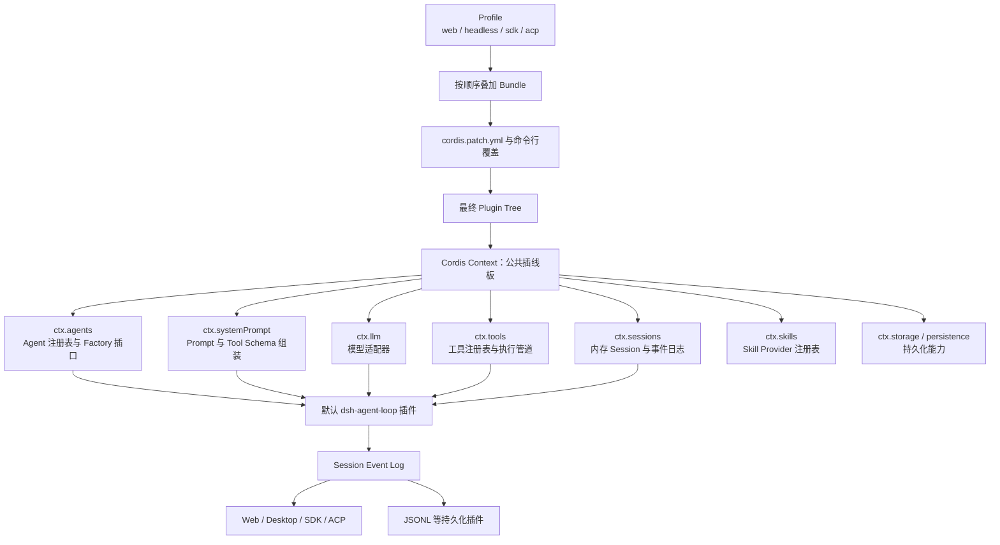

# deepseek harness# DeepSeek Harness 整体架构

> 一句话理解：DSH 是一个由插件拼出来的 Agent Runtime。Cordis 提供“插线板、事件总线和生命周期”，Agent Loop 只负责把消息、模型、工具和 Session 串成循环。

## 1. 先看全景图



这张图里最重要的不是箭头，而是两种关系：

1. **直接调用能力**：Loop 通过 `ctx.llm`、`ctx.tools` 等稳定名字调用服务。
2. **监听或拦截过程**：其他插件通过事件观察、包装或拒绝某个阶段，而不修改 Loop 源码。

## 2. “一切皆插件”究竟是什么意思

这里的插件不是浏览器插件，也不一定来自第三方。它只是一个有明确生命周期的模块：

```text
加载时：声明依赖 → 注册服务/工具/事件监听器
运行时：通过 ctx.xxx 与事件协作
卸载时：撤销自己的注册，等待自己拥有的工作收敛
```

Cordis 提供五个关键概念：

- **Plugin**：一块可装卸行为。
- **Context**：服务容器，例如 `ctx.tools`、`ctx.llm`。
- **inject**：声明“我需要哪些服务”，依赖就绪后再激活。
- **Typed Events**：模块之间的通知和中间件管道。
- **Reversible Effects**：注册行为带 disposer，卸载时能够反向撤销。

因此，“Agent Loop 是插件”不表示它不重要，而是表示它也必须通过公共接口接入系统，其他模块不能偷偷依赖它的内部类。

## 3. 启动层：Profile、Bundle、Patch、Plugin Tree

先纠正一个容易产生误解的地方：这四个词不是四层运行时代码。

```text
Profile：决定采用哪些配置层
Bundle：发布一组可复用的配置层
Patch：修改“准备启动哪些插件”的配置清单
Plugin Tree：配置结算后，由 Cordis Loader 真正启动的运行结构
```

以 `dsh web` 为例，完整启动路径是：

```text
dsh web
  = dsh --profile web
        ↓
读取 $DSH_HOME/profiles/web/package.json
        ↓
找到 Profile 中按顺序声明的 Bundle
        ↓
读取每个 Bundle 声明的 cordis.patch.yml
        ↓
叠加 Profile、Home 和命令行 Patch
        ↓
得到最终 Cordis Entry 配置
        ↓
Cordis Loader 导入模块并调用 apply(ctx, config)
        ↓
形成正在运行的 Plugin Tree
```

### 3.1 Profile：选择一份“产品装配方案”

Profile 不是一个 TypeScript 类，也不是正在运行的服务。它是 `$DSH_HOME/profiles/<name>` 下的一组启动资料，主要包括：

```text
$DSH_HOME/profiles/web/
├── package.json
└── cordis.patch.yml
```

其中 `package.json` 的核心含义可以简化成：

```json
{
  "dsh": {
    "profile": {
      "bundles": [
        "@deepseek-ai/dsh-base",
        "@deepseek-ai/dsh-web-app"
      ]
    }
  }
}
```

这表示 Web 产品先采用公共基础层，再采用 Web 宿主层。其他产品形态只是选择了不同的 Bundle 组合：

```text
web         = base + web-app
headless    = base + headless
sdk         = base + sdk-app
acp         = base + acp-app
sdk-minimal = sdk-minimal 自己的一套最小树
```

因此“Profile 选择产品形态”的准确含义是：**Profile 通过 Bundle 列表决定这个进程最终装配成 Web 服务、一次性命令行任务、SDK 服务还是 ACP 服务。**Profile 自己不实现 Agent Loop、WebServer 或 Tool。

真实的 Profile 读取和 Bundle 解析入口在 [`packages/boot/app-boot/src/profile.ts`](https://github.com/deepseek-ai/deepseek-harness/blob/master/packages/boot/app-boot/src/profile.ts)。`loadProfileDirectory()` 的逻辑可以简化为：

```ts
function loadProfileDirectory(profileDir) {
  const manifest = readProfileManifest(profileDir)
  const bundles = manifest.dsh?.profile?.bundles ?? []

  const layers = bundles.map(packageName => {
    const packageDir = resolveBundleDir(packageName)
    const bundleManifest = readPackageJson(packageDir)
    const patchFile = bundleManifest.dsh?.bundle?.patch

    return {
      packageName,
      patches: loadOverlayPatches(patchFile),
    }
  })

  return {
    layers,
    patches: loadOverlayPatches(`${profileDir}/cordis.patch.yml`),
  }
}
```

这个阶段只是在收集配置，还没有启动任何业务插件。

### 3.2 Bundle：可以安装和复用的“插件配置包”

Bundle 的主要职责不是自己整体运行，而是告诉启动器：“选择我时，请应用哪些 Patch。”一个 Bundle 的 `package.json` 会声明：

```json
{
  "name": "@deepseek-ai/dsh-web-app",
  "dsh": {
    "bundle": {
      "patch": "./cordis.patch.yml"
    }
  }
}
```

`dsh-base` 的 [`cordis.patch.yml`](https://github.com/deepseek-ai/deepseek-harness/blob/master/packages/bundle/base/cordis.patch.yml) 会一次插入大量公共 Plugin Entry，概念上类似：

```yaml
- insert:
    - id: llm
      name: '@deepseek-ai/dsh-llm'

    - id: session
      name: '@deepseek-ai/dsh-session'

    - id: sandbox
      name: '@deepseek-ai/dsh-sandbox-local'

    - id: tool-bash
      name: '@deepseek-ai/dsh-tool-bash'

    - id: tool-fs
      name: '@deepseek-ai/dsh-tool-fs'
```

Web Bundle 再通过自己的 [`cordis.patch.yml`](https://github.com/deepseek-ai/deepseek-harness/blob/master/packages/bundle/web-app/cordis.patch.yml) 增加 Web 产品需要的插件，例如：

```yaml
- id: webserver
  name: '@deepseek-ai/dsh-host-webserver'
  inject: [webStartup]
  config:
    host: !!js ctx.webStartup.host ?? '127.0.0.1'
    port: !!js ctx.webStartup.port ?? 3080

- id: web-runtime
  name: '@deepseek-ai/dsh-web-app'
  inject: [webStartup]
  config:
    openBrowser: !!js ctx.webStartup.openBrowser
    printUrl: true
```

所以一个 Bundle 可以插入一个插件，也可以插入几十个插件，还可以覆盖或关闭前面 Bundle 提供的配置。要区分：

```text
Bundle：配置和分发单位，描述一组插件如何加入产品
Plugin：真正被 Loader 加载、执行和卸载的运行单位
```

### 3.3 Patch：修改最终插件清单，而不是修改源码

Patch 操作的是 Cordis Plugin Entry。它可以：

- 使用 `insert` 插入新插件。
- 通过稳定 `id` 修改已有插件。
- 使用 `disabled: true` 关闭插件。
- 替换已有插件的完整 `config`。

例如插入自定义插件：

```yaml
- insert:
    - id: company-audit
      name: '@company/dsh-audit-plugin'
```

关闭 Web Tool：

```yaml
- id: tool-web
  disabled: true
```

覆盖 Web Tool 配置：

```yaml
- id: tool-web
  config:
    fetch: false
    searchTimeoutMs: 60000
```

需要特别注意：后一个 Patch 的 `config` 是**整块替换**，不是深度合并。如果默认配置还有其他字段，而后面的 Patch 没有重新写出，那些字段不会因为“以前存在”就自动保留。

所有层从空列表开始，按以下顺序结算：

```text
1. Profile 中各 Bundle 的 Patch，按 bundles 声明顺序
2. $DSH_HOME/profiles/<name>/cordis.patch.yml
3. $DSH_HOME/cordis.patch.yml
4. 命令行中按顺序传入的 --patch 文件
```

后面的层级优先级更高。可以用下面两个命令观察结算结果：

```bash
# 只看 Bundle 默认层
dsh --profile web --dump-default-config

# 加上 Profile、Home 和命令行覆盖后的最终配置
dsh --profile web --dump-config
```

### 3.4 一条 Plugin Entry 怎么读

以这条配置为例：

```yaml
- id: tool-web
  name: '@deepseek-ai/dsh-tool-web'
  inject: [web]
  config:
    fetch: true
  disabled: false
```

可以逐句翻译为：

```text
id: tool-web
这条配置实例的稳定身份；后续 Patch 和管理界面用它定位。

name: @deepseek-ai/dsh-tool-web
Loader 应该从哪个 Node.js 模块加载 Plugin 实现。

inject: [web]
该 Plugin 依赖 ctx.web；服务没有就绪前不要激活。

config
校验后传给 Plugin 的 apply(ctx, config)。

disabled
是否保留声明但不启动这个 Plugin 实例。
```

#### `name` 通常是 Node module specifier

下面这条：

```yaml
name: '@deepseek-ai/dsh-tool-web'
```

概念上类似：

```ts
const pluginModule = await import('@deepseek-ai/dsh-tool-web')
```

它通常会通过该 npm 包的 `package.json#exports` 定位到编译后的入口文件。`name` 也可以是：

```text
@deepseek-ai/dsh-plugin-manager/tools
└─ npm 包的子路径导出

./index.js
└─ 相对于 Patch 文件的模块路径

/absolute/path/plugin.js 或 file:///...
└─ 绝对模块路径

cordis:group
└─ Cordis Loader 内置的分组节点，不是 npm 包
```

因此“安装依赖”和“运行插件”是两件事：

```text
package/node_modules 中存在
= Plugin 代码可以被解析

最终配置中存在 name 对应的启用 Entry
= Loader 会尝试加载它

Loader 成功调用 apply(ctx, config)
= Plugin 才真正运行
```

如果包已经安装，但最终配置没有对应 Entry，它不会运行；如果配置有 Entry，但模块无法解析，启动会失败并产生诊断。

还要避免混淆三种名字：

```text
Entry id：tool-web
用于 Patch 定位这一条配置实例

Plugin module name：@deepseek-ai/dsh-tool-web
用于 Node.js 模块解析

模型 Tool name：web_search / web_fetch
Plugin 启动后注册给模型调用的工具名
```

一个 Plugin 模块可以注册多个 Tool，同一个 Plugin 模块也可以用不同 `id` 和 `config` 启动多个实例。

### 3.5 Plugin Tree：配置变成正在运行的模块

所有 Patch 结算完后，Cordis Loader 才真正开始工作。它会：

1. 根据 Entry 的 `name` 导入模块。
2. 按插件 Schema 校验 `config`。
3. 等待 `inject` 声明的 Service 就绪。
4. 为插件创建对应 Context/Fiber。
5. 调用插件的 `apply(ctx, config)`。
6. 配置变化或进程退出时，撤销插件注册并运行清理逻辑。

一个最小插件可以写成：

```ts
export const name = 'hello-plugin'

export function apply(ctx, config) {
  console.log('hello plugin started')

  ctx.on('dispose', () => {
    console.log('hello plugin stopped')
  })
}
```

之所以叫 Tree，而不只叫 List，是因为配置中可以存在 Group、隔离 Context、Agent Preset 和嵌套插件。例如 Web 产品可以粗略画成：

```text
Root Context
├── Host 公共能力
│   ├── llm
│   ├── session
│   ├── tools
│   ├── persistence
│   ├── sandbox
│   ├── approval
│   ├── webserver
│   └── web-runtime
│
└── Agent Presets
    ├── preset-standard
    │   ├── persona
    │   ├── agent-instructions
    │   ├── tool-bash
    │   ├── tool-fs
    │   ├── tool-web
    │   ├── skills
    │   └── compaction
    ├── preset-ptc
    └── preset-minimal
```

配置文件中的行顺序不等于真实启动顺序。插件通过 `inject` 声明服务依赖，Loader 会等待服务可用后再激活 Consumer。例如：

```yaml
- id: order-tool
  name: '@company/order-tool'
  inject: [orders]

- id: order-provider
  name: '@company/order-provider'
```

即使 `order-tool` 写在前面，它也要等 `order-provider` 提供 `ctx.orders` 后才能启动。

启动或热更新时，`app-boot` 会把结算后的 Patch 交给根 Include Entry，再等待 Loader 收敛。核心过程可以在 [`reconcileProfilePatches()`](https://github.com/deepseek-ai/deepseek-harness/blob/master/packages/boot/app-boot/src/index.ts) 中看到：

```ts
await entry.update({
  config: {
    ...includeConfig,
    patches: prepared,
  },
})

await ctx.loader.await()
```

`entry.update()` 让 Loader 按新配置挂载、卸载或替换插件；`ctx.loader.await()` 等待相关 Fiber 激活或给出失败、缺少服务等诊断。

### 3.6 四个概念最后压缩一次

```text
Profile
“我要启动哪套产品？”
保存有序 Bundle 名单。

Bundle
“这套能力默认需要哪些插件？”
发布一组 Patch 文件，也可以携带自己的 Plugin 代码。

Patch
“最终插件配置清单需要怎么改？”
插入、覆盖、关闭某个 Entry。

Plugin Tree
“配置结算后，实际有哪些模块在运行？”
Loader 创建出的 Context、Service、事件监听器和 Fiber 结构。
```

这也是为什么 DSH 不需要维护很多相互分叉的可执行程序：Web、Headless 和 SDK 可以共享大部分基础 Bundle，只在上层增加不同的宿主插件。

## 4. Cordis Context：不是“全局变量”，而是能力插口

`ctx.tools` 看起来像全局变量，但设计意图更接近“插口”：

```ts
// 概念示意
pluginA.apply(ctx) {
  ctx.tools.register(myTool)
}

pluginB.apply(ctx) {
  const schemas = ctx.tools.schemas()
}
```

消费者只依赖 `ctx.tools` 的公共契约，不依赖某个具体工具包。这样可以替换 Provider，也可以在某个 Agent 的 Scope 中增加局部能力。

DSH 还强调三种角色：

```text
Service Definition：定义接口和 ctx key
Service Provider：提供一种实现
Consumer：使用这个能力，或者把它暴露给模型
```

例如 Skill：

- `dsh-skill` 定义 `ctx.skills`。
- filesystem provider 从目录发现 Skill。
- `dsh-tool-skill` 把 Skill 目录和加载能力暴露给模型。

只有一个实现类，还没有独立消费者时，不必硬说成“能力缝隙”；真正有替换价值的是完整的 Definition → Provider → Consumer 边界。

## 5. 核心脊柱：六块能力如何组成一次 Turn

DSH 的核心链路可以压缩为六块：

```text
agent-loop
  → agent：公共 Agent 接口、注册表、事件
  → session：追加式事件日志和模型历史派生
  → system-prompt：Prompt Section 与 Tool Schema 组装
  → llm：模型无关的流式调用接口
  → tools：工具注册表与受保护执行管道
  → scope：每个 Agent 的局部注册边界
```

它们不是同一种“核心”：

- `agent`、`session`、`tools` 更像公共协议和基础设施。
- `agent-loop` 是这些协议上的默认驾驶员，可以替换。
- 模型、文件系统、Shell、沙箱、持久化等能力通过 Provider 接进来。

## 6. Turn、Step、Attempt 的区别

这是读 Agent Loop 源码时最容易混淆的三个词。

### Turn

一轮完整用户任务，从 Loop 接受本轮输入开始，到当前没有欠下的工具结果或下一步输入为止。

### Step

一次模型请求，加上这次模型响应产生的工具调用。

一个 Turn 可以有多个 Step：

```text
用户：查订单并退款

Step 1：模型调用 query_order
Step 2：模型看到查询结果，调用 refund_order
Step 3：模型看到退款结果，生成最终回复

以上三个 Step 属于同一个 Turn。
```

### Attempt

一次具体的模型流式请求尝试。发生可重试错误时，一个 Step 可以包含多个 Attempt，但不会重复接纳同一批用户消息。

## 7. 默认 Agent Loop 的运行流程

```mermaid
sequenceDiagram
    participant U as User/UI
    participant A as Agent Inbox
    participant LOOP as Agent Loop
    participant P as System Prompt
    participant L as LLM
    participant T as Tool Pipeline
    participant S as Session Log

    U->>A: followup / steer / inject
    LOOP->>S: turn/start
    LOOP->>A: claim input
    LOOP->>P: assemble prompt + tool schemas
    LOOP->>LOOP: agent/pre-step
    LOOP->>S: step/start + admitted messages
    LOOP->>L: stream(request)
    L-->>LOOP: chunks + tool calls
    LOOP->>S: assistant/message 或 assistant/attempt
    LOOP->>T: execute tool calls
    T->>S: tool/call + tool/result
    alt 还欠一次模型请求
        LOOP->>P: next step
    else 已完成
        LOOP->>S: step/end + turn/end
    end
```

一个非常重要的原则是：**模型可见事实必须先成为 Session 中可重建的事实**。下一次请求从 Session Log 派生，而不是相信某个临时数组仍然正确。

## 8. Tool：模型按钮 + 宿主执行函数

一个 Tool 至少包含：

- 给模型看的名称、描述和参数 Schema。
- 宿主执行的 `execute()`。
- 对成功结果的规范化输出声明。

宿主专用的信息，例如超时、并发安全分类和 UI 展示器，不应该泄漏给模型。

工具调用统一经过：

```text
tools/pre-execute
  → 允许、拒绝、取消、请求人工审批
tools/execute
  → 真正执行；超时、重试、指标可包在这里
tools/post-execute
  → 替换、丰富或阻止结果
tools/result
  → 观察最终不可变结果
```

因此权限、沙箱、超时不必复制到每个 Tool 中。Tool 负责业务能力，Pipeline 负责统一治理。

## 9. Skill：按需加载的操作手册

Skill 不是 Tool，也不是长期记忆。

```text
Skill Provider
  → 返回技能名称、摘要、调用策略
ctx.skills
  → 合并全局与 Agent Scope 中的目录
dsh-tool-skill
  → 给模型一个 skill 加载工具
模型调用 skill(name)
  → 完整 Skill 内容作为普通 Tool Result 进入会话
```

初始请求只暴露名称和有限长度摘要，避免把所有 `SKILL.md` 全塞进上下文。用户也可以通过 `/name` 显式调用允许用户调用的 Skill。

## 10. Session：当前会话的事实账本

Session 采用追加式事件日志。典型事件包括：

- `turn/start`、`turn/end`
- `step/start`、`step/end`
- `system/message`、`user/message`、`assistant/message`
- `tool/call`、`tool/result`
- `request/header`、`request/context`
- `agent/inbox/spliced`

“追加式”不等于上下文只能无限增长。Compaction 可以通过表面替换让旧节点不再进入模型上下文，同时保留历史记录用于审计和恢复。

需要特别区分：

```text
Session Log
= 当前会话可重放历史

Long-term Memory
= 跨会话保存、检索和注入的用户/业务知识
```

当前官方核心提供前者，没有一个统一、已落地的第一方 `ctx.memory`。长期记忆可以作为插件组合：持久化存储 + 召回策略 + Prompt Section + `memory_*` 工具。

## 11. 事件为什么是插件化的关键

直接调用适合“我要使用某项能力”，事件适合“我要观察或改变一个过程”。

常见事件类型：

- **emit**：广播通知，不让监听器阻断主流程。
- **serial**：按顺序等待监听器。
- **waterfall**：类似洋葱中间件，监听器通过 `next()` 继续传递，也可以短路。
- **parallel**：并行等待所有监听器。
- **bail**：第一个给出结果的监听器结束分发。

例如 `agent/request` 是 waterfall：插件可以修改模型路由；`tools/pre-execute` 也是 waterfall：策略插件可以拒绝工具调用。

## 12. Scope：同一个进程里，不同 Agent 可以拥有不同能力

全局注册并不能满足所有产品需求。例如：

- 主 Agent 可以修改文件，审查 Agent 只能读取。
- 财务 Agent 可以使用付款查询工具，普通 Agent 看不到。
- 子 Agent 拥有独立 Persona 和 Prompt Section。

DSH 为每个 Agent 创建 `agent.ctx`。注册在这个 Context 中的工具、Prompt Section 和监听器只对对应 Scope 生效，并随 Agent 销毁一起撤销。

因此 Scope 同时解决了两个问题：

1. **可见性隔离**：谁能看到什么能力。
2. **生命周期隔离**：Agent 消失后，局部能力不会泄漏。

## 13. 对我们自己开发 Agent 产品的启发

不必一开始复制 DSH 的全部复杂度。推荐按下面顺序建设。

### 第一阶段：先立边界

```ts
interface ModelGateway {}
interface ToolRegistry {}
interface SessionEventStore {}
interface ContextAssembler {}
interface AgentDriver {}
```

先让业务代码只依赖这些边界，不要把模型 SDK、数据库调用和 Prompt 拼接全部塞进一个 Service。

### 第二阶段：统一执行管道

把工具审批、权限、审计、超时放到统一 Pipeline，而不是散落在每个工具里。

### 第三阶段：事件化关键事实

确保模型实际看到的消息、工具结果、记忆注入都能从日志重建。UI 流式帧可以是暂态，但最终消息必须有持久结算。

### 第四阶段：出现第二种实现后再插件化

只有一个固定实现时，接口即可；当真的出现第二种模型 Provider、第二种存储或第二种 Loop 时，再增加动态装载、配置覆盖和热重载。

### 第五阶段：补齐生命周期

插件化最难的部分通常不是注册，而是卸载：取消是否传播、任务是否收敛、日志是否 flush、资源是否反向释放。

## 14. 推荐继续阅读的上游入口

- [项目 README](https://github.com/deepseek-ai/deepseek-harness)
- [官方 Architecture](https://github.com/deepseek-ai/deepseek-harness/blob/master/docs/architecture.md)
- [Cordis Primer](https://deepseek-harness.github.io/deepseek-harness/en/reference/cordis-primer)
- [Core subsystem](https://github.com/deepseek-ai/deepseek-harness/blob/master/docs/subsystems/core.md)
- [Agent Loop package](https://github.com/deepseek-ai/deepseek-harness/tree/master/packages/core/agent-loop)
- [Tools](https://deepseek-harness.github.io/deepseek-harness/en/reference/subsystems/tools)
- [Skills](https://deepseek-harness.github.io/deepseek-harness/en/reference/subsystems/skills)
- [Session package](https://github.com/deepseek-ai/deepseek-harness/tree/master/packages/core/session)

