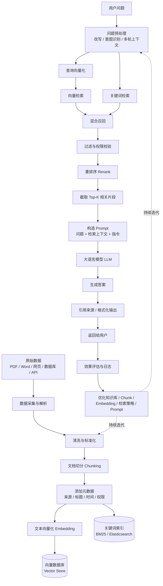

# RAG大厂面试题汇总：向量检索、混合检索、Rerank、幻觉处理高频问题

## RAG是什么？为什么需要RAG？

> 是检索增强生成。大模型在推理阶段知识是固定的，不会获得额外知识。通过RAG可以挂载额外的知识库，提供更新的、私有的基本事实数据，以增强检索的能力。
> LLM的三大知识缺陷

1. 知识截止---训练数据有截止日期，昨天发生的事它不知道。
2. 私有数据无法触达---公司内部文档，客户数据、业务规则，
3. 容易幻觉---当LLM不确定但又想回答时，他会编造看似合理但完全错误的信息。这个问题在没有外部知识验证时尤其严重

RAG的核心思路

RAG的就一句话：在LLM生成回答之前，先从外部知识库检索相关信息，把检索结果塞进Prompt，让LLM基于事实回答。
面试核心点： RAG不是替代LLM，是给LLM补充外部知识，LLM负责理解和生成，RAG负责提供事实依据。

## RAG的完整链路是怎么样



- line1: 文档预料获取解析 -> 数据清洗、标准 -> chunk -> 添加元数据（来源/标题/时间/权限）-> embedding -> 入库
- line2: query预处理 -> 标准化、意图识别改写 -> embedding -> 混合检索（向量+关键词） -> rrf融合 -> 阈值过滤 -> rerank -> topK截取 -> 构建prompt -> llm

### 常见优化点

```
数据质量
  → 解析、清洗、去重、结构化

切分策略
  → Chunk 大小、重叠区间、语义切分

检索策略
  → 向量检索、关键词检索、混合检索

召回质量
  → Query Rewrite、Query Expansion、Multi-Query

排序质量
  → Rerank、Top-K、相关性过滤

生成质量
  → Prompt、上下文压缩、引用约束


系统效果
  → 评估、日志、监控、持续迭代
```

#### Query Write

> 在检索前，利用大模型结合当前问题和上下文，对用户查询进行补全、规范化和意图澄清。使查询更适合后续的向量检索或关键词检索。它主要解决指代不明，口语化、多轮上下文缺失和查询条件表达不规范的问题。

### Query Expansion

> 市对原始查询补充同义词、缩写、专业术语和相关概念，增加查询与知识库文本的词汇重合度，从而提升召回率。 它适合解决用户表述和文档表述不一致的问题，但扩展过度可能引入噪声，因此需要控制扩展词数量，或者结合重排序和过滤机制
> 在原始查询的基础上，补充同义词、相关词、专业术语或可能的表达方式，从而扩大召回范围

### Multi-Query

> 是让模型将一个复杂问题改写成多个语义不同但目标一致的查询。分别进行召回，再对结果进行合并、去重和重排序。它可以提供召回覆盖率，尤其适合复杂问题，长问题和多角度问题。但代价是检索次数和延迟会增加
> 让大模型根据一个用户问题生成多个不同角度的查询，然后分别检索，最后合并结果

```
# 示例
如何保障 RAG 系统的回答准确？
- RAG系统如何提高答案准确率
- 如何评估检索增强生成系统
- RAG如何降低幻觉
- 如何优化向量检索召回效果
- RAG系统的准确率评估指标
```

### 三者配合示例

```
它离职多久不能登录

query rewrite: 员工离职后账号登录权限何时失效？

multi-query:
1. 员工离职后账号权限回收时间
2. 离职员工系统登录权限什么时候关闭
3. 离职员工的账号禁用流程

query expansion：
离职、离任、账号禁用、权限回收、登录失效、账户注销
```

常见扩展方式

```
# 1.同义词
报销 -> 费用报销、差旅费报销、发票报销

# 2.缩写扩展
VPN -> Virtual Private Network

# 3.中英文扩展
向量数据库 -> Vector Database 、 Vector Store

# 领域术语扩展
登录失败 -> 认证失败、鉴权失败。身份验证失败
```

## 系统效果：评估、日志、监控、持续迭代

1. 评估：系统到底好不好？

```
检索是否找对
  +
答案是否生成对
  +
系统是否足够快、足够稳定
```

2. 检索评估指标

- 召回率,表示前K个结果中，是否包含正确文档
- 关注正确资料有没有被召回

```
知识库中有5个相关文档
系统召回Top-10，其中找到了4个
Recall@10 = 4/5 = 80%
```

- 准确率，表示前K个结果，有多少是相关的
- 召回的结果是不是大部分是相关的？

```
Top-10 结果中有 6 个相关文档
Precision@10 = 6 / 10 = 60%
```

- MRR:平均倒数排名
- 关注第一个正确结果排在第几位

```
第 1 位正确 → 1
第 2 位正确 → 1/2
第 5 位正确 → 1/5
```

3. 生成质量评估

3.1 Faithfulness：忠实性。答案是否有依据，是否超出检索内容

```
Q：系统支持pdf和word文件
Error-A：系统支持PDF、Word、Excel和图片。
```

3.2 Answer Relevance： 答案相关性。回答是否真的解决用户问题

```
Q.如何申请报销？
A：xxxxxxx - 回答大量介绍公司历史、即使内容正确、也不相关
```

3.3.Context Relevance：上下文相关性。检索到的文档是否与问题相关。
3.4 Correctness：答案正确性 通常需要人工标注，或者使用评估模型与标准答案对比。

4. 评估数据集怎么构建

```
// 准备一批真实或模拟问题：
{
  "question": "员工离职后账号多久被禁用？",
  "ground_truth_documents": [
    "employee_offboarding_policy.pdf"
  ],
  "reference_answer": "员工离职后，账号将在当天或规定时间内被禁用。"
}
```

```
// 然后不同版本对比
旧版本：
Recall@5 = 72%
Answer Correctness = 68%

优化 Query Rewrite 后：
Recall@5 = 84%
Answer Correctness = 79%
```

5. 日志：记录每次请求发生什么
   > 日志用于回答：这次回答为什么错？错在检索？还是错在生成？
   > 日志的核心价值是实现问题可追踪和错误归因。通过记录原始查询、重写查询、召回结果、最终上下文、模型输出和好事。可判断问题究竟来源数据解析、切分、embedding、检索、排序还是生成环节

```
{
  "query": "它支持多大文件？",
  "rewritten_query": "知识库系统单个文件最大支持多大？",
  "retrieved_documents": [
    {
      "id": "doc_123",
      "score": 0.86,
      "rank": 1
    }
  ],
  "rerank_results": [
    {
      "id": "doc_123",
      "score": 0.94,
      "rank": 1
    }
  ],
  "prompt_tokens": 1200,
  "completion_tokens": 180,
  "latency_ms": 2100,
  "answer": "单个文件最大支持 100MB。",
  "user_feedback": "thumbs_up"
}
```

重点日志包括：

```
原始问题
重写后的问题
召回文档ID和分数
Rerank分数
最终使用的上下文
Prompt
答案
响应好事
Token消耗
错误信息
用户反馈
```

6. 监控主要分为四类

6.1 质量监控

```
用户点赞率
用户点踩率
答案正确率
引用命中率
无答案率
幻觉率
人工转接率
```

6.2 检索监控

```
平均召回分数
Top-K 为空的比例
低相关性结果比例
Rerank 分数分布
知识库命中文档分布
```

6.3 性能监控

```
P50 延迟
P95 延迟
P99 延迟
Embedding 耗时
向量检索耗时
Rerank 耗时
LLM 首 token 延迟
完整响应耗时
```

6.4 成本和稳定性监控

```
Token 使用量
单次请求成本
模型调用失败率
超时率
限流次数
向量数据库错误率
服务可用性
```

一个典型监控告警

```
发现：
- P95 延迟从 2 秒升到 8 秒
- Rerank 耗时明显增加
- 用户点踩率上升

排查：
可能是 Top-K 从 10 调到了 50，
导致 Rerank 处理文档数量增加。

处理：
降低召回数量，或改用批量 Rerank。
```

1. 持续迭代

```
用户问题
  ↓
系统回答
  ↓
收集日志和反馈
  ↓
发现失败案例
  ↓
定位问题环节
  ↓
调整方案
  ↓
离线评估
  ↓
灰度发布
  ↓
线上监控
  ↓
继续收集反馈
```

## 向量检索原理是什么

把文本转化为高纬空间的点，语义相似的文本在这个空间里距离近。检索就是找离问题向量最近的几个向量

- cos相似度

```
cos(A, B) = (A · B) / (|A| × |B|) // 值域 [-1, 1]，越大越相似。1 表示方向完全相同，0 表示无关，-1 表示方向相反。
```

- 欧氏距离

```
为什么不用欧式距离？ 受原文本长度影响，长文本摸长更大，但语义不一定更相关
```

- 点积

```
受原文本长度影响，长文本摸长更大，但语义不一定更相关
```

## ANN检索（近似邻接相似）

> HNSW 是一种基于多层近邻图的 ANN 算法。它将向量作为节点，将相近向量连接起来，并通过多层结构实现从粗到细的搜索：高层负责快速定位区域，低层负责精确搜索。它的优势是查询速度快、召回率高、支持增量插入；缺点是内存占用较大，构建时间较长。主要参数是 M、efConstruction 和 efSearch，其中 efSearch 是线上延迟和召回率之间的重要调节参数。
> 给定一个查询向量q，从大量向量中找到距离最近的Top-K个向量

时间复杂度 O(N x D)

其中：

- N：向量数量
- D：向量纬度
  > ANN的思路：不保证检查所有向量，而是通过索引快速缩小候选范围，在可接受的准确率损失下换取更低延迟

主流ANN算法：
|算法|原理|特点|主要解决的问题|
|---|---|---| --- |
|HNSW|在向量之间建立多层图，从近邻跳到近邻|查询块、内存占用大，Milvus默认|高质量、低延迟搜索|
|IVF|先把向量聚成多个桶，只搜索相关桶|缩小搜索范围|缩小搜索范围|
|PQ（乘积量化）|把向量压缩成短编码，降低存储和距离计算成本|内存省，精度缺|处理超大规模数据|

### HNSW(Hierarchical Navigable Small World)

分层可导航小世界图：它把每个向量看作一个节点，和相邻的向量建立边，形成一个图：
搜索时不再和所有向量比较，而是：

```
从一个入口点出发
  ↓
移动到距离查询向量更近的节点
  ↓
不断寻找更近的邻居
  ↓
得到 Top-K
```

#### 为什么需要分层？

如果只有一层图、节点很多、搜索仍然可能需要走很多步。HNSW类似高速公路和城市道路：

```
顶层：高速公路、节点少、快速跨越很远距离
中层：主干道、逐步接近目标区域
底层：普通道路。精细查找最终邻居
```

搜索过程。顶层节点少，适合快速定位；底层节点密集，适合精准定位

```
顶层入口
 ↓ 快速跳跃
中层节点
  ↓ 缩小范围
底层节点
  ↓ 精细搜索
最终 Top-K
```

#### HNSW的构建过程

step1:插入向量

```
从最高层入口开始
  ↓
找到距离 x 更近的节点
  ↓
下降到下一层
  ↓
继续寻找更近节点
  ↓
在底层连接若干近邻节点
```

step2：建立连接.每个节点只和部分近邻连接，而不是和所有节点连接。这样可以控制

```
索引大小
构建时间
搜索时间
```

#### HNSW主要参数

`M` 每个节点最多连接多少个邻居

```
M 越大：
- 图连接越丰富
- 召回率通常更高
- 索引占用更大
- 构建和搜索成本更高
```

`efConstruction` 构建索引时搜索候选节点的数量。

```
efConstruction 越大：
- 构建出来的图质量通常更好
- 构建时间更长
- 内存消耗更高
```

`efSearch` 查询时维护的候选节点数量

```
efSearch 越大
- 搜索范围更广
- 召回率更高
- 查询延迟更高
```

可以怎么理解

```
M:每个城市修多少条路
efConstruction： 修路时考察多少候选城市
efSearch：查询时允许探索多少座城市
```

#### HNSW优点

- 查询速度快
- 召回率高
- 对中小规模数据非常好用
- 不需要提前设置聚类中心
- 支持增量插入
- 工业界使用非常广泛

#### HNSW缺点

- 内存占用比较大
- 构建索引较慢
- 数据量特别大时成本较高
- 删除和更新处理相对复杂
- 参数需要根据数据调优

### IVF(Inverted File Index，倒排文件索引)

> IVF 的核心是先使用 K-Means 将向量划分为多个簇，并为每个簇建立倒排列表。查询时，先找到距离查询向量最近的若干个簇，只在这些簇中进行精确或近似搜索，从而降低计算量。nlist 控制簇的数量，nprobe 控制每次查询搜索多少个簇。nprobe 越大，召回率通常越高，但延迟也越高。IVF 的主要风险是聚类边界问题：如果真实近邻落在未搜索的簇中，就会被漏掉。
> 核心思路是：先把所有向量划分到多个桶中，查询时只搜索最相关的几个桶。类似图书馆

```
所有书
  ↓
按主题分成多个书架
  ↓
用户查询“数据库索引”
  ↓
只看数据库、计算机相关书架
```

#### 构建过程

step1: 训练聚类中心

使用 K-means 把向量分成 `nlist`个簇。每个簇有一个中心点

```
中心点 1
中心点 2
中心点 3
...
中心点 nlist
```

step2: 分配向量

每个向量被分配到距离最近的中心：

```
向量 A → 簇 1
向量 B → 簇 3
向量 C → 簇 1
向量 D → 簇 8
```

step3:建立倒排表

```
簇 1 → A、C、F、H
簇 2 → B、E
簇 3 → D、G、K
```

#### 查询过程

```
q 与所有聚类中心计算距离
  ↓
找到最近的 nprobe 个中心
  ↓
只搜索这些中心对应的向量
  ↓
得到 Top-K
```

例如

```
nlist = 1000
nprobe = 10

总共 1000 个桶
每次只搜索其中 10 个桶
```

#### IVF主要参数

`nlist` 聚类桶的数量

```
nlist 越大：
- 每个桶平均向量越少
- 查询候选更少
- 但聚类中心搜索和训练成本更高
- 如果 nprobe 太小，可能漏掉正确结果
```

`nprobe` 每次查询搜索多少个桶

```
nprobe 越大：
- 召回率越高
- 延迟越高
- 扫描向量越多
```

#### IVF的优点

- 能明显减少搜索范围
- 内存占用通常比纯 HNSW 更可控
- 适合大规模数据
- 参数比较直观
- 可以和 PQ 组合

#### IVF的缺点

- 需要训练聚类中心
- 聚类质量会影响召回率
- 只搜索少数簇可能漏召回
- 动态数据增删需要维护倒排表
- 数据分布变化时可能需要重新训练

### PQ

> PQ 是一种向量压缩算法。它把高维向量切成多个低维子空间，每个子空间分别使用 K-Means 学习一个码本，然后用最近的聚类中心编号表示原始子向量。查询时通过预计算距离表快速估算距离。PQ 的核心优势是大幅降低存储和计算成本，代价是会产生量化误差，可能降低召回率。
> Product Quantization，乘积量化

主要解决

```
向量太大，内存占用太高
向量距离计算成本太高
```

例如，一个 768 维的 float32 向量：

```
768 × 4 bytes = 3072 bytes

1百万个就要 3GB
```

#### PQ 的核心原理

假设一个向量有 8 维：

```
x = [x1, x2, x3, x4, x5, x6, x7, x8]
```

PQ 把它切成 4 段：

```
[x1, x2] [x3, x4] [x5, x6] [x7, x8]
```

每一段单独做聚类。假设每段有 256 个聚类中心，那么每个子向量只需要存一个编号：

```
原始向量：
8 个 float 数字

PQ 编码：
[12, 203, 87, 45]

原本需要存8个浮点数，现在只需要4个字节编码
```

#### PQ 如何计算距离？

```
查询向量也切成相同的子空间
  ↓
预先计算查询子向量与各个聚类中心的距离
  ↓
通过查表得到整体距离
  ↓
避免反复计算完整浮点向量距离

第 1 段距离查表
第 2 段距离查表
第 3 段距离查表
第 4 段距离查表
  ↓
把各段距离相加
  ↓
得到近似总距离   这叫 ADC，Asymmetric Distance Computation，即查询向量保持原始精度，而数据库向量使用 PQ 编码。
```

#### PQ 的特点

优点

- 压缩比例非常高
- 大幅降低内存占用
- 减少磁盘和内存带宽
- 适合超大规模向量搜索
- 通常和 IVF 结合使用

缺点

- 有量化误差
- 召回率通常低于原始向量搜索
- 需要训练码本
- 数据分布变化时可能需要重新训练
- 单独使用 PQ 通常不如 IVF-PQ 实用

### IVF-PQ:工业界常见组合
> IVF-PQ 通常采用“两阶段搜索”：第一阶段使用 IVF 缩小候选范围，并通过 PQ 快速计算近似距离；第二阶段对候选结果使用原始向量进行精确重排，在性能、内存和召回率之间取得平衡。
```
IVF：缩小候选范围
PQ：压缩候选向量
```
```
所有向量
  ↓
IVF 分桶
  ↓
查询时选 nprobe 个桶
  ↓
桶内向量使用 PQ 编码
  ↓
快速计算近似距离
  ↓
取候选 Top-K
  ↓
使用原始向量重新精排
```
### IVF+Flat
> IVF-Flat 是 IVF 和原始向量搜索的组合。系统首先使用 K-Means 将向量划分到多个簇中，并建立倒排表。查询时先计算查询向量与各个聚类中心的距离，选择距离最近的 nprobe 个簇，然后只在这些簇中使用完整的原始向量进行精确距离计算。相比全量 Flat，它减少了候选范围；相比 IVF-PQ，它不压缩向量，因此召回率更高、精度更好，但内存占用也更大。IVF-Flat 的主要参数是 nlist 和 nprobe：nlist 控制桶的数量，nprobe 控制每次搜索的桶数量。通常数据规模较大但内存充足、且对召回率要求较高时，可以选择 IVF-Flat。
IVF-Flat = IVF倒排分桶 + Flat原始向量搜索

核心思想是
```
先通过 IVF 缩小搜索范围
  ↓
再使用原始向量进行精确距离计算
```
假入有100w条向量
```
全部向量
  ↓ K-Means 聚类
分成 1000 个桶
  ↓
每个桶保存原始 float 向量
```


### HNSW/IVF/PQ对比

| 维度             | HNSW            | IVF           | PQ                     |
| ---------------- | --------------- | ------------- | ---------------------- |
| 本质             | 图索引          | 聚类分桶      | 向量压缩               |
| 是否直接负责检索 | 是              | 是            | 主要负责压缩和距离计算 |
| 召回率           | 高              | 取决于 nprobe | 通常有量化损失         |
| 查询延迟         | 低              | 可调          | 很低                   |
| 内存占用         | 较高            | 中等          | 很低                   |
| 构建成本         | 较高            | 需要训练聚类  | 需要训练码本           |
| 动态插入         | 较好            | 一般          | 需要编码               |
| 适合规模         | 千万级以内常见  | 百万到亿级    | 超大规模               |
| 常见组合         | HNSW + 原始向量 | IVF + Flat    | IVF + PQ               |

### 不同数据量的选择
数据量不是唯一标准，还要看：
```
向量维度
召回率要求
延迟要求
内存预算
数据更新频率
是否允许离线训练
```
1w以内 -> 暴力搜索 Flat

1w~100w -> HNSW

100w~1000w ->  HNSW/IVF-Flat/IVF-PQ

1000w~1亿 -> IVF-PQ