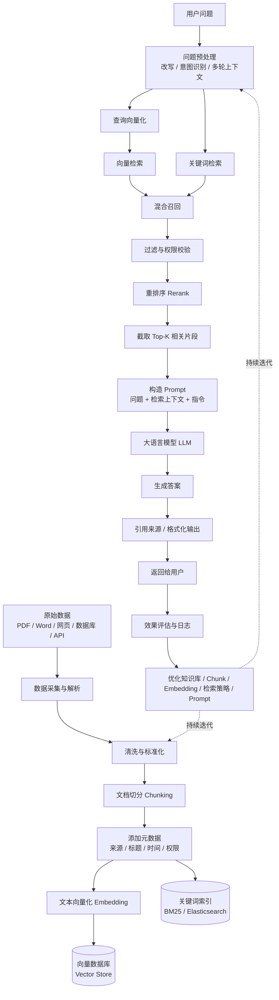

# RAG大厂面试题汇总：向量检索、混合检索、Rerank、幻觉处理高频问题

## RAG是什么？为什么需要RAG？

> 是检索增强生成。大模型在推理阶段知识是固定的，不会获得额外知识。通过RAG可以挂载额外的知识库，提供更新的、私有的基本事实数据，以增强检索的能力。
> LLM的三大知识缺陷

1. 知识截止---训练数据有截止日期，昨天发生的事它不知道。
2. 私有数据无法触达---公司内部文档，客户数据、业务规则，
3. 容易幻觉---当LLM不确定但又想回答时，他会编造看似合理但完全错误的信息。这个问题在没有外部知识验证时尤其严重

RAG的核心思路

RAG的就一句话：在LLM生成回答之前，先从外部知识库检索相关信息，把检索结果塞进Prompt，让LLM基于事实回答。
面试核心点： RAG不是替代LLM，是给LLM补充外部知识，LLM负责理解和生成，RAG负责提供事实依据。

## RAG的完整链路是怎么样



- line1: 文档预料获取解析 -> 数据清洗、标准 -> chunk -> 添加元数据（来源/标题/时间/权限）-> embedding -> 入库
- line2: query预处理 -> 标准化、意图识别改写 -> embedding -> 混合检索（向量+关键词） -> rrf融合 -> 阈值过滤 -> rerank -> topK截取 -> 构建prompt -> llm

### 常见优化点

```
数据质量
  → 解析、清洗、去重、结构化

切分策略
  → Chunk 大小、重叠区间、语义切分

检索策略
  → 向量检索、关键词检索、混合检索

召回质量
  → Query Rewrite、Query Expansion、Multi-Query

排序质量
  → Rerank、Top-K、相关性过滤

生成质量
  → Prompt、上下文压缩、引用约束


系统效果
  → 评估、日志、监控、持续迭代
```

#### Query Write

> 在检索前，利用大模型结合当前问题和上下文，对用户查询进行补全、规范化和意图澄清。使查询更适合后续的向量检索或关键词检索。它主要解决指代不明，口语化、多轮上下文缺失和查询条件表达不规范的问题。

### Query Expansion

> 市对原始查询补充同义词、缩写、专业术语和相关概念，增加查询与知识库文本的词汇重合度，从而提升召回率。 它适合解决用户表述和文档表述不一致的问题，但扩展过度可能引入噪声，因此需要控制扩展词数量，或者结合重排序和过滤机制
> 在原始查询的基础上，补充同义词、相关词、专业术语或可能的表达方式，从而扩大召回范围

### Multi-Query

> 是让模型将一个复杂问题改写成多个语义不同但目标一致的查询。分别进行召回，再对结果进行合并、去重和重排序。它可以提供召回覆盖率，尤其适合复杂问题，长问题和多角度问题。但代价是检索次数和延迟会增加
> 让大模型根据一个用户问题生成多个不同角度的查询，然后分别检索，最后合并结果

```
# 示例
如何保障 RAG 系统的回答准确？
- RAG系统如何提高答案准确率
- 如何评估检索增强生成系统
- RAG如何降低幻觉
- 如何优化向量检索召回效果
- RAG系统的准确率评估指标
```

### 三者配合示例

```
它离职多久不能登录

query rewrite: 员工离职后账号登录权限何时失效？

multi-query:
1. 员工离职后账号权限回收时间
2. 离职员工系统登录权限什么时候关闭
3. 离职员工的账号禁用流程

query expansion：
离职、离任、账号禁用、权限回收、登录失效、账户注销
```

常见扩展方式

```
# 1.同义词
报销 -> 费用报销、差旅费报销、发票报销

# 2.缩写扩展
VPN -> Virtual Private Network

# 3.中英文扩展
向量数据库 -> Vector Database 、 Vector Store

# 领域术语扩展
登录失败 -> 认证失败、鉴权失败。身份验证失败
```

## 系统效果：评估、日志、监控、持续迭代

1. 评估：系统到底好不好？

```
检索是否找对
  +
答案是否生成对
  +
系统是否足够快、足够稳定
```

2. 检索评估指标

- 召回率,表示前K个结果中，是否包含正确文档
- 关注正确资料有没有被召回

```
知识库中有5个相关文档
系统召回Top-10，其中找到了4个
Recall@10 = 4/5 = 80%
```

- 准确率，表示前K个结果，有多少是相关的
- 召回的结果是不是大部分是相关的？

```
Top-10 结果中有 6 个相关文档
Precision@10 = 6 / 10 = 60%
```

- MRR:平均倒数排名
- 关注第一个正确结果排在第几位

```
第 1 位正确 → 1
第 2 位正确 → 1/2
第 5 位正确 → 1/5
```

3. 生成质量评估

3.1 Faithfulness：忠实性。答案是否有依据，是否超出检索内容

```
Q：系统支持pdf和word文件
Error-A：系统支持PDF、Word、Excel和图片。
```

3.2 Answer Relevance： 答案相关性。回答是否真的解决用户问题

```
Q.如何申请报销？
A：xxxxxxx - 回答大量介绍公司历史、即使内容正确、也不相关
```

3.3.Context Relevance：上下文相关性。检索到的文档是否与问题相关。
3.4 Correctness：答案正确性 通常需要人工标注，或者使用评估模型与标准答案对比。

4. 评估数据集怎么构建

```
// 准备一批真实或模拟问题：
{
  "question": "员工离职后账号多久被禁用？",
  "ground_truth_documents": [
    "employee_offboarding_policy.pdf"
  ],
  "reference_answer": "员工离职后，账号将在当天或规定时间内被禁用。"
}
```

```
// 然后不同版本对比
旧版本：
Recall@5 = 72%
Answer Correctness = 68%

优化 Query Rewrite 后：
Recall@5 = 84%
Answer Correctness = 79%
```

5. 日志：记录每次请求发生什么
   > 日志用于回答：这次回答为什么错？错在检索？还是错在生成？
   > 日志的核心价值是实现问题可追踪和错误归因。通过记录原始查询、重写查询、召回结果、最终上下文、模型输出和好事。可判断问题究竟来源数据解析、切分、embedding、检索、排序还是生成环节

```
{
  "query": "它支持多大文件？",
  "rewritten_query": "知识库系统单个文件最大支持多大？",
  "retrieved_documents": [
    {
      "id": "doc_123",
      "score": 0.86,
      "rank": 1
    }
  ],
  "rerank_results": [
    {
      "id": "doc_123",
      "score": 0.94,
      "rank": 1
    }
  ],
  "prompt_tokens": 1200,
  "completion_tokens": 180,
  "latency_ms": 2100,
  "answer": "单个文件最大支持 100MB。",
  "user_feedback": "thumbs_up"
}
```

重点日志包括：

```
原始问题
重写后的问题
召回文档ID和分数
Rerank分数
最终使用的上下文
Prompt
答案
响应好事
Token消耗
错误信息
用户反馈
```

6. 监控主要分为四类

6.1 质量监控

```
用户点赞率
用户点踩率
答案正确率
引用命中率
无答案率
幻觉率
人工转接率
```

6.2 检索监控

```
平均召回分数
Top-K 为空的比例
低相关性结果比例
Rerank 分数分布
知识库命中文档分布
```

6.3 性能监控

```
P50 延迟
P95 延迟
P99 延迟
Embedding 耗时
向量检索耗时
Rerank 耗时
LLM 首 token 延迟
完整响应耗时
```

6.4 成本和稳定性监控

```
Token 使用量
单次请求成本
模型调用失败率
超时率
限流次数
向量数据库错误率
服务可用性
```

一个典型监控告警

```
发现：
- P95 延迟从 2 秒升到 8 秒
- Rerank 耗时明显增加
- 用户点踩率上升

排查：
可能是 Top-K 从 10 调到了 50，
导致 Rerank 处理文档数量增加。

处理：
降低召回数量，或改用批量 Rerank。
```

1. 持续迭代

```
用户问题
  ↓
系统回答
  ↓
收集日志和反馈
  ↓
发现失败案例
  ↓
定位问题环节
  ↓
调整方案
  ↓
离线评估
  ↓
灰度发布
  ↓
线上监控
  ↓
继续收集反馈
```

## 向量检索原理是什么

把文本转化为高纬空间的点，语义相似的文本在这个空间里距离近。检索就是找离问题向量最近的几个向量

- cos相似度

```
cos(A, B) = (A · B) / (|A| × |B|) // 值域 [-1, 1]，越大越相似。1 表示方向完全相同，0 表示无关，-1 表示方向相反。
```

- 欧氏距离

```
为什么不用欧式距离？ 受原文本长度影响，长文本摸长更大，但语义不一定更相关
```

- 点积

```
受原文本长度影响，长文本摸长更大，但语义不一定更相关
```

## ANN检索（近似邻接相似）

> HNSW 是一种基于多层近邻图的 ANN 算法。它将向量作为节点，将相近向量连接起来，并通过多层结构实现从粗到细的搜索：高层负责快速定位区域，低层负责精确搜索。它的优势是查询速度快、召回率高、支持增量插入；缺点是内存占用较大，构建时间较长。主要参数是 M、efConstruction 和 efSearch，其中 efSearch 是线上延迟和召回率之间的重要调节参数。
> 给定一个查询向量q，从大量向量中找到距离最近的Top-K个向量

时间复杂度 O(N x D)

其中：

- N：向量数量
- D：向量纬度
  > ANN的思路：不保证检查所有向量，而是通过索引快速缩小候选范围，在可接受的准确率损失下换取更低延迟

主流ANN算法：
|算法|原理|特点|主要解决的问题|
|---|---|---| --- |
|HNSW|在向量之间建立多层图，从近邻跳到近邻|查询块、内存占用大，Milvus默认|高质量、低延迟搜索|
|IVF|先把向量聚成多个桶，只搜索相关桶|缩小搜索范围|缩小搜索范围|
|PQ（乘积量化）|把向量压缩成短编码，降低存储和距离计算成本|内存省，精度缺|处理超大规模数据|

### HNSW(Hierarchical Navigable Small World)

分层可导航小世界图：它把每个向量看作一个节点，和相邻的向量建立边，形成一个图：
搜索时不再和所有向量比较，而是：

```
从一个入口点出发
  ↓
移动到距离查询向量更近的节点
  ↓
不断寻找更近的邻居
  ↓
得到 Top-K
```

#### 为什么需要分层？

如果只有一层图、节点很多、搜索仍然可能需要走很多步。HNSW类似高速公路和城市道路：

```
顶层：高速公路、节点少、快速跨越很远距离
中层：主干道、逐步接近目标区域
底层：普通道路。精细查找最终邻居
```

搜索过程。顶层节点少，适合快速定位；底层节点密集，适合精准定位

```
顶层入口
 ↓ 快速跳跃
中层节点
  ↓ 缩小范围
底层节点
  ↓ 精细搜索
最终 Top-K
```

#### HNSW的构建过程

step1:插入向量

```
从最高层入口开始
  ↓
找到距离 x 更近的节点
  ↓
下降到下一层
  ↓
继续寻找更近节点
  ↓
在底层连接若干近邻节点
```

step2：建立连接.每个节点只和部分近邻连接，而不是和所有节点连接。这样可以控制

```
索引大小
构建时间
搜索时间
```

#### HNSW主要参数

`M` 每个节点最多连接多少个邻居

```
M 越大：
- 图连接越丰富
- 召回率通常更高
- 索引占用更大
- 构建和搜索成本更高
```

`efConstruction` 构建索引时搜索候选节点的数量。

```
efConstruction 越大：
- 构建出来的图质量通常更好
- 构建时间更长
- 内存消耗更高
```

`efSearch` 查询时维护的候选节点数量

```
efSearch 越大
- 搜索范围更广
- 召回率更高
- 查询延迟更高
```

可以怎么理解

```
M:每个城市修多少条路
efConstruction： 修路时考察多少候选城市
efSearch：查询时允许探索多少座城市
```

#### HNSW优点

- 查询速度快
- 召回率高
- 对中小规模数据非常好用
- 不需要提前设置聚类中心
- 支持增量插入
- 工业界使用非常广泛

#### HNSW缺点

- 内存占用比较大
- 构建索引较慢
- 数据量特别大时成本较高
- 删除和更新处理相对复杂
- 参数需要根据数据调优

### IVF(Inverted File Index，倒排文件索引)

> IVF 的核心是先使用 K-Means 将向量划分为多个簇，并为每个簇建立倒排列表。查询时，先找到距离查询向量最近的若干个簇，只在这些簇中进行精确或近似搜索，从而降低计算量。nlist 控制簇的数量，nprobe 控制每次查询搜索多少个簇。nprobe 越大，召回率通常越高，但延迟也越高。IVF 的主要风险是聚类边界问题：如果真实近邻落在未搜索的簇中，就会被漏掉。
> 核心思路是：先把所有向量划分到多个桶中，查询时只搜索最相关的几个桶。类似图书馆

```
所有书
  ↓
按主题分成多个书架
  ↓
用户查询“数据库索引”
  ↓
只看数据库、计算机相关书架
```

#### 构建过程

step1: 训练聚类中心

使用 K-means 把向量分成 `nlist`个簇。每个簇有一个中心点

```
中心点 1
中心点 2
中心点 3
...
中心点 nlist
```

step2: 分配向量

每个向量被分配到距离最近的中心：

```
向量 A → 簇 1
向量 B → 簇 3
向量 C → 簇 1
向量 D → 簇 8
```

step3:建立倒排表

```
簇 1 → A、C、F、H
簇 2 → B、E
簇 3 → D、G、K
```

#### 查询过程

```
q 与所有聚类中心计算距离
  ↓
找到最近的 nprobe 个中心
  ↓
只搜索这些中心对应的向量
  ↓
得到 Top-K
```

例如

```
nlist = 1000
nprobe = 10

总共 1000 个桶
每次只搜索其中 10 个桶
```

#### IVF主要参数

`nlist` 聚类桶的数量

```
nlist 越大：
- 每个桶平均向量越少
- 查询候选更少
- 但聚类中心搜索和训练成本更高
- 如果 nprobe 太小，可能漏掉正确结果
```

`nprobe` 每次查询搜索多少个桶

```
nprobe 越大：
- 召回率越高
- 延迟越高
- 扫描向量越多
```

#### IVF的优点

- 能明显减少搜索范围
- 内存占用通常比纯 HNSW 更可控
- 适合大规模数据
- 参数比较直观
- 可以和 PQ 组合

#### IVF的缺点

- 需要训练聚类中心
- 聚类质量会影响召回率
- 只搜索少数簇可能漏召回
- 动态数据增删需要维护倒排表
- 数据分布变化时可能需要重新训练

### PQ

> PQ 是一种向量压缩算法。它把高维向量切成多个低维子空间，每个子空间分别使用 K-Means 学习一个码本，然后用最近的聚类中心编号表示原始子向量。查询时通过预计算距离表快速估算距离。PQ 的核心优势是大幅降低存储和计算成本，代价是会产生量化误差，可能降低召回率。
> Product Quantization，乘积量化

主要解决

```
向量太大，内存占用太高
向量距离计算成本太高
```

例如，一个 768 维的 float32 向量：

```
768 × 4 bytes = 3072 bytes

1百万个就要 3GB
```

#### PQ 的核心原理

假设一个向量有 8 维：

```
x = [x1, x2, x3, x4, x5, x6, x7, x8]
```

PQ 把它切成 4 段：

```
[x1, x2] [x3, x4] [x5, x6] [x7, x8]
```

每一段单独做聚类。假设每段有 256 个聚类中心，那么每个子向量只需要存一个编号：

```
原始向量：
8 个 float 数字

PQ 编码：
[12, 203, 87, 45]

原本需要存8个浮点数，现在只需要4个字节编码
```

#### PQ 如何计算距离？

```
查询向量也切成相同的子空间
  ↓
预先计算查询子向量与各个聚类中心的距离
  ↓
通过查表得到整体距离
  ↓
避免反复计算完整浮点向量距离

第 1 段距离查表
第 2 段距离查表
第 3 段距离查表
第 4 段距离查表
  ↓
把各段距离相加
  ↓
得到近似总距离   这叫 ADC，Asymmetric Distance Computation，即查询向量保持原始精度，而数据库向量使用 PQ 编码。
```

#### PQ 的特点

优点

- 压缩比例非常高
- 大幅降低内存占用
- 减少磁盘和内存带宽
- 适合超大规模向量搜索
- 通常和 IVF 结合使用

缺点

- 有量化误差
- 召回率通常低于原始向量搜索
- 需要训练码本
- 数据分布变化时可能需要重新训练
- 单独使用 PQ 通常不如 IVF-PQ 实用

### IVF-PQ:工业界常见组合
> IVF-PQ 通常采用“两阶段搜索”：第一阶段使用 IVF 缩小候选范围，并通过 PQ 快速计算近似距离；第二阶段对候选结果使用原始向量进行精确重排，在性能、内存和召回率之间取得平衡。
```
IVF：缩小候选范围
PQ：压缩候选向量
```
```
所有向量
  ↓
IVF 分桶
  ↓
查询时选 nprobe 个桶
  ↓
桶内向量使用 PQ 编码
  ↓
快速计算近似距离
  ↓
取候选 Top-K
  ↓
使用原始向量重新精排
```
### IVF+Flat
> IVF-Flat 是 IVF 和原始向量搜索的组合。系统首先使用 K-Means 将向量划分到多个簇中，并建立倒排表。查询时先计算查询向量与各个聚类中心的距离，选择距离最近的 nprobe 个簇，然后只在这些簇中使用完整的原始向量进行精确距离计算。相比全量 Flat，它减少了候选范围；相比 IVF-PQ，它不压缩向量，因此召回率更高、精度更好，但内存占用也更大。IVF-Flat 的主要参数是 nlist 和 nprobe：nlist 控制桶的数量，nprobe 控制每次搜索的桶数量。通常数据规模较大但内存充足、且对召回率要求较高时，可以选择 IVF-Flat。
IVF-Flat = IVF倒排分桶 + Flat原始向量搜索

核心思想是
```
先通过 IVF 缩小搜索范围
  ↓
再使用原始向量进行精确距离计算
```
假入有100w条向量
```
全部向量
  ↓ K-Means 聚类
分成 1000 个桶
  ↓
每个桶保存原始 float 向量
```


### HNSW/IVF/PQ对比

| 维度             | HNSW            | IVF           | PQ                     |
| ---------------- | --------------- | ------------- | ---------------------- |
| 本质             | 图索引          | 聚类分桶      | 向量压缩               |
| 是否直接负责检索 | 是              | 是            | 主要负责压缩和距离计算 |
| 召回率           | 高              | 取决于 nprobe | 通常有量化损失         |
| 查询延迟         | 低              | 可调          | 很低                   |
| 内存占用         | 较高            | 中等          | 很低                   |
| 构建成本         | 较高            | 需要训练聚类  | 需要训练码本           |
| 动态插入         | 较好            | 一般          | 需要编码               |
| 适合规模         | 千万级以内常见  | 百万到亿级    | 超大规模               |
| 常见组合         | HNSW + 原始向量 | IVF + Flat    | IVF + PQ               |

### 不同数据量的选择
数据量不是唯一标准，还要看：
```
向量维度
召回率要求
延迟要求
内存预算
数据更新频率
是否允许离线训练
```
1w以内 -> 暴力搜索 Flat

1w~100w -> HNSW

100w~1000w ->  HNSW/IVF-Flat/IVF-PQ

1000w~1亿 -> IVF-PQ

## 长上下文怎么削弱了RAG的叙事优势
> 长上下文削弱了 RAG 的一部分叙事优势，主要是因为对于单文档或小规模数据，模型现在可以直接接收大量原文，不一定需要先切分和检索。例如一份几十页的合同，可以直接放进上下文让模型回答问题。但长上下文并没有取代 RAG，因为它解决的是模型一次能读多少内容，而 RAG 解决的是如何从海量知识中找到、过滤和组织相关内容。长上下文还会带来成本、延迟、噪声和 Lost in the Middle 问题。因此实际系统通常是短文档直接使用长上下文，海量知识库仍使用 RAG，或者采用“RAG 召回 + 长上下文理解”的组合方案。
一、传统RAG的优势是什么？
```
模型上下文有限
  ↓
不能一次读完大量文档
  ↓
先通过检索找到相关片段
  ↓
只把相关片段放给模型
  ↓
降低上下文压力并节省成本
```
例如
```
知识库有 100 万篇文档
模型不能全部读完
  ↓
RAG 找出最相关的 5 个片段
  ↓
LLM 根据这 5 个片段回答
```
二、长上下文和RAG的实际结合

现在常见的方案不是二选一，而是
```
海量知识库
 ↓
RAG召回较大候选集
 ↓
上下文压缩/重排/去重
 ↓
把高质量上下文交给LLM   
```
例如
```
100 万篇文档
  ↓ RAG
召回 50 个相关 Chunk
  ↓ Rerank
筛选 15 个高相关 Chunk
  ↓ Context Compression
压缩成 8 个关键片段
  ↓
LLM 生成答案
```

### 向量相似度高但答案不在召回里
> 向量相似度高但正确答案不在召回结果中，根本原因是 Embedding 相似度衡量的是语义空间中的接近程度，通常代表主题相关性或语义相关性，并不等价于答案包含关系。
>例如用户问“员工离职后账号什么时候禁用”，文档“员工离职账号注销流程”和问题的主题非常接近，因此相似度可能很高，但它可能只描述了申请流程，没有具体时间，而真正的答案在另一篇“账号于下一个工作日 18 点前禁用”的文档中。
>从 Embedding 原理看，文本被压缩成固定维度的向量，实体、时间、数字、否定、条件等细粒度信息可能被弱化；同时 Embedding 模型的训练目标通常是让相关 Query 和文档靠近，而不是判断文档是否包含完整答案。另外，Chunk 切分也可能把问题和答案拆开。
>排查时我会先区分是召回问题还是排序问题：如果正确文档完全不在 Top-K，是 Recall 问题；如果在 Top-K 但排名靠后，是 Rerank 问题。优化上会结合 Query Rewrite、Multi-Query、合理 Chunk、混合检索、Rerank、Top-K 调优以及时间和权限过滤，最后通过 Recall@K、MRR 和端到端答案准确率验证效果。

原因一、Embedding学习的是语义相关，不是答案蕴含
```
用户问题：员工离职后，账号多久被禁用

文档A：员工离职后，系统账号需要进行权限回收

文档B： 员工离职后，账号在当天18:00自动禁用

// Embedding 检索可能把 A 排在 B 前面，特别是当 A 与 Query 共享更多常见语义概念时。
```

原因二： 向量压缩了大量信息，丢失了细节
```
账号会在离职当天禁用

账号不会再离职当天禁用，而是在审批完成后禁用

//它们共享 ‘账号’ ‘离职’ ‘当天’ ‘禁用’ ，但真正含义可能相反，这说明 Embedding 更擅长表达这段话大概讲什么

//不一定擅长表达： 这段话的精确条件和结论是什么
```
原因三：Query 和文档的语义粒度不匹配
```
用户问题通常很短：退款多久到账？

文档 Chunk 可能很长：退款政策、支付方式、退款条件、到账时间、特殊情况……

这个 Chunk 的整体向量代表的是一个混合主题： 退款 + 支付 + 订单 + 售后 + 时间


它和 Query“退款多久到账”整体上很接近。但是具体到账时间可能在另一个 Chunk 中，或者在同一文档的下一段。这叫 “文档主题相似，但目标信息不在当前 Chunk”
```

原因四：Chunk 切分破坏了答案完整性
```
Query:员工离职后账号什么时候禁用？

员工离职后，账号由 HR 发起注销申请。
IT 部门审核完成后，于下一个工作日 18:00 前禁用。

Chunk 1：员工离职后，账号由 HR 发起注销申请。

Chunk 2：IT 部门审核完成后，于下一个工作日 18:00 前禁用。

Chunk 1 可能因为包含：
员工离职
账号
注销
而获得高相似度。但真正的时间信息在 Chunk 2。这是典型的："语义相关性被召回了,答案完整性没有被召回"
```
原因五：Embedding 模型对领域术语理解不足

通用 Embedding 模型主要在通用语料上训练。例如
```
“冻结用户”
--------在不同业务中可以表示------
禁止登录
禁止交易
暂停提现
暂时风控
```
原因六：训练目标决定了模型更关注“相似表达”

训练数据往往标注的是：这篇文档是否与问题相关。而不是“这篇文档是否包含完整、准确、最新的答案”。模型学习的目标是相关性匹配，而非‘答案验证’


### 离线指标提升但线上满意度下降
> 离线指标提升但线上满意度下降，通常说明优化只改善了评测集上的某个局部指标，但没有改善真实用户的完整使用体验。可能是评测集与真实流量分布不一致，也可能是检索结果虽然更相关，但上下文过长、冲突、格式不适合模型，导致最终答案变差。因此需要建立线上 A/B 测试和反馈闭环，不能只看离线 Recall、MRR 等指标。
一、为什么出现这种现象？

原因一：评测集和真实用户分布不一致。离线评测集通常是人工构造或抽样得到的，可能比较规范：

原因二：检索结果更准，但 LLM 反而用不好

假设优化后召回数量从 5 个增加到 20 个。离线检索指标可能提升。但传给 LLM 的上下文变长了导致【重点信息被淹没】【上下文超长】【模型无法判断哪个片段最重要】【不同文档结论冲突】

原因三：离线指标优化错了目标
```
只优化了召回率，TopK↓

Recall@10 ↑
Precision@10 ↓
上下文噪声 ↑
答案可读性 ↓
用户满意度 ↓
```
原因四：线上还有离线没有覆盖的问题
```
离线评测通常只测试： 一个问题 → 一次检索 → 一个答案

但真实用户可能是：

多轮对话
权限限制
文档过期
服务超时
模型限流
检索为空
用户追问
复杂组合问题
```

原因五：线上体验指标不只有准确率,线上满意度是一个综合指标

即使答案更准确，用户满意度也可能下降。
- 首字延迟
- 总响应时间
- 回答长度
- 是否直接回答
- 是否有引用
- 是否重复用户问题
- 是否频繁拒答
- 是否需要用户重新提问
- 是否出现格式错误
```
回答准确率上升
但是响应时间从 2 秒变成 8 秒
```

### Autocut 动态截断替代固定 TopK
> 固定 TopK 对所有 Query 都返回相同数量的文档，但不同问题所需的上下文数量不同。Autocut 是一种动态截断策略：先设置一个最大召回数量，再观察排序结果中的相似度或距离分布，当相邻结果之间出现明显跳变时，认为后面的结果相关性明显下降，于是提前停止返回。这样可以减少简单问题的上下文噪声，同时保留复杂问题需要的更多文档。
>例如结果分数为 0.92、0.91、0.90、0.88、0.52、0.50，前四个分数接近，但第四个到第五个出现明显断层，因此可以只返回前四个。实际系统中 Autocut 通常作为最大 TopK 之后的后处理策略，而不是完全不设置 TopK。它也存在分数不可比、无明显断层和复杂问题误截断等问题，所以最好结合 Rerank 和线上评估使用。

### Self-RAG
```
模型自己判断要不要检索
  ↓
判断检索结果是否有用
  ↓
生成答案
  ↓
检查答案是否有依据、是否完整
  ↓
必要时再次检索或修改答案
```
核心思想：
> 不仅让模型“使用检索结果”，还让模型学习决定什么时候检索、检索结果是否相关、答案是否被证据支持

```
用户问题
  ↓
是否需要检索？
  ├─ 不需要 → 直接回答
  └─ 需要
       ↓
     检索
       ↓
     文档相关吗？
       ├─ 否 → 改写 Query / 重新检索
       └─ 是
            ↓
          生成答案
            ↓
          答案有依据吗？
            ├─ 否 → 修改 / 拒答 / 再检索
            └─ 是 → 返回
```

## 向量数据库怎么选？Milvus、FAISS、Qdrant各自适合什么场景
||FAISS|Milvus|Qdrant|
|---|---|---|---|
|类型|库|数据库|数据库|
|部署方式|嵌入应用进程|独立服务、支持分布式|独立服务、轻量级|
|持久化|需自己实现|原生支持|原生支持|
|适合规模|百万级以下|亿级|千万级|
|运维成本|低（无额外服务））|中（需部署集群）|低（单节点起步）|
|生产环境|适合原型验证|适合大规模生产|适合中小规模生产|

## 纯向量检索会有什么问题？为什么需要混合检索？
根据语义相似度，对特点专有名词检索效果不如关键词检索
纯向量检索的三个致命问题
1. 精确匹配度不行---用户搜“RFC 7231”，向量检索可能返回“http协议规范”这种语义相关单没提到RFC 7231的文档。因为它靠语义相似，而不是精准匹配。
2. 专业术语召回差---“K8s的HPA怎么配置”。向量检索可能找的是“Kubernetes自动扩容”，2️⃣真正包含HPA配置细节的文档反而排不上。专业术语的向量表示和口语描述的向量表示的距离可能很远。
3. 专有名词遗漏----产品名、人名、缩写这些，向量检索容易丢失。

## 混合检索 = 向量检索 + 关键词检索
混合检索同事跑两路：
- 向量检索：抓语义相关的文档（“数据库优化”和“SQL调优”能匹配上）
- 关键词检索（BM25）：抓精确匹配的文档（“RFC 7231”能精准命中）
两路结果合并，取长补短。

合并策略：RRF（Reciprocal Rank Fusion）

`k`通常设60 `rank_i(d)`是文档d在第i路检索中的排名。排名越靠前，贡献分数越高
```
RRF_score(d) = Σ 1 / (k + rank_i(d))
```

## Rerank是什么？为什么检索之后还要重排序
检索和Rerank的区别

检索是粗筛---从百万文档里快速捞出Top-20 速度快但精度有限。用向量相似度或者BM25打分，这种打分是近似的，不一定反映真实的相关性。

Rerank是精排---对Top-20重新计算相关性分数，用更精确的模型（通常是Cross-Encoder）逐个打分，把真正最相关的排在前面。

### 为什么检索的打分不够准？
向量检索用的是 Bi-Encoder：问题和文档分别编码成向量，再算相似度。问题和文档在编码时互不知道对方的存在，所以只能算"大概相关"。

Rerank 用的是 Cross-Encoder：把问题和文档拼在一起送进模型，模型可以同时看到双方内容，做更精确的相关性判断。代价是慢——Cross-Encoder 不能预计算，每个 (问题, 文档) 对都要过一遍模型，所以只能对少量候选做精排。

## Chunk怎么切？切大切小各有什么问题？

切大了：信息稀释---一个chunk里塞了太多内容，检索时真正相关的那部分被其他无关内容淹没，导致相关分数降低，排名靠后。 

切小了：上下文丢失---一个完整的论述被切成碎片，检索出的是断章取义的片段，LLM拿到后无法理解完整含义，生成质量下降。

### 三种主流Chunk策略
1. 固定长度切分---最简单，每512token切一块。优点简单，缺点是不管语义边界，可能一句话切两半。
2. 递归切分---按段落->句子->字符的优先级递归切分，尽量在自然边界处切断。**这是生产环境最常用的方案**
```python
from langchain.text_splitter import RecursiveCharacterTextSplitter

splitter = RecursiveCharacterTextSplitter(
    chunk_size=500,
    chunk_overlap=200,  # 相邻 chunk 重叠 200 字符
    separators=["\n\n", "\n", "。", "！", "？", "；", "，", " ", ""]
)
```
3. 语义切分---用embedding计算相邻橘子的语义相似度。在语义断点处切分。理论上最好，但计算量大，生产环境很少用

#### overlap的作用
相邻chunk之间重叠一部分文字，避免关键信息正好切割点被截断。overlap一般设置设置chunk_size的10%-20%

#### 不同文档类型分别怎么处理
|文档类型|处理策略|
|md|按标题层级切分，保留标题层级信息|
|pdf|先解析表格和图片，再按段落切分|
|代码|按函数/类切分，保留完整代码块|
|FAQ|每个问答对作为一个chunk，不要拆开|

## Embedding模型怎么选？中文场景选什么？
选项纬度
- 语言支持
- 向量纬度
- 检索效果(MTEB排名)

中文场景主流模型
|模型|纬度|特点|
|---|---|---|---|
|bge-large-zh-v1.5|1024|中文效果最好，开源，本地部署|
|bge-m3|1024|多语言，支持稠密+稀疏+多向量三种检索|
|text-embedding-3-large(OpenAi)|3072|效果好，但API调用优成本，中文不如bge|
|text-embedding-3-small(OpenAi)|1536|便宜、效果够用，英文场景首选|

维度越高越好吗？

不是。维度高→表达能力强但存储和检索成本也高。1024 维是当前性价比最好的选择，3072 维的检索效果提升有限但存储翻 3 倍。

## RAG的幻觉怎么处理
幻觉是RAG项目最大的工程挑战，面试官必问（它本质是检索召回和生成忠实度的级联问题）

幻觉的两种类型：
1. 内在幻觉 --- 检索结果里有正确信息，但LLM生成的内容和检索结果矛盾。比如检索说“准确率91%”，llm说“准确率95%”
2. 外在幻觉 --- LLM生成了检索结果里根本没有的内容。检索只提到A，LLM自己编了B

6种幻觉处理策略
1. Prompt约束 - 在Prompt里明确要求 “只基于检索结果回答、检索结果没有的信息不要编造”
2. 输出自校验 - LLM生成回答后，在用一次LLM检查：回答的每一条是否能在检索结果里找到依据？找不到的标注为“未验证”。
3. 引用标注 - 要求LLM在回答时标准每一条信息的来源chunk，方便人工核查
4. 温度调低 - temperture 设 0.1-0.3 降低LLM的随机性，减少“编造”的倾向
5. 检索结果和生成结果对齐 - 生成回答后，把回答和检索结果做相似度对比，如果回答中有大段内容和所有检索结果都不相关，大概率是幻觉。
6. 兜底回答 - 当检索结果的相似度都低于阈值时，直接回答“未找到”

例子：组合几种策略 “prompt + 输出自校验 + 调低温度”，幻觉率降低了12%

## RAG检索效果不好该怎么优化？

优化思路： 从链路的每一步找问题

文档处理阶段 --- PDF表格提取的准确率够不够？图片里的文字有没有OCR？不同格式（PDF/word/Markdown）分别做了什么适配

Chunk阶段 --- chunk——size合不合理？ 有没有针对不同文档类型调参？ overlap设多少

检索阶段 --- 纯向量还是混合检索 Top-K设多少? 有没有加rerank？

生成阶段 --- prompt怎么写？ 幻觉怎么处理？

四种高级优化策略
> 实际用过的优化策略和量化结果。比如 ”加了Rerank后Top-5召回率从71%-89%“ “混合检索比纯向量检索在专业术语场景下准确率提升了25”
1. query改写
```
怎么调优？
rag向量检索准确率低，有哪些优化方式
```
2. 多路召回：同一问题用多种方式检索：原问题检索、改写问题检索、提取关键词检索、拆分子问题检索，最后合并结果。
3. Parent-Child检索 - 检索时用小 chunk（精确匹配），返回时用大 chunk（保留上下文）。具体做法：小 chunk 存向量索引用于检索，每个小 chunk 关联一个父 chunk，检索命中后返回父 chunk 的完整内容。
4. 上下窗口扩展 - 检索到一个 chunk 后，把它前后的 chunk 也带上，保证上下文完整。

## Agentic RAG是什么？和普通RAG有什么区别？
> Agentic适合复杂问题场景（法律、医疗、金融），简单回答用普通RAG就够了，不用过度设计。
普通RAG的局限

固定流程：用户问 -> 检索一次 -> 生成回答。如果第一次检索结果不好，它不会自己纠正，直接硬生成。

Agentic RAG：让RAG自己决定怎么检索。把Agent的规划能力引入RAG --- LLM自己判断：需要检索哪些数据源？检索结果够不够？不够就换个角度再检索

||普通RAG|Agentic RAG|
|检索次数|1次|动态，LLM决定|
|检索策略|国定pipeline|LLM自主选择|
|结果不满意|直接生成|换策略重新检索|
|复杂问题|容易答偏|可拆解子问题分布检索|
|Token消耗|低|高（多次推理）|

```
flowchart TD
    A["用户问题"] --> B["Agent 规划<br/>这个问题需要检索什么？<br/>用哪种检索策略？"]
    B --> C["检索<br/>混合检索 / 改写 Query<br/>多路召回 / 子问题拆分"]
    C --> D{"结果够吗？"}

    D -- "够了" --> E["生成回答"]
    D -- "不够，换策略再检" --> B

    %% 右侧对比说明
    F["对比<br/>─────────────<br/>普通 RAG：检索 1 次 → 生成<br/>Agentic RAG：动态检索 → 判断<br/>不够就换策略重检 → 直到够<br/>─────────────<br/>代价：Token 消耗高"]

    style A fill:#FFF3E0,stroke:#FF9800,stroke-width:2px,color:#333
    style B fill:#F3E5F5,stroke:#9C27B0,stroke-width:2px,color:#333
    style C fill:#E8F5E9,stroke:#4CAF50,stroke-width:2px,color:#333
    style D fill:#FFF8E1,stroke:#FF9800,stroke-width:2px,color:#333
    style E fill:#E3F2FD,stroke:#2196F3,stroke-width:2px,color:#333
    style F fill:#F5F5F5,stroke:#999,stroke-width:1px,color:#333
```

### 混合检索权重怎么调？向量和BM25各多少？
两种常见做法：手动调权重（向量0.7 + BM25 0.3），在验证集上试出最佳比例； 二是用RRF融合，不设权重，靠排名融合，更稳健。

### Top-k设置多少？设大设小会有什么问题？
设小（K=3） 可能会漏，召回不够。设大（K=20）：引入噪声和token消耗。通常5～10. 加了Rerank后先用K=20检索在用Rerank取Top-5

### 文档更新了，向量索引怎么更新？
三种策略

- 全量重建（简单但慢、适合日级更新）
- 增量更新（只更新embed变更的文档、适合实时更新）
- 双写（新文档同写旧索引和新索引，切换时零停机）
```
旧索引 v1 在线服务
        ↑
        │
current alias
        │
        ↓
线上查询

开始升级
   ↓
创建新索引 v2
   ↓
开启实时双写
   ├── 新变更 → v1
   └── 新变更 → v2
   ↓
历史数据全量回填到 v2
   ↓
补偿回放回填期间的变更
   ↓
新旧索引数据校验
   ↓
离线评测 + 双读对比
   ↓
原子切换 alias
   ↓
current alias → v2
   ↓
线上观察
   ↓
异常则回滚到 v1
   ↓
稳定后下线 v1
```
只有在以下情况才通常需要新建全量索引
```
Embedding 模型变化
向量维度变化
Chunk 策略变化
字段 Mapping 变化
索引算法变化
距离函数变化
需要大规模重建索引
```

## RAG的Token成本怎么控制？
Prompt压缩：裁剪检索结果的冗余内容、

上下文窗口管理：只保留当前问题相关的历史、

模型路由：简单问题小模型；复杂问题用大模型

缓存：相同或者相似问题的检索结果缓存复用。

## 设计一个面向10w用户的RAG知识库系统，你会怎么设计？
- 数据层（文档解析 -> chunk -> Embedding -> 向量库 + ES双写）
- 检索层（混合 + Rerank，Top-20 + Top-5精排）
- 生成 （vLLM部署 + Prompt模版 + 幻觉约束）
- 工程层（Redis缓存热点查询、异步处理文档更新、监控检索准确率和幻觉率）
- 安全层 （文档权限隔离、Prompt Injection防御、敏感信息过滤）

## RAG 和微调怎么选？

RAG 适合知识频繁更新、需要可溯源的场景，微调适合固化领域能力或改变风格。多数应用先用 RAG，确有必要再考虑微调，两者也可以结合使用。

