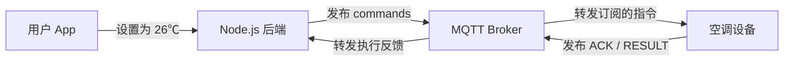
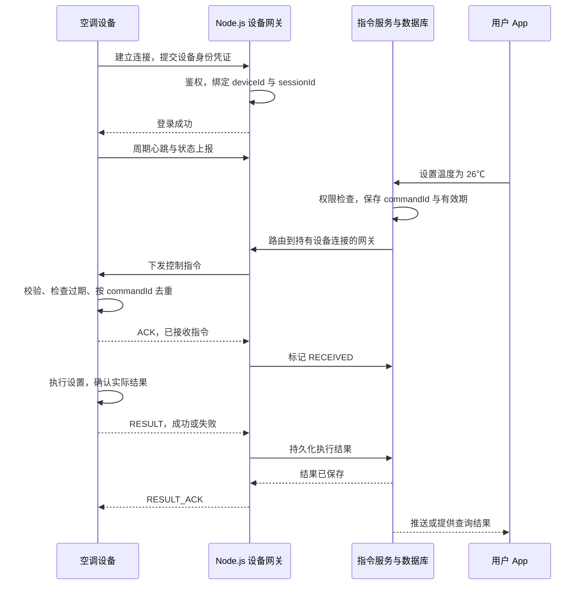
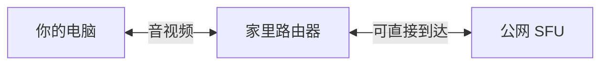
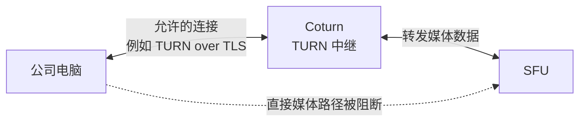
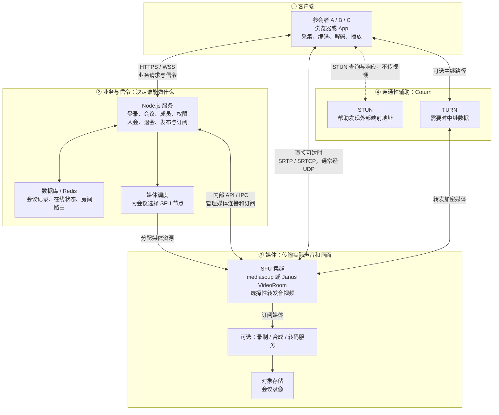
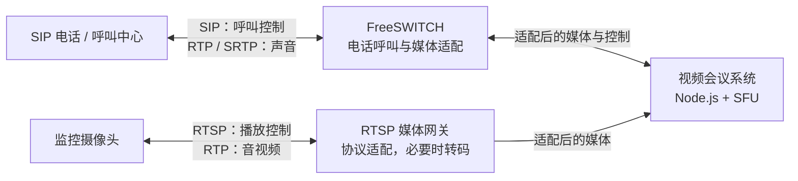

# IoT 与 MQTT

设备通信协议、长连接管理与空调控制示例。

## MQTT
> MQTT 是一种轻量的发布/订阅消息协议，常用于设备与服务端之间的长连接通信。 通常运行在 TCP/TLS 上。
在空调场景中，Node.js 后端和空调设备都是 MQTT Client，它们都连接到一个 MQTT Broker。Broker 根据 Topic 转发消息。

### 核心概念
- Client：连接 Broker 的客户端。设备和后端都可以同时发布、订阅。
- Broker：接收消息，转发给订阅者，例如 Mosquitto、EMQX。
- Topic：路由消息的主题名称，例如 devices/ac-001/commands。
- Publish：向某个 Topic 发布消息。
- Subscribe：订阅 Topic，之后持续接收匹配的消息。
- Payload：消息内容，可以是 JSON、文本或二进制。

本例约定三个 Topic：
```
devices/ac-001/commands   后端 → 空调：控制指令
devices/ac-001/replies    空调 → 后端：接收确认、执行结果
devices/ac-001/status     空调 → 后端：在线状态
```

### QoS、retain、遗嘱
will（遗嘱消息）就是客户端提前交给Broker的一条“异常离线通知”
> 如果我突然断电吗，断网，来不及告诉大家，请你替我发布“空调离线”
> 反映的是broker判断设备连接已异常断开。不能据此确定设备究竟是断电、断网，还是应用奔溃。
```js
will:{
  topic:'devices/ac-001/status',
  payload:JSON.stringify({online:false}),
  qos:1,
  retain:true // 表示离线消息发布后，broker将它保存为Topic最新的状态。后端即使晚一点订阅，也能收到。设备重新上线，在主动发布retained的 online:true 替换旧状态
}
// 这条消息不会在连接时立即发布，而是由broker保存，等待触发条件
```
正常运行时
```
空调连接Broker，并提交遗嘱
空调主动发布：online = true
正常通信，MQTT客户端维护心跳
```
突然断电时
```
空调断电，无法主动发离线消息
Broker 检测到连接异常关闭，或者Keep Alive超时
Broker代替空调发布：online = false
订阅status的Node.js后端收到离线通知
```

MQTT 的 QoS(quality of service) 有三个级别：
|QoS	|语义	|重复	|丢失|	交互次数|	使用场景|
|---|---|---|---|---|---|
|0|	最多一次|	❌不会重复|	✅可能丢	|1 次报文|	高频传感器，温湿度上报|
|1|	至少一次|	✅可能重复|	❌不丢|	2 次报文|	设备告警、事件上报（最常用）|
|2|	恰好一次	|❌不重复|	❌不丢|4 次报文|	控制指令、重要业务，对延迟不敏感|


另外：
- retain：Broker 保留该 Topic 最新的一条 retained 消息，供后续订阅者获取。适合状态快照。
- Will，遗嘱：客户端连接时预先声明；异常断开满足条件后，由 Broker 发布。
- Keep Alive：用于连接存活检测，MQTT 客户端库会处理协议心跳。

### 代码例子

下面使用 MQTT.js 和 Mosquitto，在本地模拟“后端下发温度指令 → 空调接收并执行 → 返回结果”。后端用命令行触发，代替用户调用 HTTP 接口后的发布逻辑。

#### 启动本地 Broker

在独立的实验目录中创建 `mosquitto.conf`。它是 Mosquitto Broker 的配置文件，不是 Node.js 的配置文件：

```conf
listener 1883
allow_anonymous true
```

启动 Docker 中的 Mosquitto，并安装客户端依赖：

```bash
docker run --rm --name mqtt-demo \
  -p 127.0.0.1:1883:1883 \
  -v "$PWD/mosquitto.conf:/mosquitto/config/mosquitto.conf:ro" \
  eclipse-mosquitto:2

# 另开终端，在相同实验目录安装依赖
npm install mqtt
```

匿名连接仅用于本机实验；部署时需要配置认证、TLS 和设备 Topic 访问权限。`ro` 表示容器只读挂载此配置。

#### 空调模拟器：device.mjs

订阅指令、按 `commandId` 去重、发送业务 ACK，再模拟设置目标温度。遗嘱用于异常离线，正常退出则主动发布离线状态。

```js
import mqtt from 'mqtt';

const deviceId = 'ac-001';
const base = `devices/${deviceId}`;
const client = mqtt.connect('mqtt://localhost:1883', {
  clientId: `device-${deviceId}`,
  clean: true,
  keepalive: 30,
  reconnectPeriod: 1000,
  will: {
    topic: `${base}/status`,
    payload: JSON.stringify({ online: false }),
    qos: 1,
    retain: true,
  },
});

let targetTemperature = 24;
// 教学示例：去重记录仅保存在当前进程内存中。
const commands = new Map();

function reply(message) {
  client.publish(
    `${base}/replies`,
    JSON.stringify(message),
    { qos: 1, retain: false },
    (err) => {
      if (err) console.error('反馈发布失败：', err.message);
    },
  );
}

client.on('connect', () => {
  client.subscribe(`${base}/commands`, { qos: 1 }, (err, granted) => {
    if (err || !granted?.length || granted.some((item) => item.qos > 2)) {
      console.error('订阅指令失败', err);
      return;
    }
    client.publish(
      `${base}/status`,
      JSON.stringify({ online: true }),
      { qos: 1, retain: true },
    );
    console.log(`空调 ${deviceId} 已就绪`);
  });
});

client.on('message', (topic, payload) => {
  if (topic !== `${base}/commands`) return;
  let command;
  try {
    command = JSON.parse(payload.toString());
  } catch {
    console.error('收到非法 JSON');
    return;
  }

  const { commandId, action, params, expiresAt } = command ?? {};
  if (typeof commandId !== 'string' || !commandId) return;

  const previous = commands.get(commandId);
  if (previous) {
    // 重复指令：返回已有结果或处理中状态，不重复执行。
    reply(previous.result ?? {
      type: 'ACK', commandId, status: 'PROCESSING',
    });
    return;
  }

  const temperature = params?.temperature;
  if (
    action !== 'SET_TEMPERATURE' ||
    !Number.isFinite(temperature) || temperature < 16 || temperature > 30 ||
    !Number.isFinite(expiresAt) || Date.now() >= expiresAt
  ) {
    reply({
      type: 'RESULT', commandId, status: 'REJECTED',
      reason: '指令无效、温度超范围或已过期',
    });
    return;
  }

  // 在异步执行前登记，避免执行期间重复收到时再次执行。
  const record = { result: null };
  commands.set(commandId, record);
  reply({ type: 'ACK', commandId, status: 'RECEIVED' });

  setTimeout(() => {
    if (Date.now() >= expiresAt) {
      record.result = {
        type: 'RESULT', commandId, status: 'REJECTED',
        reason: '执行前指令已过期',
      };
    } else {
      // 真设备需调用硬件接口，并根据执行反馈构造结果。
      targetTemperature = temperature;
      record.result = {
        type: 'RESULT', commandId, status: 'SUCCEEDED', targetTemperature,
      };
      console.log(`目标温度已设置为 ${targetTemperature}℃`);
    }
    reply(record.result);
  }, 1000);
});

client.on('error', (err) => console.error('MQTT 错误：', err.message));

process.once('SIGINT', () => {
  client.publish(
    `${base}/status`,
    JSON.stringify({ online: false }),
    { qos: 1, retain: true },
    () => client.end(),
  );
});
```

#### 后端下发指令：server.mjs

先订阅反馈，再发布指令。QoS 1 的发布回调成功仅代表 Broker 确认；业务 ACK 代表设备已接收；RESULT 才是执行结果。

```js
import mqtt from 'mqtt';
import { randomUUID } from 'node:crypto';

const deviceId = 'ac-001';
const base = `devices/${deviceId}`;
const temperature = Number(process.argv[2] ?? 26);
if (!Number.isFinite(temperature) || temperature < 16 || temperature > 30) {
  throw new Error('温度必须在 16～30℃之间');
}

const commandId = randomUUID();
const client = mqtt.connect('mqtt://localhost:1883', {
  clientId: `backend-${randomUUID()}`,
  clean: true,
  reconnectPeriod: 1000,
});

let finished = false;
const timer = setTimeout(() => {
  finish('等待超时：执行结果未知，需要查询或使用相同 commandId 重试');
}, 15_000);

function finish(message) {
  if (finished) return;
  finished = true;
  clearTimeout(timer);
  console.log(message);
  client.end(true);
}

client.on('message', (topic, payload) => {
  if (topic !== `${base}/replies`) return;
  let message;
  try {
    message = JSON.parse(payload.toString());
  } catch {
    return;
  }
  if (message?.commandId !== commandId) return;
  if (message.type === 'ACK') {
    console.log('设备已接收：', message.status);
  }
  if (message.type === 'RESULT') {
    finish(`设备执行结果：${JSON.stringify(message)}`);
  }
});

client.once('connect', () => {
  client.subscribe(`${base}/replies`, { qos: 1 }, (err, granted) => {
    if (finished) return;
    if (err || !granted?.length || granted.some((item) => item.qos > 2)) {
      finish('订阅设备反馈失败');
      return;
    }
    const command = {
      commandId,
      action: 'SET_TEMPERATURE',
      params: { temperature },
      expiresAt: Date.now() + 10_000,
    };
    client.publish(
      `${base}/commands`,
      JSON.stringify(command),
      { qos: 1, retain: false },
      (err) => {
        if (finished) return;
        if (err) {
          finish(`发布失败，执行状态需确认：${err.message}`);
          return;
        }
        console.log('Broker 已确认接收，等待设备反馈');
        console.log('commandId：', commandId);
      },
    );
  });
});

client.on('error', (err) => console.error('MQTT 连接错误：', err.message));
```

#### 运行与观察

先启动设备，看到“已就绪”后，在另一个终端运行后端：

```bash
node device.mjs

# 另一个终端
node server.mjs 26
```

预期后端依次收到 Broker 确认、设备 ACK 和设备 RESULT（前两者日志先后不应作为业务保证）：

```text
Broker 已确认接收，等待设备反馈
commandId：……
设备已接收：RECEIVED
设备执行结果：{"type":"RESULT","commandId":"……","status":"SUCCEEDED","targetTemperature":26}
```

- `SUCCEEDED` 表示目标温度设置成功，不表示室温已经降到 26℃。
- 若设备未启动，Broker 仍可能确认发布，但后端会因收不到执行结果而超时。
- 指令使用 `retain: false`，避免新订阅设备执行旧控制指令；在线状态使用 `retain: true`。
- `clean: true` 的示例不保证离线指令补发。生产需设计持久化指令、结果确认、重试、去重记录的持久化与清理。
- 同一设备的真实客户端 ID 必须唯一；同时启动两份 `device.mjs` 会发生连接接管。

#### 完整时序图

```mermaid
sequenceDiagram
    autonumber
    actor User as 用户
    participant Backend as Node.js 后端 server.mjs
    participant Broker as Mosquitto Broker
    participant Device as 空调模拟器 device.mjs

    Note over Broker: 启动时读取 mosquitto.conf<br/>监听 1883，允许本地匿名连接

    rect rgb(235, 245, 255)
        Note over Broker,Device: 一、设备连接与上线
        Device->>Broker: CONNECT：clientId=device-ac-001<br/>clean=true，keepalive=30<br/>携带离线遗嘱
        Note over Broker: 保存遗嘱，暂不发布<br/>status：online=false<br/>QoS 1，retain=true
        Broker-->>Device: CONNACK：连接成功
        Device->>Broker: SUBSCRIBE devices/ac-001/commands<br/>请求 QoS 1
        Broker-->>Device: SUBACK：订阅成功
        Device->>Broker: PUBLISH devices/ac-001/status<br/>online=true，QoS 1，retain=true
        Broker-->>Device: PUBACK：确认收到上线消息
        Note over Broker: 保存最新 retained 状态：online=true
    end

    rect rgb(240, 250, 240)
        Note over User,Device: 二、用户下发温度指令
        User->>Backend: 运行 node server.mjs 26
        Backend->>Backend: 校验温度，生成 commandId<br/>启动 15 秒总超时计时器
        Backend->>Broker: CONNECT：唯一 backend clientId<br/>clean=true
        Broker-->>Backend: CONNACK
        Backend->>Broker: SUBSCRIBE devices/ac-001/replies<br/>请求 QoS 1
        Broker-->>Backend: SUBACK
        Note over Backend: 先订阅反馈，再下发指令

        Backend->>Broker: PUBLISH devices/ac-001/commands<br/>commandId、SET_TEMPERATURE、26℃<br/>expiresAt=当前时间加10秒<br/>QoS 1，retain=false

        par 发布端协议确认
            Broker-->>Backend: PUBACK
            Note over Backend: publish 回调成功<br/>只表示 Broker 已确认接收
        and 向订阅设备投递
            Broker->>Device: PUBLISH：转发控制指令
            Device-->>Broker: PUBACK，由 MQTT.js 处理
        end
    end

    rect rgb(255, 248, 235)
        Note over Broker,Device: 三、设备校验、去重和执行
        Device->>Device: 解析 JSON，检查 commandId

        alt 相同 commandId 已存在
            Device->>Device: 不重复执行
            Device->>Broker: 发布 replies<br/>已有 RESULT，或 ACK：PROCESSING
            Broker->>Backend: 转发已有结果或处理中状态
        else 新指令无效或已过期
            Device->>Broker: 发布 replies<br/>RESULT：REJECTED
            Broker->>Backend: 转发拒绝结果
        else 新指令合法
            Device->>Device: 在 Map 中登记 commandId
            Device->>Broker: 发布 replies<br/>业务 ACK：RECEIVED
            Broker->>Backend: 转发业务 ACK
            Note over Backend: 打印“设备已接收”<br/>继续等待执行结果

            Device->>Device: setTimeout 模拟执行等待 1 秒
            alt 执行前已过期
                Device->>Device: 保存 RESULT：REJECTED
            else 仍在有效期内
                Device->>Device: targetTemperature = 26<br/>保存 RESULT：SUCCEEDED
            end

            Device->>Broker: 发布 replies<br/>RESULT，QoS 1，retain=false
            Broker->>Backend: 转发执行结果
        end

        Note over Backend,Device: replies 同样使用 QoS 1<br/>各段 PUBACK 由 MQTT.js 处理，图中省略
    end

    rect rgb(245, 240, 250)
        Note over User,Backend: 四、后端等待结束
        alt 总超时前收到匹配 commandId 的 RESULT
            Backend->>Backend: 清除计时器，打印结果
            Backend-->>User: 显示 SUCCEEDED 或 REJECTED
            Backend->>Backend: client.end(true)，结束连接
        else 15 秒内未收到匹配 RESULT
            Backend-->>User: 执行结果未知<br/>需要查询或沿用 commandId 重试
            Backend->>Backend: client.end(true)，结束连接
        end
    end

    rect rgb(245, 245, 245)
        Note over Broker,Device: 五、设备后续存活与离线
        opt 空闲期间需要维持连接
            Device->>Broker: PINGREQ，由 MQTT.js 自动发送
            Broker-->>Device: PINGRESP
        end

        alt 设备进程通过 Ctrl+C 正常退出
            Device->>Broker: 主动发布 status：online=false<br/>QoS 1，retain=true
            Broker-->>Device: PUBACK
            Device->>Broker: DISCONNECT，由 client.end() 发送
            Note over Broker: 正常断开，不发布遗嘱
        else 设备断电、网络中断或进程被强制终止
            Note over Device: 无法主动发布离线状态
            Broker->>Broker: 检测异常断开或 Keep Alive 超时
            Broker->>Broker: 发布预先保存的遗嘱<br/>status：online=false，retain=true
            Note over Broker: 更新 retained 状态<br/>并转发给在线的 status 订阅者
        end
    end
```


与代码对应的几个边界：
- PUBACK 是 MQTT 协议确认；业务 ACK 表示设备接收；RESULT 表示执行结果。
- 示例后端只订阅 replies，没有订阅 status，所以不会收到上下线通知。
- 图中的超时计时与通信流程同时进行；超时后，设备仍可能执行或返回结果。
- 示例没有实现自动业务重试、持久化去重和业务 RESULT_ACK；设备去重记录仅在当前进程内有效。

## IoT 设备通信
> 普通http是请求->查库->返回。设备通信会多几个问题：设备真的在线吗？设备收到消息了吗？收到的消息是否完整？执行了吗？重复发送会执行两次？

以“远程控制空调、把温度设置为26度”为例

1.先区分这些协议在什么位置？
```
业务：设置温度、上报状态、返回执行结果

消息协议： 自定义协议/ MQTT / WebSocket

传输层： TCP 或者 UDP

网络
```

### TCP 字节流、消息边界、半包和粘包是什么
> tcp没有业务消息边界，不能把一次data事件当成一条消息，我会使用长度分帧，每个连接维护接受缓冲区，循环解析完整帧，并设置长度和超时限制。
假设设备连续发布两条消息
```
第一条：{"temperature":25}
第二条：{"temperature":26}
```
node`socket.on('data')`可能收到：
```js
第一次：{"temperature":       // 只读取一条业务消息的一半
第二次：25}{"temperature":26} // 一次读取多条业务消息
```
需要自己定义分帧规则。设备协议常用：
```
[消息体长度:4字节][消息体：N字节]
```
实际还要限制最大消息长度、缓冲区大小和等待时间，避免异常失败无限占用内存。长度按字节数计算，不是字符串字符数。

使用MQTT或者 Websocket事，库已处理底层分帧，一般不用自己拆tcp数据

### TCP 连接存在，不等于设备真的在线
设备正常关闭连接时，服务器通常能收到 end、close 等事件。
但如果设备突然断电、Wi-Fi 消失，或者中间网络出现故障，服务器不一定立即知道。
因此需要心跳，例如：
```
设备每 20 秒发送一次心跳
服务端更新 lastSeen
超过 60 秒没有有效通信，判定设备离线
```

### UDP的丢包、乱序、重复、应用怎么处理
> UDP 适合实时媒体、发现和部分容忍丢失的数据场景。它本身简单，但要实现可靠控制，需要额外处理确认、超时、重传、乱序、去重和拥塞控制。协议选择取决于业务对完整性、顺序和时效性的要求，而不是单纯比较速度。
UDP适合的场景
- 实时音视频，重视数据的时效性
- 允许偶尔丢失，持续更新的状态数据
- 局域网发现和组播。
- 资源受限的设备

UDP需要处理
- 丢包：超时后是否重发？重发多少次？
- 重复：同一指令收到两次，如何避免重复执行？
- 乱序：先发 26℃，后发 24℃，却先收到 24℃，怎样防止旧指令覆盖新状态？
- 结果丢失：设备已执行，但反馈没到，如何查询或恢复？
- 网络拥塞：何时降低发送速率，而不是越丢越重传？
- 连接状态与安全：怎样识别设备、维护可达性、防伪造和重放？

UDP 保留数据报边界，但不保证送达、不保证顺序，也不保证不会重复。
```
发送：第 10 条 → 第 11 条 → 第 12 条
收到：第 12 条 → 第 10 条 → 第 12 条
```
应用是否补救：要看业务：
- 实时温度上报：可以带设备会话编号和序号，只接受更新数据，旧数据丢失
- 重要指令：需要指令ID、ACK、超时重试、去重和执行结果
- 实时音视频：通常结合序号、时间戳、抖动缓冲、丢包恢复及拥塞控制；数据不一定值得等待
序号让你发现问题，ACK与重传帮助恢复，去重避免重复处理。如果自行基于UDP实现可靠通信，还需要考虑重传退避、流量控制和报文大小。不能只是“不成功就一直重发”。Node使用`node:dgram`接受udp数据报

### 设计“设备上线、接受指令、返回结果的完整流程”
下面以自定义 TCP/TLS 设备网关为例，MQTT 也可以承载相同的业务流程。

下发的指令可以是：
```json
{
  "type": "COMMAND",
  "deviceId": "ac-001",
  "commandId": "cmd-8f32",
  "action": "SET_TEMPERATURE",
  "params": { "temperature": 26 },
  "expiresAt": "2026-10-12T10:30:00Z"
}
```
收到后的确认：
```json
{
  "type": "ACK",
  "commandId": "cmd-8f32",
  "status": "RECEIVED"
}
```
执行结果
```json
{
  "type": "RESULT",
  "commandId": "cmd-8f32",
  "status": "SUCCEEDED",
  "actualTemperatureSetting": 26
}
```
超时了是否可以重发？

可以有条件重发，超时意味结果未知，不代表没有执行
```
服务端发送“设置为 26℃”
设备执行成功
设备回传结果时断网
服务端等待超时
```
更合理是：
- 同一条业务指令重试时沿用同一个 `commandId`。
- 设置有效期、重试上限和退避间隔。
- 设备发现该 ID 已完成，直接返回历史结果。
- 发现正在执行，返回当前状态，不再执行一次。
- 结果没有被服务端确认时，设备保留并重传结果；服务端也去重。
- 已过期的指令拒绝执行，避免设备重连后执行陈旧控制命令。

### 多个node实例，指令怎么找到设备
```
设备 ac-001 连接网关 A
用户请求却到达 API 实例 B
```
B 不能直接使用 A 内存中的 socket。通常分成两部分：
```
网关 A 本地：
deviceId → socket

共享路由信息：
deviceId → gatewayId + sessionId + 有效期
```
指令服务查到设备在 A，再通过内部 RPC 或消息系统转给 A，由 A 写入真实连接。

### 如果使用MQTT，会简化什么
MQTT Broker可以承担设备连接、订阅路由、Keep Alive和消息投递等工作。Node.js 业务可以发布：
```
devices/ac-001/commands
```
设备订阅指令主题，再向下面的主题返回结果：
```
devices/ac-001/replies
```
需注意：
- MQTT QoS 1 允许重复，业务仍需去重。
- MQTT QoS 2 的协议交付语义，不等于物理设备动作绝对只执行一次。
- 发布到 Broker 成功，不等于设备已执行成功。
- Keep Alive 和遗嘱消息可以帮助判断异常离线，仍需处理状态延迟及重连竞争。

## 信令
> 把系统分成信令、媒体和连通性三部分。Node.js 负责用户、房间和信令交互；Janus、mediasoup 或 FreeSWITCH 根据场景承担媒体与呼叫能力；Coturn 提供 STUN/TURN。SIP、RTSP 主要控制会话，RTP/SRTP 传输媒体，WebRTC 将协商、连通、安全传输和实时媒体能力组合起来。
> 谁和谁通话？——信令

### 信令服务器是什么
假设你通过浏览器呼叫另一位用户。
信令服务器负责组织通话：
```
用户登录
A 呼叫 B
B 接听或拒绝
交换音视频能力和连接信息
加入房间、离开房间、挂断
```
这些通常是少量控制消息，Node.js 可以通过 HTTP、WebSocket 实现。


### 流媒体
媒体服务器负责处理实际音视频：
```
接收音频、视频
转发给其他用户
根据接收端网络选择合适的视频层
按具体产品能力进行混音、转码、录制等
```

### SIP(session initation protocol) 会话发起协议
常见于 IP 电话、呼叫中心、语音网关等系统。它属于信令协议。一次简化的呼叫可能是：
```
A → B：INVITE       邀请通话
B → A：180 Ringing 正在响铃
B → A：200 OK      接听
A → B：ACK         确认建立会话

双方传输音视频

A → B：BYE         挂断
B → A：200 OK      确认结束
```
SIP 消息常携带 SDP，描述音视频能力和相关参数。真正的声音通常通过 RTP/SRTP 传输，不装在 SIP 呼叫消息里。

### RTSP(Real-Time Stream Protocol) 实时流控制协议
常见与网络摄像头和监控系统
```
rtsp://camera-address/stream
```
RTSP 主要负责控制，媒体通常由 RTP 承载。 RTP 可以通过 UDP 传输，也可以在 RTSP 的 TCP 连接中交错传输，所以不能说“RTSP 一定走 UDP”。

可以把SIP和RTSP的典型用途理解为
```
SIP：我要和这个人建立通话
RTSP：我要观看这台摄像头的媒体流
```

### RTP（Real-time Transport Protocol）RTCP SRTP：真正的媒体传输实时传输协议
编码后的音频、视频被分成一个个包，RTP 为它们添加信息，例如：
- 序号：帮助发现丢包和乱序。
- 时间戳：帮助确定播放时序。
- SSRC：标识媒体源。
- Payload Type：标识协商的载荷格式。
```
摄像头画面
    ↓ 视频编码，例如 H.264
编码后的数据
    ↓ RTP 分包
网络传输
    ↓ 接收端整理、解码
显示画面
```
配套的 RTCP 用于质量报告、同步等控制信息；相关反馈扩展还能支持丢包反馈、请求关键帧等能力。SRTP 则在 RTP 基础上提供加密和认证等保护，WebRTC 音视频使用安全媒体传输

#### WebRTC，Web Real-Time Communication，是用于实时音视频和数据通信的一套技术体系。
它把很多能力组合起来：
```
音视频采集、编码和解码
          +
SDP(SDP 是会话描述格式，描述编解码器、媒体类型等参数) Offer / Answer 协商  
          +
ICE / STUN / TURN 连通性处理
          +
DTLS-SRTP 安全媒体传输
          +
网络质量适应
```
浏览器里常接触到的 API：
```js
// 获取摄像头、麦克风
navigator.mediaDevices.getUserMedia(...);

// 建立和管理实时通信连接
new RTCPeerConnection(...);

// 在连接上传输应用数据
peerConnection.createDataChannel(...);
```

### Janus、FreeSWITCH、Coturn、mediasoup 是什么
#### Janus：插件式 WebRTC 服务器。
它负责 WebRTC 连接和相关协议处理，通过插件提供不同媒体功能，例如：
- VideoRoom：多人会议的 SFU 转发。
- SIP：与 SIP 系统互通。
- Streaming：向 WebRTC 客户端提供媒体流。
- AudioBridge：音频混音。
Node.js 通常调用 Janus 接口，组织房间、权限、发布和订阅流程；也可以进一步开发 Janus 插件。

#### FreeSWITCH：偏电话通信的交换与媒体平台。
典型场景包括：
- SIP 电话、分机和呼叫路由。
- 呼叫中心。
- IVR，例如“按 1 转人工”。
- 会议、录音、媒体处理。
- WebRTC 与传统电话系统互通。
Node.js 可以通过控制接口，例如 Event Socket，发起呼叫、监听状态、控制播放和挂断。它比单纯的媒体转发器更强调呼叫业务和电话系统能力。

#### Coturn：STUN/TURN 服务器实现。
> STUN 帮我了解外部看到的地址。
> TURN 在需要时替我转发数据。
> ICE 实际检查并选择可用路径。
把 Coturn 和 STUN、TURN、ICE 的关系拆开：
- Coturn 是服务器软件，可以提供 STUN 和 TURN 服务。
- STUN：帮助客户端发现自己经过路由器映射后的地址。
- TURN：提供一条可以转发数据的中继路径。
- ICE：客户端与对端执行的“尝试并选择可用路径”的机制，不是 Coturn 里的一个独立服务器。

现在可以先只考虑一个问题：
> 参会者的电脑，能不能把音视频传给 SFU？
1. 网络允许直接通信：不需要 TURN 中继
假设你在家里开会，SFU 有公网地址，网络允许所需的通信：

此时媒体可以直接到 SFU。TURN 不在实际音视频路径里，没有 TURN 也可能正常开会。
这里的“直接”指的是客户端直接连 SFU，不经过 TURN 中继，不是说没有经过家里的路由器。

2. 网络不允许直接通信：TURN 提供绕行路径
例如你在公司网络，直接访问 SFU 的 UDP 媒体端口被限制，但允许连接某个配置好的 TURN 服务：

电脑先把数据发给 Coturn，Coturn 再转给 SFU；反方向也一样。


主要用来：
- 提供 STUN 服务。
- 分配 TURN 中继地址。
- 在需要时中继客户端数据。
它不替你完成登录、呼叫、会议和设备控制业务。

通常不负责：
- 视频解码、画面合成；
- 决定谁加入会议；
- 决定你订阅谁的视频。

#### TURN
TURN：提供中继地址，代为转发数据。TURN 主要转发传输数据，通常不负责视频解码、混音或会议成员管理。
直接路径不可用或策略要求中继时，可以使用：
TURN和SFU,都能转发数据，但转发的层次和目的不同。
- TURN：解决“网络能不能通”,为客户端提供中继路径，不负责理解会议里有哪些人、谁订阅谁的视频。
- SFU：解决“媒体发给谁、发哪一路”。
比如 A、B、C 三人开会，只有 A 的网络无法直接连接 SFU：
```
A → TURN → SFU
              ├→ B
              └→ C
```
TURN 帮 A 把数据送到 SFU；SFU 决定把 A 的视频发给 B、C。
普通 TURN 不会因为你加入了会议，就自动知道要把视频分发给哪些参会者；SFU 也不意味着所有受限网络都能直接连接它。因此，两者可以配合使用，并不互相替代。

#### STUN解决什么
假设电脑的局域网地址是：`192.168.1.10:50000`；经过家里的路由器后，外部服务器看到的可能是：`公网地址:62000`

电脑向 STUN 服务询问 `“你收到我的请求时，看到的来源地址和端口是什么？”` STUN 把它看到的结果告诉电脑，电脑就获得了一个可以用于尝试连接的候选地址。但这只是线索。路由器可能对不同目标使用不同映射，防火墙也可能限制访问，所以：知道外部地址 ≠ 对方一定能通过这个地址联系到你。STUN 查询结束后，视频不会因为用了 STUN 就持续经过 STUN 服务器转发。

#### ICE
> ICE 就是负责“实际试路”的
客户端可能收集了几种候选地址
```
本机地址
通过 STUN 获得的映射地址
通过 TURN 获得的中继地址
```
ICE的工作是：
```
收集候选地址
    ↓
与对端交换相关信息
    ↓
实际检查哪些候选路径能双向通信
    ↓
选择可用路径
```

收集候选地址、检查连通性、选择可用路径。

候选地址可能包括：
- 本机地址。
- 通过 STUN 得到的外部映射地址。
- 通过 TURN 分配的中继地址。
因此，更准确的关系是：
> ICE 负责选择通信路径，STUN 和 TURN 为它提供相关能力。  

#### 没有他们会怎么样
没有独立 STUN 服务：
少了一种发现外部映射地址的手段，不代表所有连接都会失败。同一局域网、某些客户端到公网 SFU 的连接，或者通过 TURN 的连接，仍可能成功。

没有 TURN 服务：
直接路径可用的用户能正常使用；直接路径不可用的用户没有中继兜底，可能无法建立媒体连接。
这就是为什么可能出现：`家里 Wi-Fi：正常` `换成公司网络：能入会，但看不到画面`

没有 ICE 机制：
标准 WebRTC 的连接建立就缺少了必需的连通性检查与路径选择过程。“不配置 STUN/TURN 服务器”不等于“关闭 ICE”：即使没有配置这两种服务器，WebRTC 仍会使用 ICE，只是可用候选可能更少。

#### mediasoup：适合嵌入 Node.js 应用的 SFU(Selective Forwarding Unit，选择性转发单元，是一种音视频媒体服务器) 组件。
它主要接收媒体流并选择性转发，通常不做混音和转码：
```
A 上传自己的音视频
B 上传自己的音视频
C 上传自己的音视频

mediasoup 按订阅和网络条件转发给其他参与者
```
它的一个重要特点是：
```
Node.js：房间、用户、信令与媒体对象控制
C++ Worker：高性能媒体处理与转发
```
mediasoup 不规定业务信令协议，你通常需要自己用 WebSocket 等实现控制流程。它不是安装后就自带完整会议业务的应用。

## 视频会议系统例子

以开发类似腾讯会议的多人视频会议应用为例：**Node.js 管业务和信令，SFU 转发音视频，Coturn 帮助网络连通。**

下面是参考架构，不代表腾讯会议的实际内部实现。SIP 电话和 RTSP 摄像头属于可选接入能力，普通浏览器视频会议不需要把所有组件都部署一遍。

### 核心架构：业务信令、媒体与连通性



客户端节点代表多个独立参会端，每个端分别建立自己的连接。分层表示职责划分，不表示数据必须依次穿过所有层；直连 SFU 和经 TURN 中继是可选路径，并非同一份媒体必须同时走两条路径。

最重要的是区分两条主线：

```text
信令路径：客户端 ↔ Node.js
          我要加入会议、开启摄像头、订阅 A 的视频

媒体路径：客户端 ↔ SFU ↔ 其他客户端
          真正的声音和画面

需要中继时：客户端 ↔ Coturn TURN ↔ SFU
```

音视频包通常不经过 Node.js 的业务 WebSocket。Coturn 解决网络可达性，SFU 根据订阅关系分发媒体，二者不互相替代。

### 每一层的职责

#### 客户端：采集、编码、传输与播放

```text
摄像头采集画面
    ↓
编码为 H.264 / VP8 等格式
    ↓
RTP 分包，并进行 SRTP 保护
    ↓
通过网络发送到 SFU
    ↓
SFU 转发给订阅者
    ↓
订阅者解密、整理、解码并显示
```

麦克风音频也有类似流程，常见编码包括 Opus。**H.264、Opus 是编码格式；RTP/SRTP 是承载媒体的协议。**

#### Node.js：业务与信令控制

- 校验登录身份、会议是否存在、用户是否有入会权限。
- 管理主持人、成员、摄像头状态和共享屏幕权限。
- 告知客户端应该连接哪台 SFU，并交换媒体协商所需信息。
- 根据业务请求创建、关闭媒体连接，管理发布与订阅关系。
- 数据库存储持久业务记录；Redis 可以存储临时状态和房间路由，不用于中转每一帧视频。

#### SFU：选择性转发媒体

A 向 SFU 发布自己的音视频，SFU 按订阅关系发给 B、C。客户端分别接收多路媒体，自己解码和排版。

```text
B 正在大屏观看 A → 选择 A 的高质量视频层
C 网络较差      → 选择 A 的低质量视频层
```

不同质量层通常来自发送端的 Simulcast 或 SVC，不能理解成 SFU 临时把每一路高清视频重新压缩。mediasoup 通常不混音、不转码；会议录制、画面合成可以交给独立服务。

#### Coturn 与 ICE：让客户端能连接媒体端

- STUN 帮助客户端得知本次请求在外部呈现的 IP 和端口，形成候选地址。
- 客户端通过信令交换候选信息；STUN 不会把地址主动广播给所有人。
- TURN 提供中继候选，需要时实际转发数据。
- ICE 在客户端和对端之间检查候选路径、选择可用路径，不是 Coturn 中独立的会议业务服务。

对于这里的 SFU 架构，检查的是客户端与 SFU 之间的可达性，不是要求所有参会者两两直连。STUN/TURN 候选收集与 ICE 检查可以交错进行，并非严格等 STUN 失败后才开始尝试 TURN。

如果缺少 TURN，直接可达的用户仍可能正常开会，受限网络中的用户则可能缺少可用媒体路径。HTTPS/WSS 入会成功，不代表媒体连接也成功。

### 从入会到看到画面的完整流程

#### 第一步：登录和入会——HTTPS

A 提交身份信息和会议号 `room-123`。Node.js 校验权限，选择承载会议的 SFU，并返回入会与连接所需信息。此时只是获准入会，音视频还没有建立。

#### 第二步：建立控制通道——WebSocket / WSS

客户端与 Node.js 建立持续连接，交换成员加入、离开、发布音视频、订阅成员及共享屏幕等信息。WebSocket 是消息的承载方式，业务消息格式由应用定义。

#### 第三步：协商媒体能力——SDP Offer / Answer 或等价参数

双方协商音频/视频类型、编解码器、收发方向和安全连接参数。SDP 是描述信息，不是音视频内容；它借助信令通道交换。

使用 mediasoup 等库时，应用层可能交换 RTP、ICE、DTLS 参数，由客户端库封装底层协商，不一定由业务代码直接转发完整 SDP。

#### 第四步：检查和选择路径——ICE + STUN + TURN

```text
客户端收集候选地址并交换相关参数
    ↓
与 SFU 进行连通性检查
    ↓
直接路径可用 → 客户端直连 SFU
需要中继     → 客户端经 TURN 连接 SFU
```

中继也要求客户端能到达 TURN、TURN 能到达对端；它不能绕过所有网络限制。

#### 第五步：建立安全媒体连接——DTLS + SRTP

典型 WebRTC 媒体连接通过 DTLS 握手协商 SRTP 使用的密钥材料，然后用 SRTP 传输受保护的音视频，用 SRTCP 传输受保护的媒体控制与质量反馈。不是每个视频包都重新进行一次 DTLS 握手。

#### 第六步：发布、订阅和持续通话

A 发布视频，SFU 将它转发给订阅 A 的 B；B 解码显示。通话期间，媒体栈依据丢包、往返时间和接收能力调整码率或媒体层，Node.js 同时维护会议成员和权限等业务状态。

WebRTC 把协商、网络连通、安全传输及实时媒体能力组合起来，但不强制应用使用某种信令协议。**WebRTC 不等于 WebSocket，也不等于用户之间一定直接 P2P。**

### 可选接入：SIP 电话与 RTSP 摄像头



- **SIP + FreeSWITCH**：让电话用户拨入会议，处理呼叫、会议号输入、挂机及音频接入。SIP 控制会话，RTP/SRTP 承载声音。
- **RTSP + 媒体网关**：请求摄像头开始发送媒体，通过 RTP 接收后适配为会议支持的传输。编解码器不兼容时可能需要转码。
- **Janus**：VideoRoom 插件可作为 SFU 方案；SIP、Streaming 等插件提供不同互通和媒体能力。它不是必须串联在 mediasoup 前后的组件。
- **RTCP**：参与媒体质量报告、同步和相关反馈，与管理用户入会的业务信令职责不同。

### 面试中的故障定位

- **无法入会**：先检查业务鉴权、房间状态和信令连接。
- **显示入会但 ICE 失败**：检查候选地址、NAT、防火墙、TURN 和端口配置。
- **媒体连接建立但黑屏**：检查是否实际发布和订阅、编解码器协商、媒体包是否到达以及解码状态。
- **画面卡顿**：检查丢包、抖动、码率、客户端性能和 SFU 负载。
- **电话拨入后没有声音**：除了 SIP 呼叫状态，还要检查 RTP 地址、端口及媒体适配链路。

面试表达：

> 我会把视频会议拆成业务信令、媒体处理和连通性三部分。Node.js 管用户、房间、权限和媒体控制；SFU 接收并选择性转发音视频；Coturn 提供 STUN/TURN，帮助 ICE 建立可用路径。客户端通过 WebRTC 完成协商、安全媒体传输和播放。SIP 电话及 RTSP 摄像头通过相应网关接入，录制和转码作为独立能力扩展。

参考：[mediasoup 架构](https://mediasoup.org/documentation/overview/)、[WebRTC 连接流程](https://webrtc.org/getting-started/peer-connections)、[Coturn](https://github.com/coturn/coturn)、[Janus 插件](https://janus.conf.meetecho.com/docs/pluginslist.html)、[FreeSWITCH 手册](https://developer.signalwire.com/freeswitch/)。
