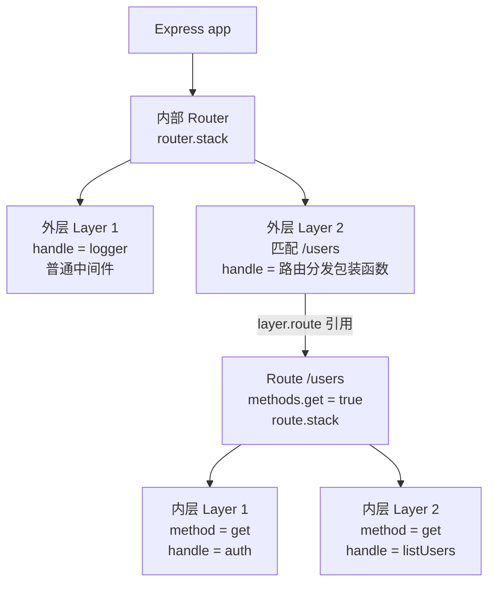
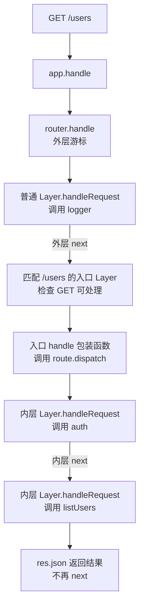

# Express 中间件与 next()：源码阅读和简版实现

## 先分清 Express 和 Koa 的洋葱模型

Express 使用基于回调的中间件链：`next()` 继续寻找后续匹配的处理函数。同步代码会产生类似洋葱的调用顺序，但它不承诺等待下游异步任务完成。

Koa 的 `next()` 返回下游执行的 Promise；中间件使用 `await next()` 才能在下游异步处理结束后继续执行。这是异步洋葱模型的关键，不只是“函数内部又调用一个函数”。

本文以 Express 5 使用的 pillarjs/router 调度结构为参考；Express 4 不原生自动转发 async 中间件返回的 Promise rejection，通常需要自己 catch 后 next(err) 或包装函数。以下是教学实现，不是 Express 全功能替代品。

## app 是 Router 吗？app.handle 是什么

**app 是 Express 应用对象，不是 Router；它内部持有 Router，并把中间件和路由调度委托给它。** 以下说明以 Express 5 为准。

### app 同时是函数和对象

`const app = express()` 得到的是一个可调用函数。JavaScript 函数也是对象，因此它既可以被调用，也可以拥有 use、get、listen、handle 等方法。

创建过程可以简化理解为以下伪代码，省略框架初始化细节：

```js
function createApplication() {
  function app(req, res, next) {
    app.handle(req, res, next);
  }

  // 框架在这里为 app 混入 handle、use、get、listen 等方法，
  // 初始化应用配置，并准备内部 Router 的访问入口。
  return app;
}
```

因此 `app(req, res)` 是调用应用函数，`app.handle(req, res)` 则是调用该对象上的请求处理方法，两者不是不同的服务器。

### 从 HTTP 请求到内部 Router

`app.listen(3000)` 底层会创建 HTTP Server，并将 app 作为请求监听器。核心关系相当于：

```js
const app = express();
http.createServer(app).listen(3000);
```

```text
HTTP 请求到达 Node.js Server
  → Node.js 调用 app(req, res)
  → app 调用自己的 app.handle(req, res)
  → 设置 Express 请求/响应原型、初始化 res.locals 等
  → 准备最终响应/错误处理回调 done
  → 内部 router.handle(req, res, done)
  → 匹配 Layer，执行中间件或进入 Route
```

以上是职责流程示意，不表示初始化操作的精确源码顺序。`app.handle` 是应用层入口，`router.handle` 是路由层调度器；没有匹配处理器或错误未被处理时，最终交给 done 收尾。

### 为什么 app 和 Router 都有 use、get

因为 app 把相关注册操作委托给内部 Router：

- `app.use(logger)`：通过内部 Router 注册中间件 Layer。
- `app.get('/users', listUsers)`：通过内部 Router 创建 Route，再注册 GET handler。
- `app.handle(req, res)`：完成应用层设置后，委托内部 Router 处理请求。

这些 API 相似不表示 app 就是 Router。app 还负责应用配置、模板引擎、启动监听等功能；Router 用来组织可挂载的中间件和路由模块。注意 `app.get('配置名')` 的单参数形式还可用于读取应用配置，和注册 GET 路由的形式不同。

```js
const app = express();
const usersRouter = express.Router();

usersRouter.get('/list', (req, res) => {
  res.json([{ id: 1, name: 'Alice' }]);
});

app.use('/users', usersRouter);
app.listen(3000);
// GET /users/list → app 的内部 Router → usersRouter → 路由 handler
```

**面试总结：** app 是一个可调用的 Express 应用对象，可以作为 Node HTTP Server 的请求监听器。请求进入后调用 app.handle，完成应用层设置，再交给内部 Router。app 通过委托 Router 提供 use、get 等接口，而 Router 本身负责匹配和调度中间件、路由。两者是组合与委托关系，不应理解成 app 就是 Router。

源码参考：[应用函数的创建](https://github.com/expressjs/express/blob/master/lib/express.js)、[app.handle、app.listen 与注册方法](https://github.com/expressjs/express/blob/master/lib/application.js)。

## Router、Route、Layer 的架构关系

先用这两条注册语句建立对应关系：

```js
app.use(logger);
app.get('/users', auth, listUsers);
```

**Router 和 Route 各有自己的 stack，两个 stack 里装的都是 Layer。Layer 是包装，不一定就是一个路由。**



这张图表示对象包含/引用关系，不表示两个 handler 并行执行。

- **app**：应用入口，接收 HTTP 请求，完成应用层设置后交给内部 Router。
- **Router**：组织一组中间件和路由，按注册顺序匹配并调度外层 Layer。`express.Router()` 创建的子路由器也具有同样的结构。
- **Route**：一次路由注册对应的处理集合，记录路径、支持的方法以及内部 handler 链。`app.route('/users').get(fn1).post(fn2)` 可以让一个 Route 支持多个方法；分开写两次 `app.get('/users', ...)` 不会自动合并为一个 Route。
- **Layer**：把函数和匹配信息包装起来。外层路由 Layer 匹配 URL，内层 Layer 关联具体 HTTP 方法与处理函数。
- **handler**：通常指你写的 logger、auth、listUsers 等函数，不是另一个必须实例化的框架类。

## handle、handleRequest、dispatch 分别是什么

这些名字不是同一个函数，必须看它属于哪个对象：

1. `app.handle(req, res, done)`：应用的请求处理入口，最终委托 `router.handle`。
2. `router.handle(req, res, done)`：遍历外层 stack，匹配路径，并检查 Route 是否支持请求方法。
3. `layer.handle`：Layer 对象保存的**函数引用字段**。普通中间件指向 logger；路由入口指向调用 `route.dispatch` 的包装函数；Route 内层 Layer 则指向 auth 或 listUsers。
4. `layer.handleRequest(req, res, next)`：Layer 的执行方法，调用 `this.handle(req, res, next)` 并负责捕获异常/转发 Promise rejection。错误分支走 `handleError`。
5. `route.dispatch(req, res, done)`：遍历 Route 内部 stack，选择方法匹配的 Layer，依次运行这条路由的处理函数。

可以把 Layer 的核心理解为以下示意代码，省略参数、匹配及错误处理细节：

```js
class Layer {
  constructor(path, handler) {
    this.path = path;
    this.handle = handler; // 保存“要执行谁”
  }

  handleRequest(req, res, next) {
    this.handle(req, res, next); // 真正调用它
  }
}
```

## 一次 GET /users 如何执行

假设 logger、auth 各调用一次 next，listUsers 最后 res.json 且不再 next：



**有两套调度游标，也就有不同的 next 闭包。** logger 收到的是 Router 的 next；auth 收到的是 Route 内部的 next。auth 调用 next 时先执行同一路由中的 listUsers，不会直接跳到 Router 的下一条路由。若 Route 的链继续 next 直至耗尽，它调用传入的 done，也就是外层 next，Router 才继续向后找。

如果 listUsers 已发送响应又调用 next，后续层仍可能被调度，导致重复写响应。因此不要把 res.json 理解为自动终止 JavaScript 控制流，通常应 `return res.json(...)` 并不再 next。

### 挂载子 Router 时

```js
const usersRouter = express.Router();
usersRouter.get('/users', auth, listUsers);
app.use('/api', usersRouter);
```

这里 app 内部 Router 新增一个匹配 `/api` 前缀的中间件 Layer，其 handle 指向 usersRouter 这个可调用函数。请求 `/api/users` 进入它时，挂载前缀会暂时从 req.url 去除，子 Router 以 `/users` 继续匹配自己的 stack；退出后外层恢复相关路径信息。因此 Router 可以嵌套，并不是所有 Layer 都必须指向 Route。

源码对应：[Application.handle](https://github.com/expressjs/express/blob/master/lib/application.js)、[Router.route / Router.handle](https://github.com/pillarjs/router/blob/master/index.js)、[Route.dispatch](https://github.com/pillarjs/router/blob/master/lib/route.js)、[Layer](https://github.com/pillarjs/router/blob/master/lib/layer.js)。

## 阅读真实源码的顺序

1. 看 [Router.prototype.use](https://github.com/pillarjs/router/blob/master/index.js)：注册函数被包装成 Layer，并放入 `stack`。注册阶段不执行请求处理逻辑。
2. 看同文件的 `Router.prototype.handle`：每个请求创建自己的 `idx` 和 `next`，随后第一次调用 next 启动调度。
3. 看内部 `next`：通过 `stack[idx++]` 向后寻找匹配 Layer，结合路径、HTTP 方法和错误状态决定是否调用它。
4. 看 [Layer.handleRequest / handleError](https://github.com/pillarjs/router/blob/master/lib/layer.js)：调用处理函数，捕获同步异常，监听返回 Promise 的 rejection，再转交 next(err)。

注意源码中“监听处理函数返回的 Promise”不等于“next 返回下游 Promise”。普通中间件返回的 Promise 成功 resolve 时，Express 也不会自动执行下一个中间件。[官方中间件说明](https://expressjs.com/en/guide/using-middleware/)

源码链接指向主分支，内容会随版本变化。真实实现还包含路径匹配、挂载路径裁剪、Route 内部栈、参数处理、默认响应和同步递归深度保护等；先抓住 stack、请求游标和 next 的关系即可。

## 简版实现：跟着编号读

示例文件位于仓库 `examples/express-next/`，没有额外依赖。

<<< ../../examples/express-next/mini-express.cjs

关键解释：

- **① stack**：保存注册顺序；所有请求共用注册表。
- **② index**：必须放在 handle 内，每个请求独立保存进度，不能让所有请求共用一个游标。
- **③ 匹配**：简版只匹配“普通处理/错误处理”，真实 Express 还匹配路径和方法。
- **④ 调用**：先 `index++` 再执行 handler，handler 里面调用 next 才能继续下一项，而不是又执行自己。
- **⑤ 异步失败**：处理函数返回 Promise 时监听 rejection，但不返回下游 Promise，也不在 resolve 时自动 next。
- **⑥ return**：防止调度器自动把全部中间件循环跑完；继续执行的权力交给当前中间件。
- **⑦ 启动**：框架先调用一次 next，随后由中间件决定何时继续。

## 同步时为什么像洋葱

设 A、B 都执行“before → next() → after”，C 响应请求且不调用 next：

```text
A before
  B before
    C
  B after
A after
```

本质是普通 JavaScript 函数调用栈：A 调用 next，next 调用 B，B 再调用 next，next 调用 C。C 返回后，B 才能执行 after；B 返回后，A 才能执行 after。不是调度器倒序重新遍历 stack，也没有把 A/B 重新执行一遍。

## 遇到异步时为什么不是真正的异步洋葱

如果 B 在 next 前等待数据库，执行顺序可能是：

```text
A before
B before
A after
……数据库查询完成……
B async done
C
B after
```

B 遇到 await 后返回一个尚未完成的 Promise；调度器监听失败后就返回了，因此 A 的 next 调用已经返回。即使 A 写成 `await next()`，它等待的也只是 undefined，不是 B 的执行完成。

对照 [Koa compose](https://github.com/koajs/compose)：其关键是把下一层调用的 Promise 逐层返回，才让外层 `await next()` 真正等待内层。不能在 Express 调度器中加上 Promise 返回链，然后称它是原样复刻 Express。

## next 的四种常见用法

1. `next()`：进入后续普通中间件；如果在错误中间件中调用，则清除当前错误并继续向后寻找普通中间件，不会从头重跑。
2. `next(err)`：进入后续错误中间件，跳过普通中间件。错误处理器声明为 `(err, req, res, next)`，四个形参不能省略，否则函数 length 不符合识别规则。
3. 不调用 next：不再向后调度。若已经 `res.end()`/`res.send()`，请求可以完成；若既不响应也不 next，请求会悬挂。
4. `return next()`：next 本身不会终止当前函数；return 才会阻止当前函数继续执行后面的代码。它不会把 next 变成 Koa 式 Promise。

不要把 next 理解成 `process.nextTick`，它只是调度器创建的普通闭包函数；可以同步调用，也可以在异步操作完成后调用。一次控制流应只调用一次 next，重复调用可能跳过层或重复响应。简版没有实现重复调用保护。

Express 还支持有特定使用场景的 `next('route')`、`next('router')`，本例不实现这些特殊信号，也不实现路径、嵌套路由、请求体解析和完整默认错误处理。

返回 Promise 的 rejection 可以被示例捕获；独立的 setTimeout 回调里直接 throw 并不属于该 Promise，需要自行 try/catch 后 next(err)。上游围绕 next 的同步 try/catch 也不能当作 Koa 式异步错误边界。

如果想记录 HTTP 响应完成耗时，应在调用 next 前监听 `res` 的 `finish` 事件；`next()` 后的代码不代表请求已经完成。finish 表示响应已交给底层发送，不保证客户端已接收；连接提前中断需要结合 close 事件处理。

## 运行例子验证顺序

在仓库根目录运行：

```bash
node examples/express-next/demo.cjs
```

<<< ../../examples/express-next/demo.cjs

示例会断言同步返回顺序、异步 next 不等待下游、三种错误转发、停止调度和两个请求交错执行的游标隔离。

## 面试表达

> Express 的中间件可以理解为按注册顺序保存的 Layer 栈。每个请求有独立游标，next 是捕获该游标的闭包，每次调用都继续寻找下一个匹配层；有错误时切换到错误处理器。同步调用时，函数调用栈会产生先进入后返回的顺序，但 Express 的 next 不返回代表下游完成的 Promise，所以不能依赖 await next 来包住下游异步任务。Koa 则通过 Promise 组合，让 await next 实现异步洋葱模型。Express 5 自动处理返回 Promise 的拒绝，是错误转发能力，不等于 Koa 的异步执行模型。
