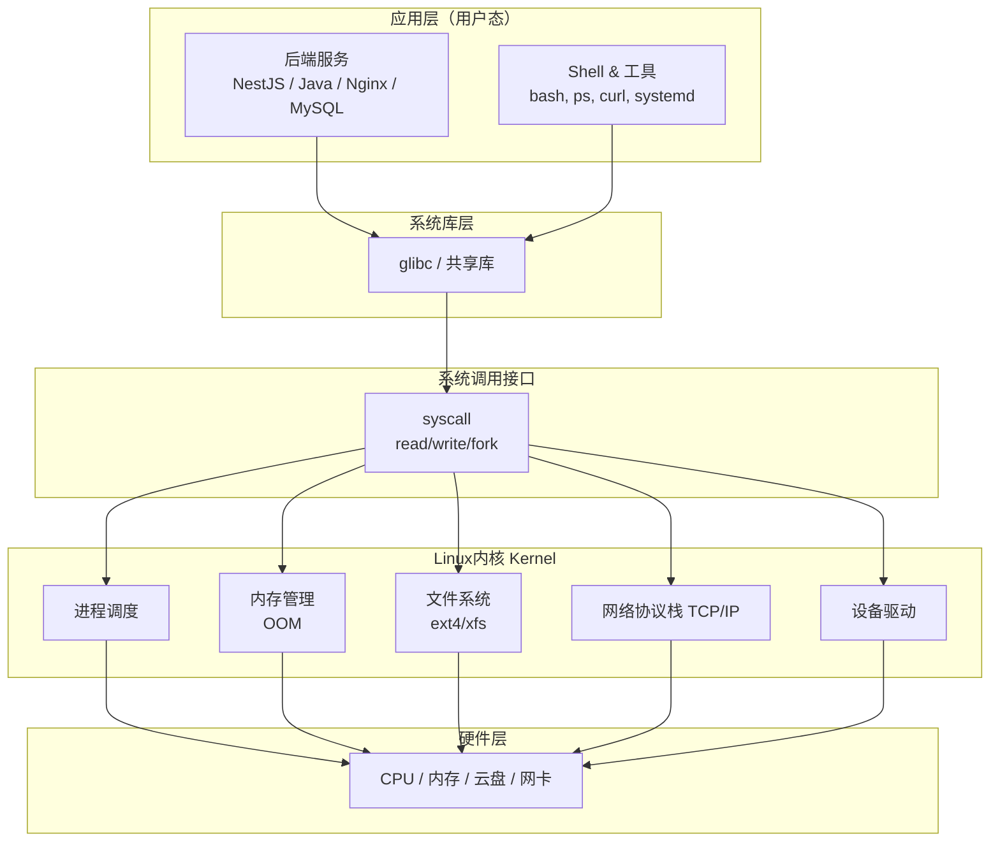
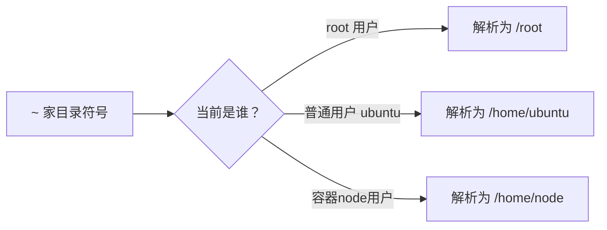

# Linux

## 架构

### 1. 内核（Kernel）—— Linux 核心

**内核是操作系统的心脏，负责管理硬件资源**

- 进程管理：调度你的后端程序运行，分配 CPU 时间片
- 内存管理：虚拟内存、OOM killer（内存不够时杀掉进程，后端部署高频踩坑点）
- 文件系统：ext4、xfs，磁盘读写
- 设备驱动：网卡、云盘
- 网络协议栈：TCP/IP，所有接口请求都走这里
- 权限模型：用户 / 用户组、rwx 权限，`chmod chown`
> 重点：**所有 Linux 发行版，用的都是同一个 Linux 内核源码，差别在内核之外的工具、包管理器、系统配置、初始化系统。**

###  系统库（glibc 最核心）

C 标准库，几乎所有程序都依赖它。

> 
> 坑：编译好的二进制程序，glibc 版本不匹配会直接跑不起来；Docker 很大程度就是解决这个依赖问题。

### 3. 用户态：Shell、工具、初始化系统

1. **Shell**：命令行交互程序，常见 `bash`（默认）、`zsh`
2. **系统初始化 systemd**（现在主流）

> 
> 老版本是 sysvinit，现在云服务器基本淘汰。
   - 负责开机启动、守护进程（后台服务）、日志管理
   - 命令：`systemctl start/stop/enable/status xxx`
   - 日志：`journalctl`
3. **基础工具集**：`ls、cp、ps、netstat` 等，来自 GNU 项目。

###  文件系统目录结构（通用标准 FHS）

所有 Linux 发行版目录结构基本一致，记住常用目录：

|目录|	核心作用|	后端开发备注|
|---|---|---|
|/|	文件系统根起点，所有目录都挂在这下面|	Linux 一切皆文件|
|/bin|	普通用户可用基础二进制命令|	现代系统是软链接指向/usr/bin|
|/boot|	Linux 内核、开机引导程序|	云服务器一般独立分区|
|/dev|	硬件设备抽象文件，磁盘、网卡|	比如/dev/vda云盘|
|/etc|	系统、服务全部配置文件|	Nginx、redis、环境变量全部在这里，部署高频访问|
|/home|	普通用户家目录，如/home/ubuntu|	存放普通用户代码、文件|
|/lib| /lib64|	系统动态库文件|	程序运行依赖库|
|/media|	光盘 U 盘自动挂载点|	云服务器几乎不用|
|/mnt|	手动临时挂载磁盘、网盘|	手动挂载硬盘时使用|
|/opt|	第三方商业大型软件|	现在更多放/usr/local|
|/proc|	虚拟内存文件系统，不占磁盘	|查看 CPU、内存、负载、进程：/proc/cpuinfo /proc/meminfo|
|/root|	root 超级管理员的家目录|	root 用户登录默认所在目录|
|/run|	系统运行时临时文件，进程 PID|	服务 pid 文件存放位置|
|/sbin|	root 管理员专属系统命令|	关机、网络配置等|
|/srv|	服务对外输出数据目录|	较少使用|
|/sys|	内核硬件信息虚拟目录|	调试硬件用|
|/tmp|	全局临时目录，重启数据丢失|	程序临时缓存，不要放业务数据|
|/usr|	用户程序、工具、文档|	系统大部分软件安装位置|
|/var|	可变数据：日志、数据库、缓存|	后端重中之重，日志、数据库数据都在这里|

|路径|	用途|
|---|---|
|/usr/local|	源码编译安装软件默认位置，自己编译程序放这里|
|/var/log|	系统、Nginx、MySQL 日志目录，排查报错必看|
|/var/lib/mysql|	MySQL 默认数据存储目录|
|/var/spool/cron|	crontab 定时任务存放位置|
|/etc/hosts|	本地域名解析配置|
|/etc/resolv.conf|	DNS 服务器配置|
|/etc/fstab|	开机自动挂载磁盘配置|

### 家目录


## 命令
## 一、文件与目录操作（Rocky & Ubuntu 几乎完全相同）

> 这一组命令：`ls/cd/pwd/mkdir/rm/cp/mv/touch/ln/cat/less/head/tail/find/grep`，**两套系统无区别**

| 命令 | 常用用法 | 说明 |
| --- | --- | --- |
| `pwd` | `pwd` | 打印当前工作目录 |
| `cd` | `cd /etc` `cd ~` `cd ..` `cd -` | 切换目录；`~`家目录，`..`上级，`-`上一次目录 |
| `ls` | `ls -l` 长列表\n`ls -a` 显示隐藏文件\n`ls -lh` 带人类可读大小\n`ls -lt` 按修改时间排序 | 列出目录内容 |
| `mkdir` | `mkdir test` `mkdir -p /a/b/c` | `-p` 递归创建多级目录，不存在父目录自动创建 |
| `rm` | `rm file.txt` `rm -r dir` `rm -rf dir` | `-r`递归，`-f`强制删除，**慎用 rm -rf** |
| `cp` | `cp file1 file2` `cp -r dir1 dir2` `cp -a` 保留权限属性 | `-r`复制目录；`-a`归档复制（部署备份常用） |
| `mv` | `mv old new` `mv file /tmp/` | 移动 / 重命名 |
| `touch` | `touch test.txt` | 创建空文件；也可修改文件时间戳 |
| `ln` | `ln -s /etc/nginx/nginx.conf link.conf` | `-s`软链接（符号链接），后端部署常用 |
| `cat` | `cat file.txt` `cat > file.txt` | 一次性输出全部内容；> 重定向写入 |
| `less` | `less file.txt` | 分页查看，`q`退出，`/关键词`搜索 |
| `head` | `head -n 20 file.txt` | 查看前 20 行 |
| `tail` | `tail -n 20 file.txt` `tail -f app.log` `tail -F app.log` | `-f`实时跟踪日志；`-F`跟踪 + 文件重建（日志切割场景） |
| `find` | `find /var/log -name "*.log"` `find . -type f -size +100M` | 查找文件；按名称、类型、大小搜索 |
| `grep` | `grep "error" app.log` `grep -i "error"`忽略大小写`grep -r "keyword" /etc`递归搜索目录 | 文本过滤，日志排查高频 |
|`cat`|`cat do.txt` 读取全部内容`cat > do.txt <<EOF` 覆盖多行写入`cat >> do.txt <<EOF` 追加多行|读取文件；配合 here-doc 实现多行写入|
|`echo`|`echo "hello" > do.txt` 单行覆盖`echo "new line" >> do.txt` 单行追加`echo -n "no newline"` 不吃管道输入|输出文本；配合重定向实现单行写入|
|`tee`|`echo "abc"`|同时打印到控制台 + 写入文件；sudo 场景首选|

## 二、用户 & 权限（Rocky / Ubuntu 基本一致）

权限模型、`chmod/chown/sudo` 逻辑一样；用户创建命令参数基本相同，细微差别在默认用户组。
| 命令 | 常用用法 | 说明 |
|---|---|---|
| `useradd` | `useradd appuser` `useradd -m appuser` | 创建用户；`-m`自动创建家目录 `/home/appuser` |
| `userdel` | `userdel appuser` `userdel -r appuser` | `-r`删除用户 + 家目录 |
| `passwd` | `passwd appuser` | 设置用户密码 |
| `groupadd` | `groupadd appgroup` | 创建用户组 |
| `usermod` | `usermod -aG appgroup appuser` | `-aG`追加附属组（**不要省略 - a**） |
| `chmod` | `chmod 755 script.sh` `chmod +x script.sh` | 修改文件权限 |
| `chown` | `chown appuser:appgroup file.txt` `chown -R appuser:appgroup /opt/app` | `-R`递归修改所有者 |
| `su` | `su - appuser` | `-` 切换并加载用户完整环境变量 |
| `sudo` | `sudo command` | 以管理员权限执行 |
| `id` | `id appuser` | 查看用户 UID/GID、所属组 |

## 三、进程、系统资源监控（Rocky / Ubuntu 基本一致）

| 命令 | 常用用法 | 说明 |
| --- | --- | --- |
| `ps` | `ps aux` `ps -ef` | 查看所有进程，后端查服务进程 |
| `top` | `top` | 实时资源监控，`q`退出 |
| `htop` | `htop` | 增强版 top（Rocky 需要手动 dnf 安装） |
| `pgrep` | `pgrep -f "node app.js"` | 根据进程名查找 PID |
| `pkill` | `pkill -f "node app.js"` | 按进程名杀死进程 |
| `kill` | `kill 1234` `kill -9 1234` | 发送信号；`-9`强制杀死，尽量少用 |
| `uptime` | `uptime` | 查看系统负载、开机时间 |
| `free` | `free -h` | 查看内存，`-h`人类可读单位 |
| `df` | `df -h` | 磁盘分区使用率 |
| `du` | `du -sh /var/log` | 统计目录占用大小；`-s`汇总 |

### ps aux
```shell
USER         PID %CPU %MEM    VSZ   RSS TTY      STAT START   TIME COMMAND

## 系统服务
root           1  0.0  0.7  23504 12420 ?        Ss   Aug02   4:52 /usr/lib/systemd/systemd
root     2796242  0.0  0.8 113380 14792 ?        S<s  Oct15   0:13 /usr/lib/systemd/systemd-journald
# docker
root       18478  0.1  3.8 2675036 64356 ?       Ssl  Aug02 172:41 /usr/bin/dockerd
root      511808  0.1  2.2 1945476 37924 ?       Ssl  Sep12  76:26 /usr/bin/containerd
root     3724473  0.0  0.4 1233864 7236 ?        Sl   11:58   0:04 /usr/bin/containerd-shim-runc-v2
# 容器内的业务服务
root     3756072  0.0  6.1 760748 102384 ?       Sl   13:56   0:03 node dist/analytics-main.js
root     3756369  0.4  9.3 11297784 154204 ?     Ssl  13:56   0:24 node /app/dist/main.js
root     3756370  0.4  9.0 11293648 149052 ?     Ssl  13:56   0:27 node /app/dist/worker.js
# 数据库/中间件
dnsmasq  3724519  0.4  0.3 144420  6456 ?        Ssl  11:58   0:57 redis-server *:6379
dnsmasq  3724525  0.2  8.6 1523840 142380 ?      Ssl  11:58   0:26 mysqld
# nginx容器进程
root     3756645  0.0  0.4  42460  6956 ?        Ss   13:56   0:00 nginx: master process nginx -g daemon off;
message+ 3756758  0.0  0.7  47200 11644 ?        S    13:56   0:00 nginx: worker process
```
表格

| 字段 | 含义 | 重点说明 |
| --- | --- | --- |
| USER | 进程运行的用户 | 进程以哪个账号身份跑，root/nginx/systemd+/dnsmasq |
| PID | Process ID，进程 ID | **进程唯一编号，kill/pkill 靠 PID 杀进程** |
| %CPU | CPU 占用百分比 | 单核心 100%= 满负载；多核可超过 100% |
| %MEM | 物理内存占用百分比 | 占整机物理内存比例，**排查内存泄漏重点看** |
| VSZ | 虚拟内存 (KB) | 进程申请的全部虚拟地址空间（包含共享库、swap，参考意义不大） |
| RSS | 常驻物理内存 (KB) | **真正占用物理内存大小，重点看这个**，不包含 swap |
| TTY | 终端 | `?` = 后台守护进程，**没有绑定终端**；`pts/0` 是 ssh 远程连接终端 |
| STAT | 进程状态码 | 进程运行状态，下面单独讲解 |
| START | 进程启动时间 | 开机时间`Aug02`；今天启动显示`11:58` |
| TIME | 进程占用 CPU 总时长 | 不是进程运行了多久！是**CPU 计算时间**，IO 密集型服务这个值很小 |
| COMMAND | 启动进程的命令 | `[]`包裹的是**内核线程**（kthreadd、kworker，内核自带，不要 kill） |


#### 、STAT 状态码（重点）
> 示例：`Ssl` S (休眠) + s (会话首进程) + l (多线程) → 常见 dockerd、node 服务
常见标记：

- `S`：Sleep 休眠，等待事件（IO、网络请求，大部分后台服务都是 S）
- `R`：Running 正在 CPU 上运行
- `I`：Idle 内核线程空闲（`kworker` 大多是 I）
- `s`（小写）：**会话首进程**，这个进程是一组进程的父进程
- `l`（小写 L）：多线程进程
- `+`：进程在前台终端（pts 里的前台命令）
- `<`：高优先级进程
- `N`：低优先级进程


### swap
```shell
free -h
                 total        used        free      shared  buff/cache   available
Mem:           1.6Gi       1.0Gi       115Mi       4.0Mi       618Mi       548Mi
Swap:          2.0Gi          0B       2.0Gi
```
>**Swap 就是拿硬盘 / 磁盘空间，临时充当内存使用。** 物理内存 (RAM) 不够用的时候，系统会把一部分**暂时不用的内存数据挪到 Swap 磁盘上**，腾出物理内存给正在活跃的程序。
#### 什么时候会使用 Swap？
1. 物理内存快要耗尽，`available` 很低时，内核开始把冷数据挪到 swap。
2. 你看到 `used` 数值变大，代表系统开始读写磁盘当内存。

### 生产排查标准流程
> **ps：快照**，一次性抓取当前进程列表，适合静态查看、脚本过滤、导出日志；不是实时刷新
> **top：内置实时工具**，系统自带，无需安装，应急首选；实时刷新
> **htop：top 增强版**，界面更好、鼠标操作、树状进程，需要安装，日常排查首选


## 四、网络命令（Rocky / Ubuntu 基本一致）
表格

| 命令 | 常用用法 | 说明 |
| --- | --- | --- |
| `ip` | `ip addr` `ip route` | 查看网卡 IP、路由（现代推荐，替代 ifconfig） |
| `ss` | `ss -tulnp` | 查看端口监听，**替代 netstat**，后端查端口占用高频 |
| `curl` | `curl http://127.0.0.1:3000` `curl -I` 只看响应头 | 测试接口连通性 |
| `ping` | `ping baidu.com` | 连通性测试 |
| `telnet` | `telnet 127.0.0.1 3000` | 端口连通测试（需安装） |
| `host` | `host baidu.com` | DNS 解析查询 |

> 
> 【Ubuntu 差异】：Ubuntu 默认防火墙是`ufw`；Rocky 默认是`firewalld`，这是**重点差异**

### Rocky firewalld 防火墙命令（Ubuntu 没有这套！）

```
# 查看状态
systemctl status firewalld
# 放行端口
firewall-cmd --add-port=3000/tcp --permanent
# 重载生效
firewall-cmd --reload
# 查看放行端口列表
firewall-cmd --list-ports
```

> 
> Ubuntu 防火墙：`ufw allow 3000/tcp`，完全不同命令。

## 五、系统信息查看（大部分一致）

表格

| 命令 | 用法 | 说明 |
| --- | --- | --- |
| `uname` | `uname -r` 内核版本`uname -a` 完整信息 | 查看内核 |
| `hostname` | `hostname` `hostnamectl set-hostname server01` | 设置主机名 |
| `hostnamectl` | `hostnamectl` | 查看系统版本、内核、架构（systemd 系统通用） |
| `cat /etc/os-release` | `cat /etc/os-release` | 查看发行版名称版本，Rocky/Ubuntu 都支持 |

## 六、包管理命令【**Rocky 和 Ubuntu 最大差异！**】

> 
> Rocky：`dnf`（推荐），兼容旧`yum`；包格式 rpm
> Ubuntu：`apt`；包格式 deb

### Rocky Linux dnf/yum

表格

| 命令 | 用法 |
| --- | --- |
| `dnf list installed` | 列出已安装软件 |
| `dnf search nginx` | 搜索软件包 |
| `dnf install nginx` | 安装软件 |
| `dnf remove nginx` | 卸载软件 |
| `dnf update` | 全部软件升级 |
| `dnf info nginx` | 查看包信息 |
| `dnf clean all` | 清理缓存 |
| `dnf repolist` | 查看软件源仓库 |

> 
> Ubuntu 对应：`apt search / apt install / apt remove / apt update && apt upgrade`

## 七、systemd 服务管理（Rocky9 / Ubuntu22.04+ 通用！）

> 
> Rocky9、Ubuntu22.04 都使用`systemd`，**这套命令完全一样**
> | 命令 | 用法 |
> |---|---|
> | `systemctl start nginx` | 启动服务 |
> | `systemctl stop nginx` | 停止服务 |
> | `systemctl restart nginx` | 重启 |
> | `systemctl enable nginx` | 开机自启 |
> | `systemctl disable nginx` | 取消开机自启 |
> | `systemctl status nginx` | 查看服务状态 |
> | `systemctl list-units --type=service` | 列出所有正在运行的服务 |

> 
> 日志：`journalctl` 两套系统通用

```
journalctl -u nginx          # 只看nginx服务日志
journalctl -u nginx -f       # 实时跟踪日志
journalctl --since "1 hour ago" # 最近一小时日志
```

## 八、磁盘挂载

表格

| 命令 | 用法 | 说明 |
| --- | --- | --- |
| `lsblk` | `lsblk` | 查看磁盘块设备 |
| `mount` | `mount /dev/vdb1 /mnt` | 挂载磁盘 |
| `umount` | `umount /mnt` | 卸载 |
| `blkid` | `blkid` | 查看磁盘 UUID（写`/etc/fstab`用） |
| `fdisk` | `fdisk /dev/vdb` | 磁盘分区 |

> 
> `/etc/fstab` 配置文件，Rocky/Ubuntu 格式一致。

## 九、定时任务 crontab（两套系统完全一致）

表格

| 命令 | 用法 |
| --- | --- |
| `crontab -e` | 编辑当前用户定时任务 |
| `crontab -l` | 列出当前用户定时任务 |
| `crontab -r` | 删除当前用户定时任务 |

## 十、压缩解压（通用）

表格

| 命令 | 用法 |
| --- | --- |
| tar | `tar -zcvf app.tar.gz /opt/app` 压缩`tar -zxvf app.tar.gz` 解压 |
| zip/unzip | `zip -r app.zip /opt/app` `unzip app.zip` |

# 📌 汇总：Rocky VS Ubuntu 命令差异总表

表格

| 模块 | Rocky (RHEL 系) | Ubuntu (Debian 系) |
| --- | --- | --- |
| 包管理器 | dnf /yum，rpm 包 | apt，deb 包 |
| 防火墙 | firewalld，firewall-cmd | ufw |
| SELinux | 默认开启（经常踩坑） | 默认关闭 |
| 系统服务 | systemd | systemd（新版 Ubuntu） |
| 基础文件 / 进程 / 网络命令 | 相同 | 相同 |
| 日志 journalctl | 相同 | 相同 |
| crontab | 相同 | 相同 |

> 
> 核心记忆口诀：**文件、进程、网络、systemd、crontab 命令几乎通用；只有包管理、防火墙是两套完全不一样的命令**

### 重定向符号
属于文件读写核心语法，**不属于独立命令，但是必掌握**

| 符号 | 作用 | 风险提示 |
|---|---|---|
| `>` | 输出重定向，**覆盖写入** | 会清空原有文件，谨慎使用 |
| `>>` | 输出重定向，**追加写入** | 在文件末尾新增，不会清空 |
| `2>` | 错误输出重定向 | `command 2> err.log` 把错误信息写入文件 |
| `&>` | 标准输出 + 错误输出一起重定向 | `command &> all.log` |
| `\|` | 管道，把前一个命令输出传给后一个命令 | `cat do.txt | grep hello` |

```shell
# 读取
cat do.txt
less do.txt
head do.txt
tail -f do.txt
grep "test" do.txt

# 单行覆盖
echo "第一行" > do.txt
# 单行追加
echo "新增一行" >> do.txt

# 多行覆盖
cat > do.txt <<EOF
line1
line2
EOF

# 多行追加
cat >> do.txt <<EOF
line3
line4
EOF

# sudo权限写入（推荐tee，规避sudo重定向坑）
echo "config" | sudo tee -a /etc/do.txt
```

## 云服务器主流发行版 & 区别
> 云厂商（阿里云、腾讯云、华为云）实例可选：**CentOS、RockyLinux、Ubuntu、Debian、OpenSUSE**
> 区分核心：**包管理器、软件源、默认工具、生命周期、企业支持**

> 两大派系：**RHEL 系（yum/dnf）** 和 **Debian 系（apt）**

|发行版|	包管理器|	软件包格式|	派系|	防火墙|	核心特点|	推荐场景|
|---|---|---|---|---|---|---|
|Rocky Linux|	dnf/yum|	rpm|	RHEL 系	|firewalld，SELinux 默认开启|	稳定保守，RHEL 二进制兼容，CentOS 替代|	国内云生产、数据库、中间件、企业后端|
|Ubuntu LTS|	apt|	deb	Debian 系|	ufw，SELinux 默认关闭|	软件版本新，文档极丰富，上手简单|	国内外云通用，Node/Nest、Docker、K8s|
|Debian|	apt|	deb	Debian 系|	默认无防火墙|	极致稳定，包版本偏老，镜像体积小|	Docker 基础镜像、极简服务器|
|AlmaLinux|	dnf/yum|	rpm	|RHEL 系	|firewalld|	同 Rocky，CentOS 替代，国内普及略低|	生产环境备选|
|CentOS7|	yum	rpm	|RHEL 系|	firewalld|	已停止维护，无安全补丁|	禁止新建实例，仅存量遗留|
|Amazon Linux 2023（AL2023，AWS 主推）|	dnf|	rpm|	Fedora 衍生（RPM 体系）|	firewalld|，SELinux 默认开启|	AWS 原生优化，深度集成 AWS 服务（CloudWatch、IAM、EC2），自带 AWS CLI v2、Corretto JDK；支持版本锁定，5 年支持至 2029|	AWS EC2 通用后端、微服务、云原生业务，AWS 新项目首选Amazon Web...|
|Amazon Linux 2（AL2，AWS 存量）|	yum|	rpm	|RHEL7 兼容	|firewalld|	AWS 老牌系统，支持内核热补丁；2026-06-30 已结束标准支持，不再接收常规安全补丁	|AWS 存量老业务，不建议新部署|
|Bottlerocket(AWS)|	无传统包管理器|	容器专用|	定制精简 Linux|	内置最小安全面|	专为 EKS/ECS 容器节点设计，只读系统，原子更新，只保留运行容器必需组件，攻击面极小	|AWS Kubernetes/EKS 容器节点|

##  两大派系对比
### 1. 包管理器

- RHEL（Rocky）：`dnf/yum`，rpm 包
- Debian(Ubuntu)：`apt`，deb 包

> 
> 软件包格式不互通，rpm 不能装在 Ubuntu，deb 不能装 Rocky。

### 2. 软件版本策略

- Rocky：**稳定优先**，软件版本保守，安全补丁多，大版本更新慢，生产业务首选。
- Ubuntu LTS：**平衡稳定 + 新软件**，新版本语言、框架更容易安装。

### 3. 防火墙 & SELinux

- Rocky：firewalld + SELinux 默认开启。很多后端部署端口访问不通，根源就是 SELinux 或 firewalld。
- Ubuntu：ufw，SELinux 默认关闭。

### 4. 目录、配置文件路径大体一致，但部分服务配置位置略有区别

比如 nginx 的配置目录两者都在 `/etc/nginx`，大部分现代软件统一。

## 四、怎么选？（后端部署建议）

1. **生产环境，企业项目，数据库、中间件** → **Rocky Linux 9**
2. **个人项目、Node/Nest、Docker、K8s、学习环境** → **Ubuntu 22.04 LTS**
3. 不要用 CentOS 新建实例，不要用非 LTS 版本 Ubuntu 跑生产。


#  生产标准排查流程（推荐固定顺序）

## 场景 1：服务器卡顿、响应慢（CPU 高 / 内存高）

### 步骤 1：先用 free -h 看整机内存基线（先判断是内存问题还是 CPU）

```
free -h
```

重点看 `available`、Swap used。

> 
> Swap used 上涨 → 内存压力大。

### 步骤 2：打开 top（应急，所有机器自带）

```
top
```

top 进入后快捷键（高频）

- `P`：按 CPU 排序（大写 P）
- `M`：按内存 % MEM 排序（大写 M，排查内存泄漏最常用）
- `1`：展开多核 CPU，看每个核心负载
- `q`：退出
- `f`：自定义显示字段（比如开启 PSS）

> 
> 重点观察：
> ① 看第一行 `load average` 系统负载
> ② 看 % Cpu (s) ：us 用户 CPU、sy 内核 CPU、wa IO 等待（wa 高 = 磁盘瓶颈）
> ③ 看进程列表，抓占用 CPU / 内存最高的 PID

> 
> 缺点：显示拥挤，进程树看不到，不能鼠标操作。

### 步骤 3：拿到 PID 后，两种选择

- 方案 A（静态快照，保存现场）：`ps aux | grep PID`，看进程完整启动命令
- 方案 B（想看父子进程树）：切换 htop

### 步骤 4：htop（如果机器已安装）

```
htop
```

快捷键：

- `F6`：选择排序字段（CPU / MEM）
- `F5`：**进程树（非常好用！看父子进程，容器 shim、pm2、node 父子关系一眼看清）**
- `F9`：kill 选中进程，可选信号（SIGTERM 优雅关闭 / SIGKILL 强制杀）
- 鼠标点击表头：直接排序

> 
> 你 docker 场景：F5 展开，能看到 containerd-shim → 容器内 node 进程，层级一目了然。

### 步骤 5：ps 用来做事后过滤、汇总、导出
**ps 不适合实时盯，适合快照采集**

```
# 按内存降序，一次性列出所有进程（静态快照）
ps aux --sort=-%mem

# 过滤node业务进程
ps aux | grep node

# 只看进程PID、%CPU、%MEM、RSS、COMMAND
ps aux | awk '{print $2,$3,$4,$5,$11}'

# 导出当前进程快照，保存日志用于事后分析
ps aux > ps_snapshot.txt
```
> 生产排查最佳实践：**故障瞬间先保存 ps 快照，防止进程重启后现场消失**
## 场景 2：怀疑内存泄漏（Node 服务）

1. `free -h` 看 available 是否持续下降，swap 慢慢上涨
2. `top` 按 M 排序，看业务进程 RSS 是否持续不断上涨
3. `ps aux --sort=-%mem` 拍快照，记录 RSS，隔几分钟对比
4. 配合 `smem` 看 PSS（真实内存，剔除共享库）
5. 看业务日志，看是否大量报错、堆积请求

## 场景 3：CPU 100%，接口超时

1. `top` 按 P 排序，找到占用 CPU 最高 PID
2. `ps -ef | grep PID` 看是什么程序
3. 若为 node：进入容器看业务日志，是否死循环、大量计算
4. 看 `wa` 指标，如果 wa 很高，不是 CPU 问题，是磁盘 IO 瓶颈

## 场景 4：需要批量监控、脚本告警

> 
> 脚本里**只用 ps，不要用 top/htop**。top 是交互式工具，不适合 shell 脚本。

### 二、高频命令清单（整理进笔记）

### ps

```
# 常用，快照所有进程
ps aux
# 按内存降序
ps aux --sort=-%mem
# 按CPU降序
ps aux --sort=-%cpu
# 查看进程树（父子关系）
ps -efH
```

### top（进入后的快捷键）

```
P → CPU排序
M → 内存排序
1 → 多核展开
q → 退出
```

### htop

```
htop
F5 进程树
F6 选择排序
F9 kill进程
```

安装 Rocky：`dnf install htop -y`

### 三、三者对比表（MD 表格）

表格

| 工具 | 类型 | 是否需要安装 | 生产最佳用途 | 缺点 |
| --- | --- | --- | --- | --- |
| ps | 静态快照 | 自带 | 故障现场保存、脚本过滤、一次性导出进程列表 | 不能实时刷新，看不到动态变化 |
| top | 实时交互 | 自带 | 应急排查，任何服务器都有，快速看 CPU / 内存负载 | 界面简陋，没有进程树，操作麻烦 |
| htop | 实时交互 | 需安装 | 日常深度排查，看进程树、定位父子进程，快速 kill | 新服务器可能没预装，故障机器不一定有 |

### 四、生产避坑要点（重点）

1. **不要直接在 top/htop 里随意 kill 进程**：先确认 PID，确认业务，优先优雅终止 `kill PID`（SIGTERM），不要直接 `kill -9`。
2. top 默认每 3 秒刷新，采样只是瞬时值，单次 CPU 高不一定是问题，**持续居高才是故障**。
3. ps RSS 相加不能等于 free used，共享库重复统计，前面讲过。
4. 容器场景：宿主机 top/htop/ps 都能看到容器内进程，PID 是宿主机 PID，不是容器内 PID。
5. 负载高的时候，优先抓快照：`ps aux > snapshot.txt`，进程一旦重启，现场直接丢失。

### 五、推荐最简工作流（记这个就够）

> 
> 告警收到 → free -h 看内存 /swap → top 看 CPU / 内存，定位高占用 PID → 有 htop 就 htop+F5 看进程树 → ps 导出快照保存现场 → 查看业务日志 / 容器日志分析根源。

### 补充：和你现有监控组合

- `ps/top/htop`：**人工应急排查工具**（故障发生后手动登服务器看）
- 长期监控（Prometheus/Grafana）：持续采集指标，提前发现趋势，**不能靠 top 长期盯**
> 
> 生产排查最佳实践：**故障瞬间先保存 ps 快照，防止进程重启后现场消失**


## top 完整解读 + 实操用法
```shell
top - 16:10:31 up 78 days, 23:10,  1 user,  load average: 0.14, 0.14, 0.13
Tasks: 152 total,   1 running, 151 sleeping,   0 stopped,   0 zombie
%Cpu(s):  8.7 us,  3.5 sy,  0.0 ni, 87.8 id,  0.0 wa,  0.0 hi,  0.0 si,  0.0 st
MiB Mem :   1613.0 total,    122.1 free,   1081.3 used,    595.3 buff/cache
MiB Swap:   2048.0 total,   2048.0 free,      0.0 used.    531.7 avail Mem
PID USER      PR  NI    VIRT    RES    SHR S  %CPU  %MEM     TIME+ COMMAND
12 root       0 -20       0      0      0 I   0.0   0.0   0:00.00 kworker/R-mm_pe
2792674 root      20   0  152880  30252  12996 S   1.3   1.8  94:01.59 AliYunDunMonito
3724474 root      20   0 1233608   7652   3308 S   0.7   0.5   0:05.36 containerd-shim
511808 root      20   0 1945476  37720  10868 S   0.3   2.3  76:30.96 containerd
2792640 root      20   0  105744  11092   8328 S   0.3   0.7  51:45.10 AliYunDun
2800994 root      20   0  261704  20308   6184 S   0.3   1.2   1:31.20 tuned
3724519 dnsmasq   20   0  144420   6460   2912 S   0.3   0.4   1:07.98 redis-server
3756008 root      20   0 1233864  11948   7616 S   0.3   0.7   0:04.78 containerd-shim
3756370 root      20   0   10.8g 147052  59324 S   0.3   8.9   0:34.61 node /app/dist/
1 root      20   0   23504  12424   7284 S   0.0   0.8   4:52.59 systemd
2 root      20   0       0      0      0 S   0.0   0.0   0:02.14 kthreadd
3 root      20   0       0      0      0 S   0.0   0.0   0:00.00 pool_workqueue_release
4 root       0 -20       0      0      0 I   0.0   0.0   0:00.00 kworker/R-rcu_g
5 root       0 -20       0      0      0 I   0.0   0.0   0:00.00 kworker/R-rcu_p
6 root       0 -20       0      0      0 I   0.0   0.0   0:00.00 kworker/R-slub_
7 root       0 -20       0      0      0 I   0.0   0.0   0:00.00 kworker/R-netns
9 root       0 -20       0      0      0 I   0.0   0.0   0:00.00 kworker/0:0H-events_highpri
12 root       0 -20       0      0      0 I   0.0   0.0   0:00.00 kworker/R-mm_pe
13 root      20   0       0      0      0 I   0.0   0.0   0:00.00 rcu_tasks_kthread
14 root      20   0       0      0      0 I   0.0   0.0   0:00.00 rcu_tasks_rude_kthread
15 root      20   0       0      0      0 I   0.0   0.0   0:00.00 rcu_tasks_trace_kthread
16 root      20   0       0      0      0 S   0.0   0.0   3:33.04 ksoftirqd/0
17 root      20   0       0      0      0 I   0.0   0.0  19:14.88 rcu_preempt
18 root      rt   0       0      0      0 S   0.0   0.0   0:24.59 migration/0
19 root     -51   0       0      0      0 S   0.0   0.0   0:00.00 idle_inject/0
20 root      20   0       0      0      0 S   0.0   0.0   0:00.00 cpuhp/0
21 root      20   0       0      0      0 S   0.0   0.0   0:00.00 cpuhp/1
22 root     -51   0       0      0      0 S   0.0   0.0   0:00.00 idle_inject/1
23 root      rt   0       0      0      0 S   0.0   0.0   0:22.57 migration/1
24 root      20   0       0      0      0 S   0.0   0.0   3:21.00 ksoftirqd/1
26 root       0 -20       0      0      0 I   0.0   0.0   0:00.00 kworker/1:0H-events_highpri
27 root      20   0       0      0      0 S   0.0   0.0   0:00.00 kdevtmpfs
28 root       0 -20       0      0      0 I   0.0   0.0   0:00.00 kworker/R-inet_
29 root      20   0       0      0      0 S   0.0   0.0   0:00.04 kauditd
31 root      20   0       0      0      0 S   0.0   0.0   0:04.91 khungtaskd
33 root      20   0       0      0      0 S   0.0   0.0   0:00.00 oom_reaper
35 root       0 -20       0      0      0 I   0.0   0.0   0:00.00 kworker/R-write
36 root      20   0       0      0      0 S   0.0   0.0  10:46.30 kcompactd0
37 root      25   5       0      0      0 S   0.0   0.0   0:00.00 ksmd
38 root      39  19       0      0      0 S   0.0   0.0   0:00.00 khugepaged
39 root       0 -20       0      0      0 I   0.0   0.0   0:00.00 kworker/R-kinte
40 root       0 -20       0      0      0 I   0.0   0.0   0:00.00 kworker/R-kbloc
41 root       0 -20       0      0      0 I   0.0   0.0   0:00.00 kworker/R-blkcg         top
```

###  1 行：系统时间、运行时长、登录用户、负载

`load average: 0.14, 0.14, 0.13`
依次：**1 分钟、5 分钟、15 分钟平均负载**

> 
> 这台机器是 2 核云服务器，经验阈值：负载 < 2 属于空闲；你当前 0.14，负载非常轻。
> 负载含义：等待 CPU 执行的任务队列长度，**不是 CPU 使用率**。

### 第 2 行：任务（进程）

- 152 total：一共 152 个进程
- 1 running：**只有 1 个进程正在 CPU 上跑（就是 top 本身）**
- 151 sleeping：休眠等待 IO / 网络（绝大多数业务进程都是 S 休眠）
- 0 stopped：暂停进程
- 0 zombie：僵尸进程，0 代表正常。>0 就需要排查父进程回收问题

### 第 3 行：CPU 整体（% Cpu (s)）

表格

| 字段 | 含义 | 你的数值 | 重点 |
| --- | --- | --- | --- |
| us | user 用户态 CPU（业务代码） | 8.7% | 业务程序占用 |
| sy | system 内核态 CPU | 3.5% | 系统内核、驱动 |
| ni | nice 低优先级进程 | 0.0 | 很少用 |
| id | idle 空闲 CPU | **87.8%** | ✅ 大量空闲，CPU 非常富余 |
| wa | iowait IO 等待 | 0.0 | ⚠️ 这个高 = 磁盘瓶颈，CPU 没事干，在等磁盘读写 |
| hi | 硬中断 | 0.0 | 硬件中断 |
| si | 软中断 | 0.0 | 网络、内核软中断 |
| st | steal 窃取时间（云虚拟机） | 0.0 | 云主机，st 高代表宿主机抢资源，宿主机过载 |

> 
> 你的机器：CPU 空闲充足，没有 IO 等待，CPU 层面完全健康。

### 第 4 行：内存 Mem（MiB 单位）

```
MiB Mem :   1613.0 total,    122.1 free,   1081.3 used,    595.3 buff/cache
```

- total：总内存 1613M
- free：完全空闲裸内存（Linux 会尽量占用做缓存，这个数字小是正常现象，**不要看 free 判断内存紧张**）
- used：已占用（程序 + 内核 + 部分缓存）
- buff/cache：文件缓存 + 缓冲区，内存压力大时可以快速回收

### 第 5 行：Swap 交换空间

```
MiB Swap:   2048.0 total,   2048.0 free,      0.0 used.    531.7 avail Mem
```

- `avail Mem:531.7MiB`：**真正可用内存，核心指标，还有 531M 可用**
- Swap used=0，完全没用到交换分区，内存压力不大。

## 二、下方进程列表字段（top 里的列）

```
PID USER      PR  NI    VIRT    RES    SHR S  %CPU  %MEM     TIME+ COMMAND
```

1. **PID**：进程 ID，kill 用
2. USER：进程运行用户
3. PR：优先级
4. NI：nice 值，负数优先级更高
5. VIRT：虚拟内存（VIRT = 你看到的`10.8g`，只是进程申请的虚拟地址空间，**不代表真实占用物理内存，参考价值很低**）
6. **RES**：常驻物理内存，**真实占用物理内存（重点！）**，单位 MiB
7. SHR：共享内存
8. **S**：进程状态
   - `S`：休眠（等待 IO，业务常态）
   - `R`：运行中
   - `I`：内核空闲线程
   - `D`：不可中断休眠（危险，磁盘卡死）
   - `Z`：僵尸进程
9. **%CPU**：CPU 使用率（单核心 100%）
10. **%MEM**：占用整机物理内存百分比（你 node 进程 `8.9%`）
11. TIME+：累计 CPU 使用时长
12. COMMAND：进程命令

> 
> 你这行业务 node：
> 
> 
> ```
> 3756370 root      20   0   10.8g 147052  59324 S   0.3   8.9   0:34.61 node /app/dist/
> ```
> 
> 
> VIRT=10.8G 只是虚拟内存，**不用恐慌**；RES=147052MiB？不对，top 单位 MiB，RES=147052KiB≈147MB 物理内存，% MEM=8.9%，才是真实占用。