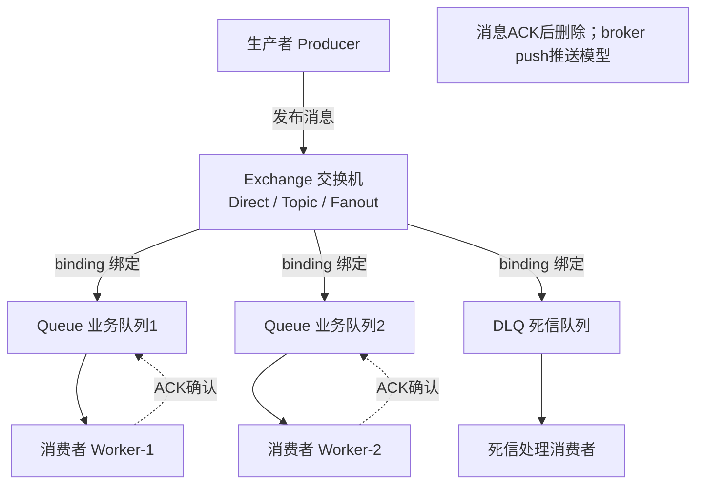
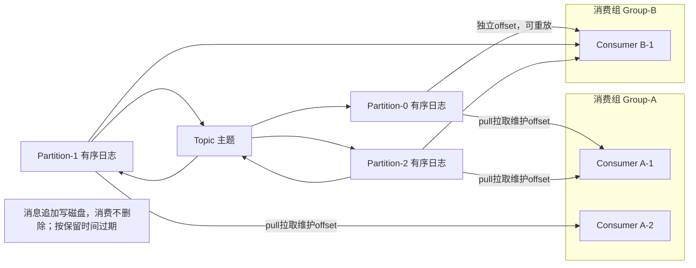
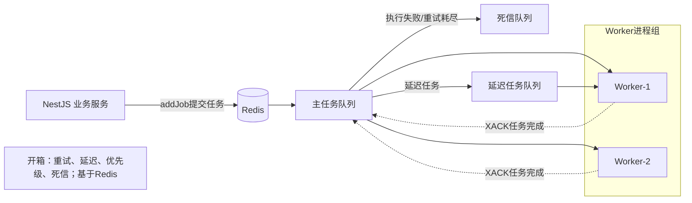
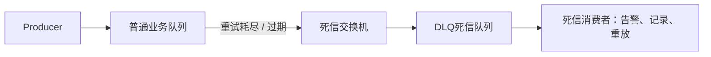
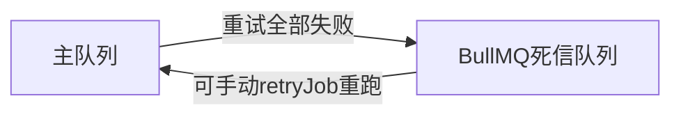

# 消息队列

1. RabbitMQ：业务任务队列（AMQP协议），Broker做路由推送，擅长人物解构，复杂路由、死信、延迟任务，**Push推送模型** 消费ACK后消息默认删除。

2. Kafka：流式日志平台，磁盘顺序写，高吞吐，pull拉取模型。消息消费完依旧磁盘留存，可以回溯重放。不擅长复杂业务路由。

3. BullMQ（redis-Stream）：Node轻量任务队列，基于Redis，专门为Job任务，重试，死信、延迟、优先级开箱即用。

## 核心指标对比表
|对比维度|RabbitMQ|Kafka|BullMQ|
|---|---|---|---|---|
|设计定位|业务消息中间件|分布式事件流平台|Node任务队列|
|模型|Push推送|Pull拉取|混合，任务驱动|
|吞吐量|单机万级/s|单机百万级/s|十万级（受Redis内存）|
|消息存储|消息ACK后删除，不长期保存|磁盘持久化，消费完依旧保留，支持回溯|Redis内存+持久化，堆积大容易OOM|
|路由能力|极强：direct/topic/fanout/header|弱，仅topic+partition key|简单，按队列名|
|死信/重试|原生支持DLQ|需要业务自己实现|开箱即用DLQ、重试、延迟任务|
|顺序性|单个队列有序|单个partition有序|单队列有序|
|运维复杂度|中等。自带web管理|高，集群调度复杂|极低，复用已有Redis|
|Nest集成|@nestjs/rabbitmq|@nestjs/kafka|@nestjs/bullmq|

## 关键概念区分
1， Push vs Pull
- RabbitMQ：Broker 主动推消息给消费者；消费者处理慢会压垮 Broker。
- Kafka：消费者主动拉取，可以自己控制消费速率，不怕消费慢，消息存在磁盘

2. 消息是否删除
RabbitMQ：ACK 之后消息删除，不能重新消费历史消息。
Kafka：消息不管消费与否，等到保留时间才删除，可以修改 offset 重放几天前的数据。

3. 死信 DLQ
- RabbitMQ 原生支持；BullMQ 原生支持；Kafka 没有原生 DLQ，业务代码捕获异常把失败消息写入新 topic。

选型一句话总结
业务异步任务、定时、重试死信，Nest+Redis → BullMQ
微服务复杂业务路由，多语言，独立中间件 → RabbitMQ
日志采集、大数据流、海量事件，需要多组消费者重放历史 → Kafka

死信DLQ:
> 通俗：正常队列处理不了的消息，扔到死信队列，留着人工排查/补偿；直接丢弃会丢业务数据
什么消息会变成死信

1. 重试次数耗尽
2. 消息过期：设置了过期时间，一直没人消费
3. 队列满了，消息无法入队
4. 消息被拒绝，不允许宠你像你返回原队列

RabbitMQ原生支持死信，给普通队列配置`dead-letter-exchange` 当消息变成死信，自动转发到死信交换机，路由到DLQ队列
- 需要单独写消费者监听DLQ：告警、记录数据库、人工修复后重新投递

BullMQ
> 适合：AI调用报错、计划提醒任务异常、不会直接丢任务
