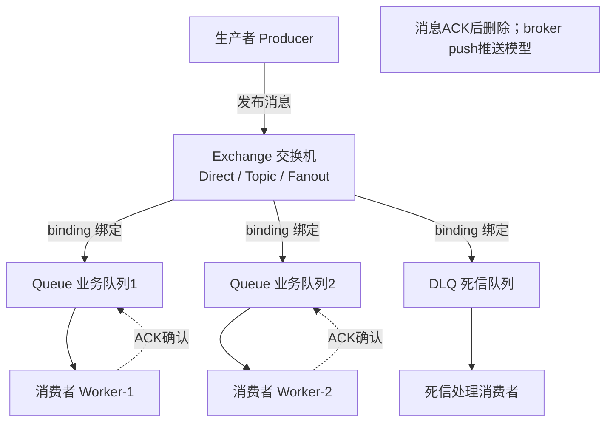
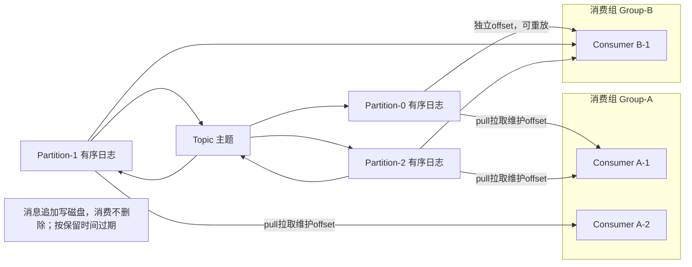
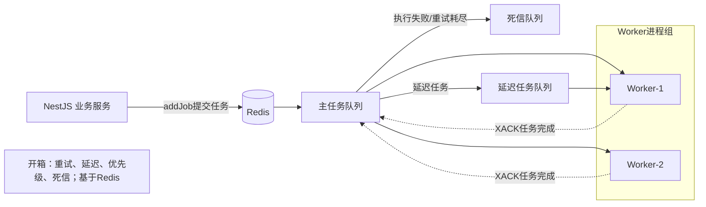
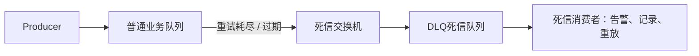
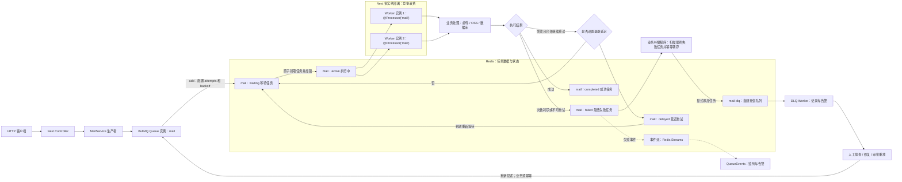
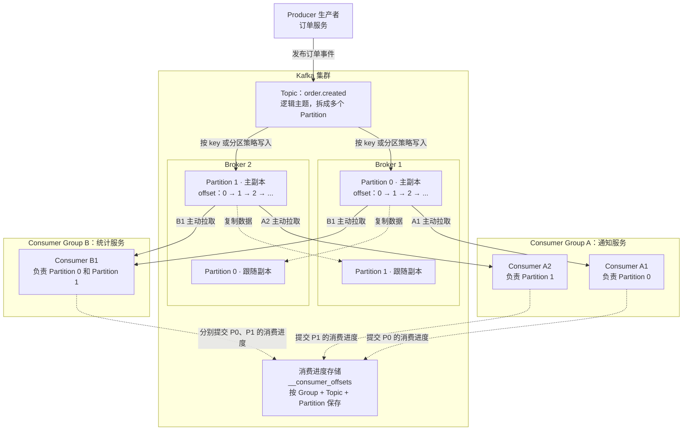

# 消息队列

1. RabbitMQ：业务任务队列（AMQP协议），Broker做路由推送，擅长人物解构，复杂路由、死信、延迟任务，**Push推送模型** 消费ACK后消息默认删除。


2. Kafka：流式日志平台，磁盘顺序写，高吞吐，pull拉取模型。消息消费完依旧磁盘留存，可以回溯重放。不擅长复杂业务路由。



3. BullMQ（redis-Stream）：Node轻量任务队列，基于Redis，专门为Job任务，重试，死信、延迟、优先级开箱即用。



## 核心指标对比表
|对比维度|RabbitMQ|Kafka|BullMQ|
|---|---|---|---|
|设计定位|业务消息中间件|分布式事件流平台|Node任务队列|
|模型|Push推送|Pull拉取|混合，任务驱动|
|吞吐量|单机万级/s|单机百万级/s|十万级（受Redis内存）|
|消息存储|消息ACK后删除，不长期保存|磁盘持久化，消费完依旧保留，支持回溯|Redis内存+持久化，堆积大容易OOM|
|路由能力|极强：direct/topic/fanout/header|弱，仅topic+partition key|简单，按队列名|
|死信/重试|原生支持DLQ|需要业务自己实现|开箱即用DLQ、重试、延迟任务|
|顺序性|单个队列有序|单个partition有序|单队列有序|
|运维复杂度|中等。自带web管理|高，集群调度复杂|极低，复用已有Redis|
|Nest集成|@nestjs/rabbitmq|@nestjs/kafka|@nestjs/bullmq|

## 关键概念区分
1， Push vs Pull
- RabbitMQ：Broker 主动推消息给消费者；消费者处理慢会压垮 Broker。
- Kafka：消费者主动拉取，可以自己控制消费速率，不怕消费慢，消息存在磁盘

2. 消息是否删除
RabbitMQ：ACK 之后消息删除，不能重新消费历史消息。
Kafka：消息不管消费与否，等到保留时间才删除，可以修改 offset 重放几天前的数据。

3. 死信 DLQ
- RabbitMQ 原生支持；BullMQ 原生支持；Kafka 没有原生 DLQ，业务代码捕获异常把失败消息写入新 topic。

选型一句话总结
业务异步任务、定时、重试死信，Nest+Redis → BullMQ
微服务复杂业务路由，多语言，独立中间件 → RabbitMQ
日志采集、大数据流、海量事件，需要多组消费者重放历史 → Kafka


死信DLQ:
> 通俗：正常队列处理不了的消息，扔到死信队列，留着人工排查/补偿；直接丢弃会丢业务数据
什么消息会变成死信

1. 重试次数耗尽
2. 消息过期：设置了过期时间，一直没人消费
3. 队列满了，消息无法入队
4. 消息被拒绝，不允许宠你像你返回原队列

RabbitMQ原生支持死信，给普通队列配置`dead-letter-exchange` 当消息变成死信，自动转发到死信交换机，路由到DLQ队列
- 需要单独写消费者监听DLQ：告警、记录数据库、人工修复后重新投递


### BullMQ
> 适合：AI调用报错、计划提醒任务异常、不会直接丢任务

#### 完整示例
```shell
npm install @nestjs/bullmq bullmq
```
> 架构说明：
> 1.Redis 作为消息存储中心，**生产者和 Worker 可以部署在不同服务 / 多实例**
> 2.多 Worker 竞争消费任务，自动负载均衡，不会重复消费
> 3.任务失败 → 自动重试；重试耗尽 → 进入死信队列，用于告警人工处理
app.module.ts 全局注册 BullMQ 连接 + 注册队列
```js
import { Module } from '@nestjs/common';
import { BullModule } from '@nestjs/bullmq';
import { MailConsumer } from './mail/mail.consumer';
import { MailService } from './mail/mail.service';

@Module({
  imports: [
    BullModule.forRoot({
      connection: {
        host: 'localhost',
        port: 6379,
        // password: 'xxx', // 生产redis密码
      },
    }),
    // 注册主队列 mail
    BullModule.registerQueue({
      name: 'mail',
    }),
    // 注册死信队列
    BullModule.registerQueue({
      name: 'mail-dlq',
    }),
  ],
  providers: [MailService, MailConsumer],
  controllers: [],
})
export class AppModule {}
```
生产者 service：mail.service.ts（入队任务） 
```js
import { Injectable } from '@nestjs/common';
import { InjectQueue } from '@nestjs/bullmq';
import { Queue } from 'bullmq';

@Injectable()
export class MailService {
  constructor(
    @InjectQueue('mail') private readonly mailQueue: Queue,
  ) {}

  /**
   * 发送邮件任务入队
   */
  async addSendEmailJob(to: string, title: string) {
    const job = await this.mailQueue.add(
      'send-email',
      { to, title }, // job业务数据
      {
        attempts: 3, // 总共尝试3次（首次执行 + 2次重试）
        backoff: {
          type: 'exponential', // 指数退避 1s → 2s →4s
          delay: 1000,
        },
        // 重试全部失败后转入死信队列
        deadLetterQueue: {
          name: 'mail-dlq',
        },
        removeOnComplete: { count: 100, age: 24 * 3600 }, // 成功任务保留24h，最多100条
        removeOnFail: { count: 500 },
      },
    );
    console.log('任务入队成功 jobId: ', job.id);
    return job;
  }

  // 延迟任务：10s后执行
  async addDelayEmailJob() {
    return this.mailQueue.add('send-email', { to:'test@xx.com', title:'延迟通知' }, { delay: 10000 })
  }

  // cron定时任务 每分钟执行
  async addCronJob() {
    return this.mailQueue.add('report', {}, { repeat: { pattern: '* * * * *' } })
  }
}
```
消费者 mail.consumer.ts
```js
import { Processor, WorkerHost, OnQueueCompleted, OnQueueFailed, OnQueueActive } from '@nestjs/bullmq';
import { Job } from 'bullmq';
import { Injectable } from '@nestjs/common';

@Processor('mail') // 监听mail队列
@Injectable()
export class MailConsumer extends WorkerHost {
  // 实际任务处理入口
  async process(job: Job<{ to: string; title: string }>) {
    switch (job.name) {
      case 'send-email':
        console.log(`开始发送邮件: ${job.data.to}`);
        // 模拟业务，随机抛出异常测试重试
        if (Math.random() < 0.4) {
          throw new Error('邮件服务商临时失败');
        }
        await this.sendEmail(job.data.to, job.data.title);
        return { success: true };
      case 'report':
        console.log('执行定时报表任务');
        return;
    }
  }

  private async sendEmail(to: string, title: string) {
    // 真实调用邮件SDK
    console.log(`send email to ${to}, title:${title}`);
  }

  // ========== 队列事件监听 ==========
  @OnQueueActive()
  onActive(job: Job) {
    console.log(`任务开始执行: ${job.id}`);
  }

  @OnQueueCompleted()
  onCompleted(job: Job, result: any) {
    console.log(`任务成功 ${job.id}, 返回结果`, result);
  }

  @OnQueueFailed()
  onFailed(job: Job, err: Error) {
    console.log(`任务失败 ${job.id}, reason: ${err.message}, 已尝试次数:${job.attemptsMade}`);
  }
}
```
调用测试（Controller）
```js
import { Controller, Get } from '@nestjs/common';
import { MailService } from './mail/mail.service';

@Controller()
export class AppController {
  constructor(private readonly mailService: MailService) {}
  @Get('add-job')
  async add() {
    await this.mailService.addSendEmailJob('user@test.com', '订单通知');
    return '任务已入队';
  }
}
```
死信队列消费者（单独处理彻底失败任务）
```js
@Processor('mail-dlq')
export class MailDlqConsumer extends WorkerHost {
  async process(job: Job) {
    console.log('死信任务，人工排查：', job.id, job.data, job.failedReason);
    // 可以在这里告警，或者手动重放回原队列
  }
}
```
#### BullMQ JobFlow
> JobFlow 用来编排**有依赖关系的任务**
> 1.父任务执行完，**才启动子任务**；
> 2.多个子任务**并行执行**；
> 3.子任务全部完成后，还可以跑收尾任务；
> 4.子任务失败，父 / 整个流可以配置是否终止；
> 5.子任务能拿到父任务的返回结果。
>
> 适用场景：创建订单 → 扣库存 (并行) → 生成支付单 → 发送通知
> 文件处理：上传文件 → 解析内容 → 生成缩略图（并行多个尺寸）→ 打包推送消息

示例1:父任务执行完后，子任务并行执行
```js
import { Processor, WorkerHost } from '@nestjs/bullmq';
import { Job } from 'bullmq';

@Processor('workflow')
export class FlowConsumer extends WorkerHost {
  async process(job: Job) {
    console.log(`[${job.name}] jobId:${job.id}, data:`, job.data);

    switch (job.name) {
      case 'step-1-create-order':
        console.log('步骤1：创建订单');
        // 返回值可以被子任务拿到
        return { orderId: 'ORD_10001' };

      case 'step-2-deduct-stock':
        console.log('步骤2：扣库存，父任务结果', job.parent?.returnvalue);
        return { stockOk: true };

      case 'step-3-send-notify':
        console.log('步骤3：发送通知，拿到前面所有结果');
        return { notify: 'ok' };
    }
  }
}
```
```js
import { Injectable } from '@nestjs/common';
import { InjectFlowProducer } from '@nestjs/bullmq';
import { FlowProducer } from 'bullmq';

@Injectable()
export class FlowService {
  constructor(
    @InjectFlowProducer('workflow') private readonly flowProducer: FlowProducer,
  ) {}

  async createOrderFlow() {
    // 构建任务流
    const flow = await this.flowProducer.add({
      name: 'step-1-create-order',
      data: { goodsId: 999, userId: 123 },
      // 子任务数组，父成功之后才会执行
      children: [
        {
          name: 'step-2-deduct-stock',
          data: { goodsId: 999 },
          queueName: 'workflow',
        },
        {
          name: 'step-3-send-notify',
          data: { userId: 123 },
          queueName: 'workflow',
        },
      ],
    });

    console.log('flow根任务id：', flow.job.id);
    return flow;
  }
}
```
进阶：多层嵌套子任务（子任务还可以有自己的 children）
> parent 执行完 → childA 启动 ;     childA 执行完 → grandChild 启动
```js
const flow = await this.flowProducer.add({
  name: 'parent',
  data: {},
  children: [
    {
      name: 'childA',
      data: {},
      queueName: 'workflow',
      children: [
        { name: 'grandChild', data: {}, queueName: 'workflow' },
      ],
    },
  ],
});
```
#### 生产要点
📌 Redis 相关（最高优先级）
1.**Redis 宕机风险** BullMQ 全部任务存储在 Redis。如果 Redis 宕机：生产者 addJob 直接报错；Worker 无法消费。
- 开启 Redis AOF+RDB 持久化，防止断电丢任务；
- 生产建议 Redis 主从 / 哨兵，不要单机裸 Redis；
- Redis 丢失数据 = 队列任务全部丢失。
2.Redis内存打爆。任务堆积（Worker 处理不过来），大量 Job 占 Redis 内存。
- 设置 `removeOnComplete / removeOnFail`，不要无限保存历史 job；
- 监控队列 waiting /active/failed 数量；堆积过高告警。
3.Redis Cluster 支持：BullMQ 原生支持 Cluster，但是 key 需要 hash tag。

📌 Worker & 任务可靠性
1. **业务必须幂等** Worker 崩溃 stall 会重跑任务；多实例场景 job 可能重复执行。
> 比如：扣款、发短信，不能直接执行；建议每个 job 携带业务唯一 bizId，执行前先判断是否已经处理完成。
2. 任务不能是超长阻塞任务.单个任务不要跑几小时；如果耗时极长，尽量拆分成多个子 Job（Job Flow 任务流）。
> 长时间运行的任务容易被判定 stall，触发不必要重试。
3. `maxConcurrency` 并发控制.Worker 不要无限制并发，防止瞬间打满数据库、外部 API 连接池。
```js
// 注册队列，限制worker最多同时跑8个任务
BullModule.registerQueue({
  name:'mail',
  workerOptions:{
    maxConcurrency:8
  }
})
```
4.队列拆分隔离
- 短快任务（发通知）、慢重任务（视频转码、大报表）**分到不同队列**。
如果全部塞同一个队列，慢任务会阻塞紧急小任务。

总结
1. ✅生产者、Worker 可以分开部署：**同一机器不同进程，或者完全不同服务器，只要共用一套 Redis**。
2. Worker 挂掉：正在执行任务 stall，任务退回队列，存活 worker 重新执行；全部 worker 挂，任务保存在 Redis 等待恢复。
3. DLQ 就是普通 Queue；DLQ 消费者挂，任务堆积 Redis，恢复后消费；可以写代码手动重放死信任务。
4. 生产最大风险来源：Redis 丢失数据、任务没有幂等导致重复执行、任务堆积打爆 Redis、快慢任务共用队列互相阻塞。


### Kafka
> Kafka 的一条铁律：**同一个消费者组里，1 个分区 最多只能分配给组内 1 个 consumer 实例**。
> 分区是消息并行的最小单元。分区数决定了这个消费组最多能有多少个并发消费实例。

> 多个系统共同使用的“持续追加的事件记录簿”。 业务不断把发生的事情写进去，其他系统按自己的进度读取，处理后还可以回头重读。
比如订单服务持续产生：
```
10:00 订单 A 已创建
10:01 订单 B 已创建
10:02 订单 A 已支付
10:03 订单 B 已取消
……不断有新事件进来
```

分布式流平台的理解
1. 流：持续记录发生的事件。“订单已支付”是一条事件。通知服务读到它可以发消息，统计服务读到它可以计算销售额。同一份事件可以服务多个用途。
2. 分布式：多台服务器共同存储和读取。Kafka 服务器叫 Broker。订单事件归入 orders 这个 Topic（主题），主题再拆成多个 Partition（分区），分布到不同 Broker，分摊读写压力。分区还可以保存副本，用于故障恢复。
3. 平台：把事件发布、存储、订阅和持续处理连接起来。
订单服务负责发布，Kafka 保存事件，各个消费应用独立处理；实时统计等计算由消费应用或 Kafka Streams 这样的处理库完成。


#### 代码示例
```shell
npm i @nestjs/microservices kafkajs
```
初始化脚本 scripts/create-order-topic.mjs：
```ts
import { Kafka } from 'kafkajs';

const kafka = new Kafka({
  clientId: 'topic-admin',
  brokers: (process.env.KAFKA_BROKERS ?? 'localhost:9092').split(','),
});

const admin = kafka.admin();
const replicationFactor = Number(process.env.KAFKA_REPLICATION_FACTOR ?? 1);

try {
  await admin.connect();

  const created = await admin.createTopics({
    waitForLeaders: true,
    topics: [
      {
        topic: 'orders.lifecycle',
        numPartitions: 4, // P0、P1、P2、P3
        replicationFactor,
        configEntries: [
          // 本地单副本允许 1；多副本示例要求至少 2 个同步副本。
          // 配合 acks: -1，仍需等待当前 ISR 中的全部副本确认。
          { name: 'min.insync.replicas', value: String(Math.min(2, replicationFactor)) },
        ],
      },
    ],
  });

  console.log(created ? 'Topic 已创建' : 'Topic 已存在');

  const metadata = await admin.fetchTopicMetadata({
    topics: ['orders.lifecycle'],
  });

  console.dir(metadata, { depth: null });
} finally {
  await admin.disconnect();
}
```
运行
```Bash
# 本地已有一个 Kafka Broker：使用 1 个副本
node scripts/create-order-topic.mjs

# 至少有 3 个可用 Broker 的集群：使用 3 个副本
KAFKA_BROKERS=kafka1:9092,kafka2:9092,kafka3:9092 \
KAFKA_REPLICATION_FACTOR=3 \
node scripts/create-order-topic.mjs
```
2. 订单服务：用订单 ID 决定分区

下面是一个用于观察分区行为的 HTTP 发布示例，省略真实订单数据库和支付流程。

`src/orders.module.ts`
```ts
import {
  Controller,
  Inject,
  Module,
  OnModuleDestroy,
  OnModuleInit,
  Param,
  Post,
} from '@nestjs/common';
import {
  ClientKafka,
  ClientsModule,
  Transport,
} from '@nestjs/microservices';
import { Partitioners } from 'kafkajs';
import { firstValueFrom } from 'rxjs';
import { randomUUID } from 'node:crypto';

const TOPIC = 'orders.lifecycle';

@Controller('orders')
class OrdersController implements OnModuleInit, OnModuleDestroy {
  constructor(
    @Inject('ORDER_KAFKA')
    private readonly kafka: ClientKafka,
  ) {}

  async onModuleInit() {
    await this.kafka.connect();
  }

  async onModuleDestroy() {
    await this.kafka.close();
  }

  @Post(':orderId/created')
  created(@Param('orderId') orderId: string) {
    return this.publish(orderId, 'ORDER_CREATED');
  }

  @Post(':orderId/paid')
  paid(@Param('orderId') orderId: string) {
    return this.publish(orderId, 'ORDER_PAID');
  }

  private async publish(orderId: string, type: string) {
    const event = {
      eventId: randomUUID(),
      orderId,
      type,
      occurredAt: new Date().toISOString(),
    };

    await firstValueFrom(
      this.kafka.emit(TOPIC, {
        key: orderId, // 关键：相同订单使用相同 key
        value: event,
      }),
    );

    return { published: true, event };
  }
}

@Module({
  imports: [
    ClientsModule.register([
      {
        name: 'ORDER_KAFKA',
        transport: Transport.KAFKA,
        options: {
          client: {
            clientId: 'orders-producer',
            brokers: (
              process.env.KAFKA_BROKERS ?? 'localhost:9092'
            ).split(','),
          },

          // 只发事件，不启动用于接收 RPC 响应的消费者
          producerOnlyMode: true,

          producer: {
            allowAutoTopicCreation: false, // Topic 不存在时，不请求自动创建；应该提前创建好 ｜ true：允许自动创建，但还需要 Broker 允许自动创建。
            createPartitioner: Partitioners.DefaultPartitioner, // 默认分区器-分区器会优先使用消息中的 partition；没有显式指定时，再根据 key 计算分区 ｜ MyPartitioner-自定义
          },

          send: { // 生产者等到什么程度，才认为写入成功
            acks: -1, // 0-不等待 Broker 确认，无法据此确认消息是否成功写入。 ｜ 1-Leader 写入后确认，不等待 Follower 复制完成。 ｜ -1-等待当前 ISR 中的副本确认，也是 KafkaJS 的默认值
          },
        },
      },
    ]),
  ],
  controllers: [OrdersController],
})
export class OrdersModule {}
```
`src/main.ts`
```ts
import { NestFactory } from '@nestjs/core';
import { OrdersModule } from './orders.module';

async function bootstrap() {
  const app = await NestFactory.create(OrdersModule);
  app.enableShutdownHooks();
  await app.listen(3000);
}

bootstrap();
```
默认分区器会根据 key 选择分区。分区数量、key 编码和分区策略不变时，同一订单的事件进入同一分区。 不要假定 "A" 一定映射到 P0，实际结果看消费者日志。

3. 通知服务：配置消费者组的分区分配策略

以下放在独立的通知服务 Nest 项目中。 `src/notification.module.ts`
```ts
import { Controller, Module } from '@nestjs/common';
import {
  Ctx,
  EventPattern,
  KafkaContext,
  Payload,
} from '@nestjs/microservices';

interface OrderEvent {
  eventId: string;
  orderId: string;
  type: string;
  occurredAt: string;
}

@Controller()
class NotificationController {
  @EventPattern('orders.lifecycle')
  async handleOrder(
    @Payload() event: OrderEvent,
    @Ctx() context: KafkaContext,
  ) {
    const message = context.getMessage();
    const partition = context.getPartition();
    const topic = context.getTopic();

    // 示例中的业务处理：输出日志
    console.log({
      instance: process.env.INSTANCE_ID,
      topic,
      partition,
      offset: message.offset,
      key: message.key?.toString(),
      event,
    });

    // 实际项目：在这里 await 业务处理完成。
    // 使用 eventId 做持久化幂等；处理失败应抛出异常。

    // 成功后保存“下一条要读取的位置”
    await context.getConsumer().commitOffsets([
      {
        topic,
        partition,
        offset: (BigInt(message.offset) + 1n).toString(),
      },
    ]);
  }
}

@Module({
  controllers: [NotificationController],
})
export class NotificationModule {}
```

`src/main.ts`
```ts
import { NestFactory } from '@nestjs/core';
import {
  MicroserviceOptions,
  Transport,
} from '@nestjs/microservices';
import { PartitionAssigners } from 'kafkajs';
import { NotificationModule } from './notification.module';

async function bootstrap() {
  const app =
    await NestFactory.createMicroservice<MicroserviceOptions>(
      NotificationModule,
      {
        transport: Transport.KAFKA,
        options: {
          client: {
            clientId: `notification-${process.env.INSTANCE_ID ?? '1'}`,
            brokers: (
              process.env.KAFKA_BROKERS ?? 'localhost:9092'
            ).split(','),
          },

          consumer: {
            // 同一个服务的多个实例使用相同 groupId
            groupId: 'order-notification',
            allowAutoTopicCreation: false, // 控制是否允许在查询不存在的 Topic 时请求自动创建，不控制是否创建消费者组。

            // 把分区轮流分配给组内消费者
            partitionAssigners: [PartitionAssigners.roundRobin], // 【 MyCustomAssigner，PartitionAssigners.roundRobin】
          },

          subscribe: {
            // 没有有效已提交进度时，从最早保留的数据开始
            fromBeginning: true,
          },

          run: {
            autoCommit: false, // 上面的 handler 手动提交
            partitionsConsumedConcurrently: 2, // 表示一个实例最多并发处理两个分区，不是创建两个分区。同一分区内的消息仍按顺序交给 handler；业务操作要 await，不要启动后立即返回。
          },
        },
      },
    );

  app.enableShutdownHooks();
  await app.listen();
}

bootstrap();
```

4.启动两个消费者，观察分区和offset
```Bash
INSTANCE_ID=1 npm run start

# 另一个终端
INSTANCE_ID=2 npm run start
```
然后向订单服务发送事件
```Bash
curl -X POST http://localhost:3000/orders/A/created
curl -X POST http://localhost:3000/orders/A/paid
curl -X POST http://localhost:3000/orders/B/created
curl -X POST http://localhost:3000/orders/B/paid
```
可能的结果
```
实例 1：partition=0 offset=0 key=A ORDER_CREATED
实例 1：partition=0 offset=1 key=A ORDER_PAID

实例 2：partition=1 offset=0 key=B ORDER_CREATED
实例 2：partition=1 offset=1 key=B ORDER_PAID
```
5.是否可以指定分区
```ts
await firstValueFrom(
  this.kafka.emit('orders.lifecycle', {
    partition: 2, // 明确写入 P2，优先于按 key 计算
    key: orderId,
    value: event,
  }),
);
```

KafkaContext 里面有什么（@Ctx () 拿到）
```ts
// ctx 是事件处理方法通过 @Ctx() 注入的 KafkaContext。
ctx.getMessage(); // kafkajs原始消息对象：value, headers, key, timestamp
ctx.getTopic(); // 当前消息所在topic名称
ctx.getPartition(); // 分区号
ctx.getMessage().offset; // offset位移（字符串）
ctx.getConsumer(); // kafkajs consumer实例
```
选型建议
1. 业务是**异步事件、日志、消息通知**：优先 `emit / @EventPattern`，纯 kafka 事件，没有回复 topic，简单稳定。
2. 必须**同步等待返回结果**（像调用接口拿到计算结果）：才使用 `send / @MessagePattern`，注意回复 topic 分区配置问题。
3. Kafka 天然适合事件驱动，**不推荐大量使用 messagePattern RPC**，这个是 Nest 封装出来的，不是 kafka 原生能力，有额外开销。
