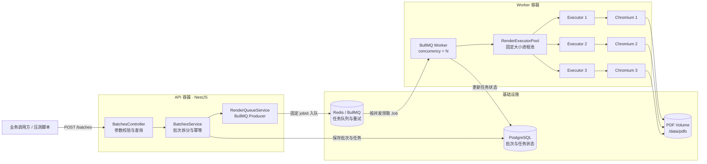
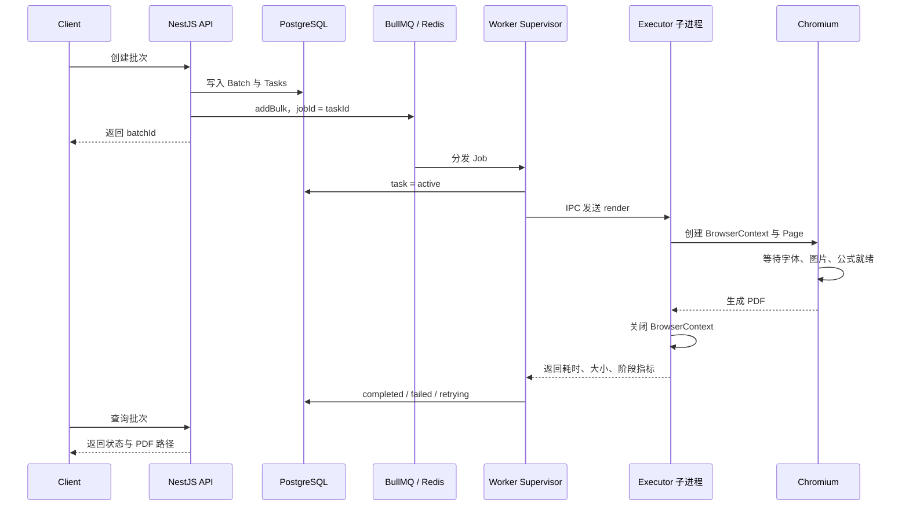
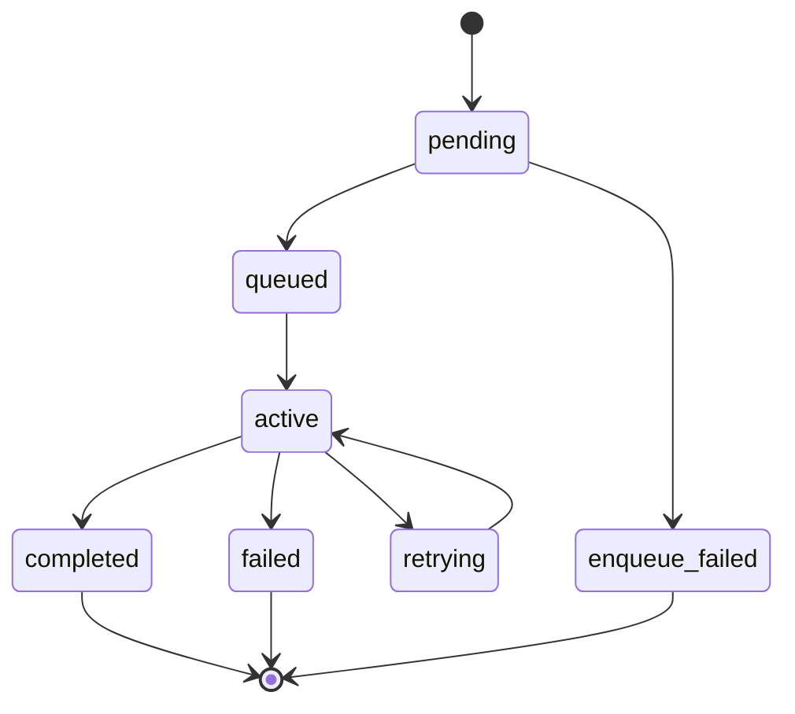

# PDF Render Service：可观测的批量 PDF 渲染服务

基于 NestJS、BullMQ、PostgreSQL 和 Puppeteer/Chromium 实现的批量 PDF 渲染服务。项目重点解决复杂 HTML 试卷在 Linux 环境下的并发调度、进程隔离、资源就绪判断、硬超时回收、失败重试和容量评估问题。

- 项目地址：[github.com/hxh-ly/pdf-render-service](https://github.com/hxh-ly/pdf-render-service)

> 本项目提供完整的 Docker Compose 运行环境、真实长试卷 heavy 模板、并发压测脚本、故障注入，以及 JSON、CSV、Markdown 三种测试报告。

## 项目成果

在 4C8G 容器配额下，使用 61 页、约 5.66MB 的数学试卷 PDF 作为重型负载，对并发 1～4 进行阶梯压测：

- 并发 3 获得最高有效吞吐，20 任务吞吐为 25.65 jobs/min；
- 并发 4 出现明显 CPU throttling，吞吐反而下降至 22.90 jobs/min，p95 上升至 10.62 秒；
- 最终选定 `WORKER_CONCURRENCY=3`；
- 并发 3 下持续执行 60 个 heavy 任务，60/60 成功；
- 持续测试吞吐 28.97 jobs/min，p95 6.44 秒，无 OOM、OOM kill 和 `memory.max` 事件；
- 按 70% 目标利用率，形成约 20 jobs/min、约 1200 jobs/hour 的容量基线。

该容量基线来自本地 Docker cgroup 配额测试。正式生产部署前，仍应在相同规格 Linux 机器上进行 30～60 分钟持续复测。

## 背景与目标

传统 `wkhtmltopdf` 或直接在主进程中启动浏览器的实现，常见问题包括：

- 高峰期无限创建 Chromium，导致整机 OOM；
- 单个页面卡死后长期占用 Worker 和浏览器进程；
- 固定延时无法准确判断字体、图片和数学公式是否已经完成渲染；
- 批量任务缺少统一状态、失败分类和结果汇总；
- 只看应用日志，无法区分 V8 OOM、容器 OOM、Chromium 崩溃和 CPU throttling；
- 无法根据机器规格回答“应该配置多少并发”。

本项目的目标不是单纯把 HTML 转成 PDF，而是建立完整的任务闭环：

```text
可接收 → 可排队 → 可隔离 → 可超时 → 可回收 → 可重试
       → 可追踪 → 可压测 → 可评估容量
```

## 技术栈

- API：Node.js 22、NestJS 11、TypeScript
- 队列：BullMQ 5、Redis 7
- 状态存储：PostgreSQL 17、TypeORM
- 渲染：Puppeteer Core、Chromium、KaTeX
- 进程隔离：`child_process.fork()`、独立进程组、IPC
- 部署：Docker、Docker Compose、cgroup v2
- 测试与报告：Jest、自定义 Node.js 压测脚本

## 总体架构



### 任务执行时序



## 分层设计

### 1. API 层

负责参数校验、批次幂等、任务拆分、状态查询和 PDF 下载，不参与 Chromium 渲染。

`clientRequestId` 在 PostgreSQL 中具有唯一约束。当调用方因网络超时重复提交时，API 返回已有批次，避免重复创建整批任务。

```ts
// src/batches/batches.service.ts（关键逻辑）
const existing = await batches.findOne({
  where: { clientRequestId: dto.clientRequestId },
});
if (existing) return get(existing.id);

const createdTasks = await tasks.save(createTasks(dto));
await queue.addBulk(createdTasks.map((task) => ({
  id: task.id,
  data: { taskId: task.id, batchId: batch.id, ...task.payload },
})));
```

### 2. 数据层

PostgreSQL 是业务状态真相源，保存两类实体：

- `render_batches`：批次状态、任务总数、成功数、失败数、原始请求；
- `render_tasks`：任务状态、尝试次数、错误码、各阶段耗时、PDF 路径和大小。

任务状态机：



### 3. 队列层

BullMQ 负责削峰、有限重试、指数退避和 stalled job 恢复。数据库任务主键同时作为 BullMQ `jobId`，结合固定 PDF 输出路径形成幂等边界。

```ts
// src/batches/render-queue.service.ts（关键逻辑）
defaultJobOptions: {
  attempts: 2,
  backoff: { type: 'exponential', delay: 2_000 },
  removeOnComplete: { age: 86_400, count: 5_000 },
  removeOnFail: { age: 604_800, count: 10_000 },
}

await queue.addBulk(tasks.map(({ id, data }) => ({
  name: 'render-pdf',
  data,
  opts: { jobId: id },
})));
```

BullMQ 提供的是 at-least-once 语义，因此业务上不能假设任务永远只执行一次。

### 4. Worker 调度层

BullMQ Worker 只负责维护队列锁、更新状态和调度任务，不在父进程中直接运行 Puppeteer。`WORKER_CONCURRENCY` 同时决定 BullMQ 并发数和 executor 池大小，避免队列并发与实际浏览器容量不一致。

```ts
const concurrency = envInt('WORKER_CONCURRENCY', 1);
const pool = new RenderExecutorPool(concurrency);

const worker = new Worker(queueName(), async (job) => {
  await taskRepository.update(job.data.taskId, { status: 'active' });
  const result = await pool.execute(job.data);
  await taskRepository.update(job.data.taskId, {
    status: 'completed',
    resultPath: result.outputPath,
    durationMs: result.durationMs,
    stageDurations: result.stages,
  });
}, { concurrency, lockDuration: 120_000 });
```

### 5. Executor 进程池

每个 slot 使用 `child_process.fork()` 创建独立 Node.js 子进程，并由该子进程管理一个 Chromium。单任务卡死、浏览器崩溃或 native 内存异常时，可以回收整个进程树，而不是只让 Promise 超时。

```ts
// src/worker/render-pool.ts（关键逻辑）
const child = fork(executorPath, [], {
  stdio: ['ignore', 'inherit', 'inherit', 'ipc'],
  detached: true,
  env: process.env,
});

const timer = setTimeout(() => {
  reject(new RenderPoolError('RENDER_HARD_TIMEOUT', 'Render timed out'));
  process.kill(-child.pid!, 'SIGTERM');
  setTimeout(() => process.kill(-child.pid!, 'SIGKILL'), 3_000);
}, hardTimeoutMs);
```

Executor 在以下情况自动回收并重建：

- 渲染硬超时；
- Chromium 断开或异常退出；
- executor 自身崩溃；
- 单个 executor 完成 `MAX_TASKS_PER_EXECUTOR` 个任务；
- 渲染返回不可恢复异常。

### 6. Chromium 渲染层

Executor 复用 Browser，降低每个任务重新启动 Chromium 的成本；每个任务创建独立 `BrowserContext` 和 `Page`，在 `finally` 中关闭上下文，避免 Cookie、缓存、页面对象和异常状态跨任务污染。

```ts
const context = await browser.createBrowserContext();
const page = await context.newPage();

try {
  await page.setContent(html, { waitUntil: 'domcontentloaded' });
  await page.waitForFunction(() =>
    document.documentElement.dataset.renderReady === 'true' &&
    Boolean(window.__PRINT_READY__),
  );
  await page.pdf({ path, format: 'A4', printBackground: true });
} finally {
  await context.close();
}
```

页面模板不使用固定 `sleep`，而是等待字体、图片和公式全部完成：

```js
Promise.all([
  document.fonts.ready,
  ...Array.from(document.images).map((image) =>
    image.complete
      ? Promise.resolve()
      : new Promise((resolve, reject) => {
          image.addEventListener('load', resolve, { once: true });
          image.addEventListener('error', reject, { once: true });
        }),
  ),
]).then(() => {
  window.__PRINT_READY__ = true;
  document.documentElement.dataset.renderReady = 'true';
});
```

## 为什么不使用 PM2

本项目采用容器化进程模型：API 与 Worker 运行在不同容器；BullMQ 负责排队、重试和 stalled job 恢复；Worker Supervisor 负责 executor 子进程拉起与回收；Docker restart policy 负责容器主进程异常后的重新启动。

容器内再运行 PM2 会产生双重守护，增加 PID 1、信号转发、优雅退出、日志和内存统计的解释成本。PM2 可以管理进程，但不能替代 Redis 持久队列、任务状态和重试语义。

## Docker Compose 服务

Compose 只保留四个运行时必要服务：

- `api`：NestJS HTTP API；
- `worker`：BullMQ Consumer、executor 子进程池和 Chromium；
- `postgres`：批次和任务状态；
- `redis`：BullMQ 队列、锁和重试数据。

没有额外运行 Prometheus、Grafana 或 exporter。压测脚本直接读取 Docker 与 cgroup 指标，降低本地示例的运行成本。

### 4C8G 资源边界

```text
Worker:     3 CPU / 4200MB / 1GB shm / 384 PIDs
API:        0.4 CPU / 512MB
PostgreSQL: 0.4 CPU / 768MB
Redis:      0.1 CPU / 256MB
```

这些限制用于建立故障边界，而不是保证永远不发生异常：

- CPU 超限：触发 cgroup throttling，延迟上升但通常不会杀进程；
- 内存超限：可能触发容器级 OOM，进程退出码通常为 137；
- `/dev/shm` 耗尽：可能导致 Chromium 页面崩溃或 `Target closed`；
- PIDs 达到上限：新的进程或线程创建失败。

总 CPU 限额为 3.9 核，容器内存限额合计约 5.7GB，其余资源留给 Linux/Docker 内核、页缓存、网络缓冲区和瞬时峰值。

## 项目目录

```text
pdf-render-service/
├── assets/                         # heavy试卷HTML、公式和图片资源
├── docs/system-architecture.mmd   # Mermaid架构源文件
├── reports/                       # 汇总报告；逐轮报告默认忽略
├── scripts/load-test.mjs          # 压测、Docker与cgroup采样
├── src/
│   ├── batches/                   # API、批次服务和BullMQ Producer
│   ├── common/                    # 环境配置与共享类型
│   ├── database/                  # 实体、迁移和数据源
│   └── worker/                    # Worker、进程池、Executor和模板
├── docker-compose.yml
├── Dockerfile
├── .env.2c4g
├── .env.4c8g
└── 压测.md
```

## 快速开始

### 环境要求

- Docker Desktop 或 Docker Engine 24+
- Docker Compose v2
- 本地开发时需要 Node.js 22、pnpm 10

### 2C4G 配置启动

```bash
git clone https://github.com/hxh-ly/pdf-render-service.git
cd pdf-render-service
docker compose --env-file .env.2c4g up -d --build
```

### 4C8G 配置启动

```bash
docker compose --env-file .env.4c8g up -d --build
docker compose --env-file .env.4c8g ps
```

服务启动后可访问：

- 健康检查：`http://localhost:3000/health`
- 队列状态：`http://localhost:3000/queue`

查看日志和资源：

```bash
docker compose logs -f api worker
docker stats
```

停止容器但保留数据库、Redis 和 PDF volume：

```bash
docker compose down
```

`docker compose down -v` 会删除数据库、队列和 PDF 数据卷，只应在确定不需要数据时执行。

## API 使用

### 创建批次

```bash
curl -sS -X POST http://localhost:3000/batches \
  -H 'content-type: application/json' \
  -d '{
    "clientRequestId": "interview-demo-001",
    "taskCount": 20,
    "title": "九年级数学综合测试",
    "difficulty": "medium"
  }'
```

### 查询批次

```bash
curl -sS http://localhost:3000/batches/<batchId>
```

返回内容包含批次状态、各状态任务数量、任务耗时、尝试次数、错误码、PDF 大小和结果路径。

### 下载 PDF

```text
http://localhost:3000/files/<taskId>.pdf
```

## Heavy 模板

Heavy 模板来源于完整数学试题的 HTML 导出，包含：

- 61 页 A4 输出；
- 300 余个公式和插图资源；
- 中文字体、图片和长文档分页；
- 额外 96 个 KaTeX 公式 DOM；
- 所有本地图片转换为 Data URI，避免外部网络影响压测；
- 字体、图片和公式全部就绪后才允许打印。

运行 20 个 heavy 任务：

```bash
pnpm install
pnpm load:test -- \
  --count 20 \
  --difficulty heavy \
  --title "广东省深圳市深圳实验学校2025-2026学年七年级下学期期末考试数学试题" \
  --timeout 600
```

## 压测方法

### 阶梯测试

在相同 heavy 模板、任务数和 Docker 配额下，仅改变 Worker 并发：

```bash
WORKER_CONCURRENCY=1 docker compose --env-file .env.4c8g up -d --no-deps --force-recreate worker
pnpm load:test -- --count 20 --difficulty heavy --timeout 600

# 将并发依次调整为2、3、4，每档重新创建Worker并重复测试。
```

每一档记录成功率、墙钟时间、jobs/min、p50/p95/p99、各容器 CPU/内存/PIDs、Worker cgroup CPU/内存事件，以及容器退出码和 `OOMKilled`。

### 阶梯压测结果

| 并发 | 成功率 | 墙钟时间 | 吞吐 | p50 | p95 | cgroup内存峰值 | PIDs峰值 | CPU throttled |
| ---: | ---: | ---: | ---: | ---: | ---: | ---: | ---: | ---: |
| 1 | 100% | 85.37s | 14.06 jobs/min | 3.96s | 4.37s | 973MiB | 94 | 0.83s |
| 2 | 100% | 59.07s | 20.31 jobs/min | 4.80s | 6.74s | 1699MiB | 171 | 8.61s |
| 3 | 100% | 46.78s | 25.65 jobs/min | 5.74s | 8.36s | 2472MiB | 252 | 26.05s |
| 4 | 100% | 52.41s | 22.90 jobs/min | 9.02s | 10.62s | 3470MiB | 333 | 86.14s |

并发 2 相对并发 1 吞吐提高约 44.5%；并发 3 相对并发 2 再提高约 26.3%。并发 4 相对并发 3 吞吐下降约 10.7%，同时 p95、内存和 CPU throttling 显著增加，因此不应继续增加单 Worker 并发。

### 持续验证结果

候选并发确定为 3 后，执行 60 个 heavy 任务：

```text
成功率                 100%（60/60）
批次墙钟时间           124.27s
吞吐                   28.97 jobs/min
p50 / p95 / max        5.81s / 6.44s / 6.62s
Docker内存峰值         2387MiB
cgroup内存峰值         2732MiB
PIDs峰值               257 / 384
memory.events.max      0
memory.events.oom      0
memory.events.oom_kill 0
容器OOMKilled          false
```

20 任务和 60 任务的吞吐存在差异，主要来自 Browser 启动、容器预热、批次创建和轮询等固定成本；容量评估优先采用更长时间、更多任务的稳定阶段数据。

## 容量评估

并发选择同时受内存、CPU 和业务延迟约束：

```text
C_mem = floor((Worker内存上限 × 0.70 - Worker基线内存) / 单任务增量内存p95)

C_final = min(
  C_mem,
  CPU未进入吞吐下降区的并发,
  p95满足业务SLO的并发
)
```

本次结果确认：

- 4C8G、单 Worker 推荐 `WORKER_CONCURRENCY=3`；
- 若业务要求 p95 必须低于 7 秒，可选择并发 2；
- 若优先考虑整批吞吐，并允许约 8 秒 p95，则选择并发 3；
- 实测峰值吞吐为 28.97 jobs/min；
- 按 70% 目标利用率，安全容量基线约为 20 jobs/min、约 1200 jobs/hour；
- 峰值到达率长期高于安全容量时，BullMQ waiting 队列会持续增长，应增加 Worker 实例，而不是继续提高单 Worker 并发。

这里的“安全容量”是基于现有 60 任务测试的工程基线，不应包装成生产 SLA。正式容量确认还需要真实 Linux 4C8G、业务模板分布、网络资源源和 30～60 分钟持续测试。

## 压测报告

每次执行 `pnpm load:test` 会在 `reports/` 生成：

- JSON：完整汇总、任务明细、Docker 采样、cgroup 和 OOM 数据；
- CSV：逐任务状态、尝试次数、耗时、PDF 大小和错误码；
- Markdown：便于复盘和归档的可读报告。

压测脚本读取的数据来源：

```text
docker stats                CPU、容器内存、内存比例、PIDs
docker inspect              状态、退出码、OOMKilled
/sys/fs/cgroup/cpu.stat     CPU使用量与throttling
/sys/fs/cgroup/memory.peak  内存历史峰值
/sys/fs/cgroup/memory.events max、oom、oom_kill
```

## 故障注入

支持以下故障：

- `render_timeout`：任务永不返回，验证父 Worker 的硬超时和进程树回收；
- `formula_not_ready`：不设置页面就绪标记，验证资源等待超时；
- `browser_crash`：主动杀死 Chromium；
- `executor_crash`：executor 子进程直接退出；
- `heavy_memory`：分配额外 native Buffer，观察 cgroup 和 RSS 变化。

示例：每 5 个任务注入一次公式就绪超时。

```bash
pnpm load:test -- \
  --count 20 \
  --difficulty medium \
  --fault formula_not_ready \
  --fault-every 5 \
  --timeout 600
```

故障测试应确认任务能够记录明确错误码、执行有限次数重试、回收异常 executor，并继续处理后续正常任务。

## OOM 判断

```bash
docker inspect pdf-render-worker-1 \
  --format '{{.State.ExitCode}} OOMKilled={{.State.OOMKilled}}'

docker exec pdf-render-worker-1 cat /sys/fs/cgroup/memory.events
```

- `JavaScript heap out of memory`：通常是 Node.js V8 heap 限制；
- `OOMKilled=true`、退出码 137、`oom_kill` 增长：容器 cgroup 或内核 OOM；
- Chromium 退出但 Worker 仍然存活：更可能是浏览器崩溃、shm/PIDs 问题或 executor 主动回收；
- `--max-old-space-size` 只限制 V8 old space，无法限制 Chromium、多进程 RSS、Buffer、共享内存和页缓存。

因此“设置进程内存限制后仍然 OOM”并不矛盾。内存限制建立的是容器故障边界，而不是让超额内存继续可用。

## 本地开发验证

```bash
pnpm install
pnpm typecheck
pnpm test
pnpm build
docker compose config --quiet
```

当前自动测试覆盖模板生成、页面就绪标记和 HTML 安全转义。部署前还应执行 Docker 构建、健康检查、heavy smoke test 和故障注入。

## 简历描述参考

> 基于 4C8G 容器配额，对 61 页复杂数学试卷进行并发 1～4 阶梯压测，结合吞吐、p95 延迟、CPU throttling、内存峰值、PIDs 和 OOM 指标确定最优并发为 3；60 个重型任务压测成功率 100%，吞吐 28.97 jobs/min、p95 6.44 秒，无 OOM，并形成约 20 jobs/min 的安全容量基线。

## 后续改进

- 在真实 Linux 4C8G 环境执行 30～60 分钟持续压测；
- 为 Redis 设置低于容器限制的 `maxmemory`，为 AOF rewrite 和内存碎片保留空间；
- 接入生产监控或日志平台，长期观测队列深度、错误码、p95/p99 和 executor 重启次数；
- 根据业务规模接入对象存储，避免多 Worker 节点依赖本地共享 volume；
- 增加任务取消、优先级队列、租户配额和结果清理策略。
