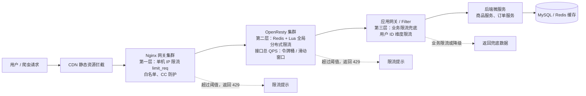
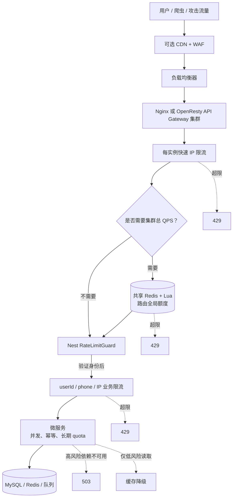

# 限流

## 目录

1. 限流基础概念 & 业务场景说明
2. 限流 4 大核心算法（固定窗口、滑动窗口、漏桶、令牌桶）
3. Nginx 层限流（limit_req /limit_conn，完整配置 + 逐行解读）
4. Redis+Lua 分布式限流（令牌桶 / 滑动窗口 Lua 脚本、原理、优势）
5. 限流分层架构（架构图 mermaid）
6. 限流的熔断、降级、排队、预热策略
7. 高频面试题（含参考答案）
8. 方案选型对比 & 踩坑总结

##  1.限流基础概念 & 业务场景

### 1.1 什么是限流

限流是流量控制手段：**对指定资源的请求速率做上限控制，超过阈值直接拒绝 / 排队 / 降级，保护后端服务不被突增流量压垮**，属于高可用防护，前置防御。

>
> 和熔断、降级区分：
> 
> 
> - 限流：控制**请求数量 / 速率**，流量太多挡在外面
> - 熔断：依赖下游持续失败，直接断开调用
> - 降级：流量过大时，返回兜底数据（静态缓存、默认页）
### 1.2 本次业务场景

- 接口：`/api/goods/detail` 商品详情接口，QPS 平时 2000，秒杀预热峰值预估 8000
- 风险：爬虫批量刷商品 ID、恶意 CC 攻击、用户疯狂刷新
- 限流规则：
  1. 单机 Nginx 层：单 IP 1s 最多 10 次请求，突发最多额外 5 个（burst）
  2. 分布式层（Redis+Lua）：接口全局总 QPS 上限 6000
  3. 白名单：内部运维 IP、内部服务调用不参与限流
  4. 限流响应：`{"code":429,"msg":"请求过于频繁，请稍后再试"}`，http 429
  5. 分层限流：Nginx 前置限流（挡大部分恶意流量）→ Redis 分布式限流（全局总控）→ 应用层兜底限流

> 
> 分层核心思想：**能在上层挡住就不要透传到后端**，Nginx 挡 IP 层高频攻击，Redis 做集群全局控制，应用层兜底。

## 2. 限流四大核心算法

### 2.1 固定窗口（计数器）

原理：把时间切成固定窗口（比如 1s），窗口内计数，超过阈值拒绝；窗口结束计数器清零。
✅ 优点：实现最简单，Redis incr 即可
❌ 缺点：**临界窗口突刺问题**（窗口最后一刻 + 下一个窗口开头，瞬间两倍流量击穿）

> 
> 例：阈值 100QPS，0.99s 来了 100，1.01s 又来 100，短时间 200 请求

### 2.2 滑动窗口（滚动窗口）

原理：把大窗口切多个小格子，随着时间滚动淘汰过期格子，实时统计最近一段时间请求数。
✅ 优点：解决固定窗口临界突刺，流量更平滑
❌ 缺点：实现复杂，Redis 需要维护多个时间片，内存更高

### 2.3 漏桶 Leaky Bucket

原理：桶容量固定，请求先入桶排队，桶满直接拒绝；桶以固定速率匀速流出（处理请求）。
✅ 优点：**强制流量匀速**，削峰，适合下游处理能力固定场景
❌ 缺点：无法应对突发流量，桶满直接丢，不能流量预热

### 2.4 令牌桶 Token Bucket（工业最常用，秒杀、接口限流首选）

原理：按固定速率往桶里放令牌；请求进来必须拿到令牌才能放行；桶有最大容量，可以积攒令牌，允许一定突发流量。
✅ 优点：支持突发流量，平滑流量，大部分网关、Redis+Lua 限流选用令牌桶
❌ 缺点：实现相对复杂，需要维护令牌生成时间戳

选型总结：

- 简单内部接口、粗粒度统计：固定窗口
- 严格控制一段时间总量，不允许毛刺：滑动窗口
- 下游 DB 能力恒定，不能扛突发：漏桶
- 电商、秒杀、允许合理突发：令牌桶

## 3. Nginx 层限流（limit_req 令牌桶、limit_conn 连接数）

> 
> nginx 限流模块：`ngx_http_limit_req_module`（速率，令牌桶）、`ngx_http_limit_conn_module`（并发连接），内置，不需要额外编译（主流版本）
> 适用：单机限流，**只能控制单台 Nginx，集群多机时无法全局统计，所以适合第一层防护**

### 3.1 limit_req 完整配置 + 逐行解读
```nginx
http {
    # 定义限流共享内存区域：name=req_zone，内存10m，key取客户端IP，rate=10r/s 每秒10个请求
    limit_req_zone $binary_remote_addr zone=req_zone:10m rate=10r/s;
    # 白名单变量，匹配内网IP就不限流
    geo $limit_white_list {
        default 1;
        127.0.0.1/32 0;
        192.168.1.0/24 0;
    }
    server {
        listen 80;
        server-name goods-api;

        location /api/goods/detail {
            # 白名单跳过限流
            if ($limit_white_list = 0) {
                set $limit 0;
            }
            if ($limit_white_list = 1) {
                set $limit 1;
            }
            # burst=5：桶容量，最多缓存5个突发请求；nodelay：缓存的请求立刻放行，不排队等待
            limit_req zone=req_zone burst=5 nodelay;
            # 限流返回429
            limit_req_status 429;
            # 返回自定义json
            error_page 429 @limit_reject;

            proxy_pass http://goods_backend;
            proxy_set_header Host $host;
            proxy_set_header X-Real-IP $remote_addr;
        }
        location @limit_reject {
            default_type application/json;
            return 429 '{"code":429,"msg":"请求过于频繁，请稍后再试"}';
        }
    }
}
```
#### 参数解读

1. `$binary_remote_addr`：二进制 IP，比 $remote_addr 省内存；一个 IP 占固定空间
2. `zone=req_zone:10m`：共享内存池，所有 worker 进程共享限流计数；10M 大概可以存 16 万 IP 限流状态
3. `rate=10r/s` 速率；也可以 `60r/m` 每分钟 60 次
4. `burst=5`：令牌桶容量，平时最多 10/s，瞬间最多可以额外扛 5 个请求
5. `nodelay`：burst 里的请求**立刻放行**；不加 nodelay 则排队匀速处理，延迟会变高

> 
> 重点坑：nodelay 不是丢弃，是突发请求立刻放行，超过 burst 直接 429

### 3.2 limit_conn 并发连接限流（控制同时在处理的连接数）

```
limit_conn_zone $binary_remote_addr zone=conn_zone:10m;
location /api/goods/detail {
    limit_conn conn_zone 20; # 单个IP最多20个并发连接
    limit_conn_status 429;
}
```

适用：防止单 IP 大量长连接、websocket 打满连接

### 3.3 Nginx 限流缺点

1. 单机维度，多 Nginx 集群部署，无法全局 QPS 控制
2. 算法简单，只有类令牌桶，没有滑动窗口
3. 状态存在本机内存，Nginx 重启丢失限流计数

> 
> 所以：Nginx 做**第一层边缘限流**，全局总控交给 Redis+Lua
## 4. Redis + Lua 分布式限流（重点面试高频）
### 4.1 为什么用 Lua？

Redis 单线程，Lua 脚本原子执行，**避免多条 redis 命令之间的竞态条件**；如果分开执行 GET + INCR，高并发下超阈值，会击穿限流。

> 
> 核心诉求：集群多台 Nginx / 多台后端实例，共享同一个限流计数器，全局统一阈值。

### 4.2 方案 A：滑动窗口 Lua（推荐，面试写这个）

> 
> 业务：接口全局限流，`/api/goods/detail` 6000QPS，统计最近 1s 内请求数
> 思路：

- key：`limit:goods:detail`
- value：zset，score = 当前时间戳，member = 唯一请求 id（时间戳 + 随机串）
- 步骤：
  1. 删除 zset 中 1s 之前的过期记录
  2. zcard 统计当前窗口数量
  3. 小于阈值：添加当前请求，返回 1 放行；超过返回 0 拒绝
```lua
-- 传入参数 KEYS [1]= 限流 key, ARGV [1]= 阈值 limit, ARGV [2]= 窗口时长 (毫秒) 
local key = KEYS [1] 
local limit = tonumber (ARGV [1]) 
local window = tonumber (ARGV [2]) 
local now = tonumber (redis.call ('TIME')[1]) * 1000 + tonumber (redis.call ('TIME')[2]) / 1000 
local expireTime = now - window 
-- 清理窗口外数据 
redis.call ('ZREMRANGEBYSCORE', key, 0, expireTime) 
local count = redis.call ('ZCARD', key) 
if count < limit then 
    redis.call ('ZADD', key, now, now .. ':' .. math.random ()) 
    redis.call ('EXPIRE', key, window/1000 + 1) 
    return 1 
else 
    return 0 
end
```
> 缺点：zset 会占用更多 Redis 内存，高 QPS 下 zset 操作开销高于计数器；适合对毛刺敏感场景
解释：now之前时间窗口内的请求，保留；去除时间窗口之前的；统计count<`limit`,满足才加进来执行。

#### 4.2.1 分片时间窗口
把一个大窗口（比如 1s）**均匀切分成 N 个固定大小的小分片（bucket / 格子）**
例子：

> 
> 大窗口：1000ms，分成 10 个分片 → **每个分片 100ms**
> [0~100ms][100~200ms][200~300ms] ... [900~1000ms]
- 每个分片独立计数，只记录这个 100ms 内来了多少请求
- 时间往前走，**整格淘汰**：过期了直接扔掉整个分片，而不是逐条删请求
- 统计总 QPS：把当前还没过期的所有分片计数加起来
分片越小精度越高、开销越大；分片越大精度越差、越快。
```lua
-- 调用入参说明
-- KEYS[1] 限流的hash key
-- ARGV[1] limit：窗口最大请求数
-- ARGV[2] window：总滑动窗口时长(ms)
-- ARGV[3] bucketSpan：单个分片bucket宽度(ms)

local key = KEYS[1]
local limit = tonumber(ARGV[1])
local window = tonumber(ARGV[2])
local bucketSpan = tonumber(ARGV[3])

-- 获取redis服务端时间（秒，微秒）
local timeArr = redis.call('TIME')
local nowSec = tonumber(timeArr[1])
local nowUs = tonumber(timeArr[2])
local now = nowSec * 1000 + math.floor(nowUs / 1000) -- 当前时间戳 ms

local expireLine = now - window -- 窗口左边界，小于这个时间的bucket全部过期

-- 当前请求落在哪个bucket
local curBucket = math.floor(now / bucketSpan) * bucketSpan

-- 取出全部bucket：HGETALL 返回 [k1,v1,k2,v2,...]
local bucketList = redis.call('HGETALL', key)
local total = 0
local delBuckets = {}

-- 遍历所有分片，统计有效计数、收集过期bucket
for i = 1, #bucketList, 2 do
    local bStart = tonumber(bucketList[i])
    local cnt = tonumber(bucketList[i+1])
    if bStart < expireLine then
        -- 这个bucket已经完全在窗口外面，标记删除
        table.insert(delBuckets, bucketList[i])
    else
        total = total + cnt
    end
end

-- 批量删除过期分片（整块删除，不是删单条请求！）
if #delBuckets > 0 then
    redis.call('HDEL', key, unpack(delBuckets))
end

local pass = 0
if total < limit then
    -- 放行，当前bucket计数+1
    redis.call('HINCRBY', key, curBucket, 1)
    pass = 1
end

-- 设置兜底过期，防止冷key永久残留；多给2s余量
redis.call('EXPIRE', key, math.ceil(window/1000)+2)

return pass
```
>总窗口 window = 1000 ms（统计最近 1s）
>bucketSpan = 100 ms （每个分片格子宽度）
>limit = 5 （窗口内最多允许 5 次请求）
>判断规则：`total < limit` 才放行（和前面 ZSET 脚本保持一致，方便对比）
```
- t=100  req1
- t=200  req2
- t=300  req3
- t=400  req4
- t=500  req5
- t=600  req6
- t=1150 req7（我们重点看这次！）

先算每个请求归属的 bucket：

- t=100 → bucket=100  区间 [100,200) （第一次进来不占total）
- t=200 → bucket=200  [200,300)
- t=300 → bucket=300  [300,400)
- t=400 → bucket=400  [400,500)
- t=500 → bucket=500  [500,600)
- t=600 → bucket=600  [600,700)
- t=1150 → bucket=1100 [1100,1200)  

- bucket=100：100 < 150 → ✅ 过期，加入删除列表
- bucket=200：200 >=150 → 有效，total +=1
- bucket=300：300 >=150 → total +=1
- bucket=400：400 >=150 → total +=1
- bucket=500：500 >=150 → total +=1
- bucket=600：600 >=150 → total +=1

👉 delBuckets = ["100"]
👉 total = 1+1+1+1+1 = 5

执行 HDEL 删除 bucket=100。
然后判断 `total < 5` → 5 <5 为 false → **return 0，拒绝 req7**
```

### 4.3 方案 B：令牌桶 Lua（允许突发，电商常用）

维护两个变量：上次填充令牌时间、当前剩余令牌数量；按时间差补充令牌，拿到令牌放行。

```lua
-- KEY[1] 令牌桶key，ARGV[1]桶最大容量，ARGV[2]令牌生成速率(每秒N个)
local key = KEYS[1]
local capacity = tonumber(ARGV[1])
local rate = tonumber(ARGV[2])
local now = tonumber(redis.call('TIME')[1]) * 1000 + tonumber(redis.call('TIME')[2]) / 1000
local bucket = redis.call('HMGET', key, 'tokens', 'lastTime')
---  剩余令牌
local tokens = tonumber(bucket[1]) or capacity
local lastTime = tonumber(bucket[2]) or now
-- 计算时间差，补充令牌
local delta = now - lastTime
local addTokens = delta / 1000 * rate
tokens = math.min(capacity, tokens + addTokens)
lastTime = now
if tokens >= 1 then
    tokens = tokens - 1
    redis.call('HMSET', key, 'tokens', tokens, 'lastTime', lastTime)
    redis.call('EXPIRE', key, 60)
    return 1
else
    redis.call('HMSET', key, 'tokens', tokens, 'lastTime', lastTime)
    redis.call('EXPIRE', key, 60)
    return 0
end
```
```
capacity = 5   -- 桶最多存5个令牌
rate = 2       -- 每秒生成2个令牌 → 每500ms产生1个令牌

调用：`EVAL "脚本" 1 limit:token:goods 5 2`
剩余token，这次要补token，没有则赋值 capacity now
剩余token >=1 扣除并return 1；否则 更新time return 0
```

### 4.4 接入位置两种方式

1. OpenResty（Nginx+lua 模块）：Nginx 直接执行 lua，在网关层做分布式限流，流量不进后端 Java/Node，性能最好（大厂常用）
2. 后端应用内执行 Lua：SpringBoot + Redisson / RedisTemplate 调用 lua；流量已经到达应用，适合二次兜底

> 
> 面试区分：OpenResty = Nginx + Lua，网关分布式限流；Spring 应用里 Lua 是应用层分布式限流

### 4.5 缺点

- Redis 是单点风险：需要 Redis 集群 / 主从 + 哨兵；限流 Redis 建议独立实例，不要和业务 Redis 混用
- 网络损耗：每次限流要走 Redis 网络 IO；可以本地做一层缓存做本地令牌缓冲（多级限流）


分层顺序：CDN → Nginx 单机限流 → OpenResty 分布式 Redis 限流 → 应用层业务限流 → 微服务

> 
> 设计思想：越上层拦截，对后端资源消耗越小；多层防护，防止某一层限流失效。

## 5. 限流分层架构图



## 6. 限流配套策略（面试加分项）

1. **排队（queue）**：Nginx burst 排队、消息队列削峰，不要直接拒绝，适合可等待业务
2. **预热限流（warm-up）**：令牌桶缓慢提升速率，秒杀刚开始，逐步放开 QPS，防止瞬间流量冲垮，Sentinel 支持
3. **限流提示**：429，返回 retry-after，告诉客户端多久重试
4. **区分限流维度**：IP、UID、接口、租户、设备号；高价值用户单独限流策略
5. **监控告警**：监控限流拒绝 QPS、Redis 延迟、429 占比；短时间大量限流触发告警，判断是否攻击
6. **动态阈值**：不要写死 QPS，配置中心（Nacos/Apollo）热更新限流阈值，不用重启网关

> 
> 组件补充：Sentinel（Java 生态）、Hystrix（老旧熔断，不推荐限流）、Gateway + Sentinel

## 7. 热门面试题 + 参考答案

> 
> 全部高频，背这个就够用

### Q1：限流、熔断、降级的区别？

A：

- 限流：控制请求速率，流量超上限拒绝，保护系统，是**入口控制**
- 熔断：下游服务连续报错率达到阈值，直接断开调用，一段时间内不再访问下游，防止雪崩
- 降级：流量大 / 下游异常时，返回兜底数据（缓存、静态页），不执行业务逻辑，保障核心链路可用

### Q2：固定窗口为什么有临界突刺？滑动窗口怎么解决？

A：固定窗口在窗口边界，上一个窗口末尾 + 下一个窗口开头叠加流量，瞬间两倍阈值击穿；滑动窗口把窗口切分成多个小时间片，滚动淘汰过期请求，统计最近 N 秒真实请求数量，消除边界毛刺；代价是内存和计算更高。

### Q3：漏桶和令牌桶区别？什么时候选哪个？

A：
漏桶：出水速率固定，强制匀速，桶满直接丢，**不能扛突发**，适合下游处理能力恒定、不允许流量抖动场景。
令牌桶：按固定速率放令牌，桶可以积攒令牌，**允许合理突发流量**；电商、秒杀、接口限流优先令牌桶。

### Q4：Nginx limit_req 的 burst 和 nodelay 是什么意思？不加 nodelay 会怎样？

A：
rate 是平稳速率，burst 是令牌桶最大容量；不加 nodelay：超出 rate 但小于 burst 的请求会排队延迟放行，严格匀速；加上 nodelay：burst 内的突发请求立刻放行，不排队；超过 burst 直接 429。

> 
> 坑：很多人误以为 nodelay 是丢弃，是错误的。

### Q5：分布式限流为什么要用 Lua 脚本，分开 Redis 命令会有什么问题？

A：Lua 脚本在 Redis 服务端原子执行；如果分多条命令：GET 计数→判断→INCR，高并发下，多个请求同时读到计数没超限，同时 + 1，超过阈值，**限流失效（竞态条件）**。

### Q6：OpenResty 分布式限流和 Spring 应用内 Redis+Lua 限流优劣？

A：
OpenResty（网关层）：请求在 Nginx 就拦截，不进入 JVM、不占用后端线程，性能极高，适合大流量网关；缺点需要维护 OpenResty，开发成本高。
应用层限流：开发简单，和业务代码放一起，可以拿到用户 uid、租户等业务维度；缺点流量已经到达后端，占用连接和线程，适合兜底。

### Q7：Redis 限流有什么风险？怎么解决？

A：
风险：Redis 宕机、网络抖动，限流失效；Redis 单点瓶颈；大 QPS 下 zset 滑动窗口性能压力大。
方案：限流 Redis 独立集群、主从 + 哨兵；上层叠加 Nginx 单机限流做保底；限流失败开关（限流 Redis 不可用时，自动关闭分布式限流，退化为本地限流）。

### Q8：分层限流架构为什么要多层？单层 Redis 分布式限流行不行？

A：单层 Redis 限流，所有流量都打到 Redis，Redis 压力巨大；爬虫 CC 攻击直接打满 Redis；分层：Nginx 先挡掉大量恶意 IP 高频请求，只有合法流量才走到分布式 Redis 限流，保护 Redis 和后端。

### Q9：限流返回码为什么用 429 而不是 503？

A：429 Too Many Requests，语义就是请求过多；503 是服务不可用，侧重服务宕机、下线；语义规范优先 429，同时可以携带 Retry-After 响应头。

### Q10：Sentinel 的限流底层是什么算法？和 Redis+Lua 对比？

A：Sentinel 默认是**滑动窗口（LeapArray）本地限流**，内存统计，不需要 Redis；分布式模式 Sentinel 也支持 Redis 限流；适合 Java 微服务快速接入，规则热更新、监控完善；缺点是非网关层，流量进入应用。

### Q11：白名单怎么实现？Nginx 和 Redis 限流如何跳过白名单？

A：Nginx geo 模块匹配 IP 白名单直接跳过 limit_req；Lua 脚本开头先判断白名单集合，命中直接 return 1 放行，不计数。

### Q12：限流之后除了拒绝，还有哪些处理方式？

A：排队延迟放行、异步排队削峰（投递 MQ）、降级返回缓存兜底、引导排队页、返回重试时间。

## 8. 方案选型 & 踩坑总结

表格

| 方案 | 限流位置 | 算法 | 是否分布式 | 性能 | 适用场景 |
| --- | --- | --- | --- | --- | --- |
| Nginx limit_req | 网关 | 令牌桶 | ❌单机 | 极高 | 第一层 IP 限流、CC 防护 |
| OpenResty+Lua | 网关 | 滑动窗口 / 令牌桶 | ✅全局 | 极高 | 电商网关、秒杀入口 |
| Spring+Redis+Lua | 应用层 | 滑动窗口 / 令牌桶 | ✅全局 | 中等 | 业务接口兜底、UID / 租户限流 |
| Sentinel 本地 | 应用层 | 滑动窗口 | ❌本地 | 高 | Java 微服务快速限流熔断 |

# 附

## OpenResty 
可以理解成：
> Nginx + LuaJIT + 一组常用扩展模块。

普通 Nginx 配置主要是声明式的：
```
location /api/ {
    proxy_pass http://backend;
}
```
OpenResty 允许在 Nginx 请求处理阶段执行 Lua：
```
access_by_lua_block {
    -- 读取 token
    -- 查询 Redis
    -- 判断限流
    -- 动态路由
}
```
它可以在请求到达 Nest 之前做：
- Redis 分布式限流；
- JWT 初步校验；
- API Key 校验；
- 动态黑白名单；
- 灰度发布；
- 动态路由；
- 请求签名校验；
- 自定义日志；
- Bot 防护。
请求关系是：
```
用户
→ OpenResty
   ├── Nginx 原有代理能力
   └── Lua 自定义逻辑
→ Nest
```
所以 OpenResty 不是必须放在 Nginx 后面：Nginx → OpenResty 更常见的是直接替换：
一些 API Gateway，例如 APISIX、Kong 的部分架构，也建立在 Nginx/OpenResty 生态之上。

## WAF 是什么
WAF 是 Web Application Firewall，即 Web 应用防火墙。
它主要检查 HTTP/HTTPS 请求内容。
```
普通防火墙主要看：
来源 IP
目标 IP
端口
TCP/UDP 协议
```
WAF 还会看：
```
URL
Query 参数
请求头
Cookie
请求体
上传内容
访问行为
```
例如收到：
`GET /user?id=1' OR 1=1`
WAF 可能识别为 SQL 注入并拦截。

常见能力包括：
- SQL 注入防护；
- XSS 攻击防护；
- 路径穿越；
- 恶意文件上传；
- 已知漏洞规则；
- IP 黑白名单；
- URL 访问控制；
- CC 攻击防护；
- Bot/爬虫识别；
- 请求频率限制。

```
WAF 一般部署在后台服务之前：

用户
→ CDN/WAF
→ Nginx
→ Nest
```
