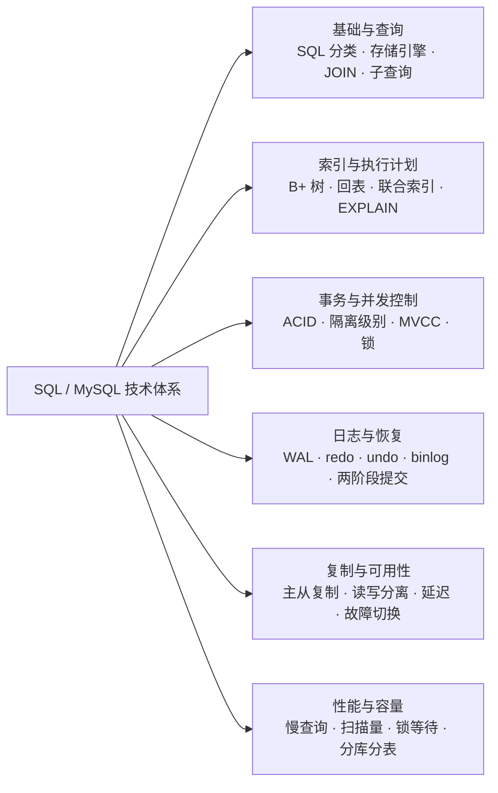

# SQL 与 MySQL 知识体系

这组笔记以 **MySQL / InnoDB** 为主线。SQL 是操作关系型数据库的语言；索引、事务、日志、复制则是数据库实现查询效率、并发正确性与可靠性的机制。先用下面的框架定位知识点，再进入具体章节。

## 知识框架

这是一张**知识分类图**，箭头表示主题划分，不表示 SQL 的执行顺序。



### 各部分解决什么问题

- **基础与查询：如何表达业务需求？** 从建表、增删改查到关联和子查询，见 [基础与查询](#基础与查询)。
- **索引与执行计划：怎样更快找到数据？** 理解索引结构、匹配规则和扫描方式，见 [SQL 索引](./sql-index.md)。
- **事务与并发：多人同时操作，怎样保持正确？** 先读 [事务与并发控制](#事务与并发控制)，再看 [SQL 锁机制](./sql-lock.md)。
- **日志与恢复：提交后宕机，数据如何恢复？** 串联日志、刷盘与提交过程，见 [日志与崩溃恢复](#日志与崩溃恢复)。
- **复制与可用性：如何跨实例同步和分担读取？** 理解复制链路与延迟，见 [SQL 主从复制](./sql-master-slave.md)。
- **性能与容量：线上慢在哪里，数据多了怎么办？** 从证据定位瓶颈，见 [SQL 调优、慢查询](#sql-调优、慢查询)。分库分表目前只作为扩展方向列出。

### 建议阅读顺序

**基础与查询 → 索引 → 事务与 MVCC → 锁 → 日志与恢复 → 主从复制 → 性能排查。**

用一个“扣减库存”场景串联：SQL 表达更新条件，索引帮助定位商品，事务与锁协调并发修改，undo 支持回滚和历史版本读取，redo 支持崩溃恢复，binlog 支持复制；如果接口变慢，再通过执行计划与锁等待信息定位原因。

## 基础与查询

### SQL 语句分类

- **DDL（数据定义）**：`CREATE`、`ALTER`、`DROP`，定义表和索引等结构。
- **DML（数据操作）**：`INSERT`、`UPDATE`、`DELETE`，写入和修改数据。
- **DQL（查询，常见教学分类）**：`SELECT`，读取数据。
- **DCL（权限控制）**：`GRANT`、`REVOKE`，管理访问权限。
- **事务控制**：`BEGIN`、`COMMIT`、`ROLLBACK`，控制事务边界。

### InnoDB 与 MyISAM 的区别

1. InnoDB：支持**事务、行锁、外键**；聚簇索引；崩溃安全恢复；不支持全文索引 (5.7 后支持)
2. MyISAM：**不支持事务，表锁**；非聚簇；查询快；崩溃容易丢数据；现在几乎不用

### 子查询

> 查询：**一条 SQL 里面嵌套另一条 select 语句**，嵌套的那条就是子查询。
三类：
1. **标量子查询**（返回 1 行 1 列）
2. **IN / ANY / ALL 子查询**（返回一列多行）
3. **派生表子查询（from 里面套 select）** → `from (select ...) t`，这个最容易产生临时表

①标量子查询
```sql
-- 标量子查询
SELECT
  id,
  name,
  (SELECT count(*) FROM `order` o WHERE o.user_id=u.id) AS order_cnt
FROM user u;
```
- 子查询每行主查询都会执行一次；
- **不会生成临时表**；
- explain 的 `select_type = SUBQUERY`

②一列多行
```sql
SELECT * FROM user WHERE id IN (SELECT user_id FROM `order` WHERE status=1);
```
MySQL 优化器内部会做改写：**很多情况自动转成 semi‑join（半连接），转成 join 执行，不建临时表**。
explain 看到 select_type=`SUBQUERY`。

③临时表
```sql
-- 派生表子查询 from (子查询) as t
SELECT * FROM (
  SELECT id,name FROM user WHERE id>100
) AS t;
```
- MySQL5.6 默认：会把子查询执行完，把结果存入**内部临时表**，这张临时表别名就是 t。
- explain 里面 `select_type=DERIVED`。

## 事务与并发控制

### 事务四大特性 ACID

- A 原子性：事务要么全部成功，要么全部失败（undo log 回滚）
- C 一致性：业务数据约束始终正确（是结果，不是底层机制）
- I 隔离性：多个事务之间互相不可见（MVCC、锁实现）
- D 持久性：提交后修改永久保存（redo log）

### 脏读、不可重复读、幻读

> 前提：**同一个事务 A 内部，连续做查询**；事务 B 做修改 / 新增并且提交。
注意：下面全部是**快照读（普通 select，不加 for update）**

1. 脏读
> 读了别的事务还没提交的脏数据
- 事务B update修改数据，还没commit
- 事务A读取B未修改的提交
- 如果B最后回滚了，A读到的数据就是无效“脏数据”

2. 不可重复读
> 同一个事务A，对同一行，前后两次读，读到不一样的值
1. 事务A：`select money -> 100`
2. 事务B：`update 200`.commit提交
3. 事务A: 再次select 变成了  200

3. 幻读
> 同一个事务A，同一个范围查询，前后两次，返回的行数不一样（多出/少了行）
1. A:`select * from t where id<100` 2条
2. B:`inert id,50` commit
3. A:再次执行完全一样的`select * from t where id <100` 3条。凭空多出来一条，像幻觉

### 4 种事务隔离级别，InnoDB 默认级别

|隔离级别|	脏读|	不可重复读|	幻读|
|---|---|---|---|
|读未提交| read‑uncommitted	|✅存在|	✅存在|	✅存在|
|读已提交| read‑committed (RC)|	❌|	✅存在	|✅存在|
|可重复读 repeatable‑read (RR，InnoDB 默认)	|❌|	❌|	InnoDB 通过临键锁解决幻读|
|串行化| serializable|	❌|	❌|	❌|

### MVCC 多版本并发控制原理

> MVCC 是 InnoDB 实现隔离级别的机制，只作用于快照读（普通 select 不加锁），通过保存数据历史版本，实现不加锁读，提升并发。
> 只作用于**快照读（普通 select 不加锁）**；当前读（select … for update /update/delete）走锁。

- 每行隐藏字段：`DB_TRX_ID`（最后修改事务 id），`DB_ROLL_PTR`指向 undo log 历史版本链
- Read‑View：生成快照，判断版本是否可见；RR 每次事务开始生成 Read‑View；RC 每次 select 生成新 Read‑View。
- 通过 undo log 版本链 + Read‑View 实现不加锁的隔离。
> 快照读：`select * from table`；
> 当前读：`select … for update / lock in share mode / update / delete`。

#### 底层基础：每行隐藏列

InnoDB每行一行数据有2个隐藏字段：
1. `DB_TRX_ID`:最后修改这行的事务ID，每次update都会更新它
2. `DB_ROLL_PTR`：回滚指针，指向undo log里这条记录的旧版本。
多版本通过`DB_ROLL_PTR`串成版本链 `最新行 (age=22,trx‑300) → undo (age=20,trx‑200) → undo (age=18,trx‑100)`.查询的时候，顺着 roll_ptr 沿着版本链找，**找到当前事务能看见的那一个历史版本返回**。
> undo log存放旧数据，不是ibd数据文件

#### Read‑View：判断版本是否可见

`read‑view`：读视图，事务开启瞬间生成，用来判断哪个版本对当前事务可见
Read‑View 就是一个快照，里面保存：

- 当前活跃的未提交事务集合
- 几个事务 ID 边界，用来判断：这条版本我能不能看见。

> 规则简化：

1. 如果记录的`DB_TRX_ID` < Read‑View 里最小活跃事务 ID → 可见（事务已经提交）
2. 如果记录的`DB_TRX_ID` > 当前事务 ID → 不可见（未来还没发生的事务）
3. 在中间区间：看是否在活跃集合，已经提交就可见，还活跃就顺着 roll_ptr 找上一个历史版本。

#### RC 与 RR：Read‑View 的生成时机

1. **RC 读已提交：每一次执行 select，就生成一个全新 Read‑View**
   - 同一个事务里，前后两次 select，会拿到新快照，可以看见别的事务刚提交的数据
   - ➡️ 所以 RC 会出现**不可重复读**
2. **RR 可重复读：整个事务启动时，只生成一次 Read‑View**
   - 整个事务期间一直用同一个快照，不管外面其他事务怎么 update 提交，看到的都是事务启动那一刻的数据
   - ➡️ RR 解决**不可重复读**

> 
> 快照读与锁定读的差异，参见 [锁机制相关面试问答](./sql-lock.md#锁机制相关面试问答)。

### 锁机制

行锁、表锁、记录锁、间隙锁、临键锁、意向锁与死锁介绍已移至 [SQL 锁机制](./sql-lock.md)。

## 索引

聚簇索引、二级索引、回表、覆盖索引、联合索引、排序与执行计划见 [SQL 索引](./sql-index.md)。

## 日志与崩溃恢复

> 依靠redo log+undo log+两阶段提交，MYSQL宕机重启自动恢复，保证事务ACID。
- `redo log`：预写日志WAL。修改内存页前，先写redo log到磁盘。**奔溃恢复核心**
- `undo log`: 保持数据旧版本，用于事务回滚、MVCC
- `binlog`：MySQL Server层的日志，不是InnoDB引擎的，记录所有修改累操作，用于主从复制、数据恢复。
- 两阶段提交：保证redo log和binlog 状态一致。

### WAL：日志先行

> 修改数据前，先把修改的日志持久化写到磁盘；再去修改内存里的数据页
> 原则：日志先落盘，数据页在刷盘

### binlog

特点：
1. 属于**Server 层**，不管什么存储引擎（InnoDB / MyISAM），只要开启 binlog 都会写
2. 记录**逻辑 SQL 变更**，不是磁盘页的物理修改。
3. 是追加写，写完一个文件，达到大小上限自动新建下一个 binlog 文件。
4. 开启必须配置 `log_bin`
三种格式

1. STATEMENT(语句格式)
- 记录原始SQL；优点：日志体积小；缺点：非确定性函数会造成主从数据不一致（now()、rand()）
- 不推荐生产

2. ROW(行格式，生产首选`binlog_format=ROW`)
- 记录每一行修改前后的数据，不记录原始SQL；优点：数据绝对一致，不怕随机函数；缺点：binlog 文件体积会更大，update 大量行时日志暴涨

3. MIXED（混合模式）
- MySQL自动判断：简单SQL用statement；有不确定函数自动切换row。现在生产一般直接选ROW
简单示例
```sql
-- 开启binlog后执行
UPDATE user SET age=20 WHERE id=1;
```
- STATEMENT 模式：记录 `UPDATE user SET age=20 WHERE id=1;`
- ROW 模式：记录 id=1 这一行修改前 age 原值、修改后 age=20。
查看binlog：
```sql
show binary logs; --- 查看所有binlog文件
show binlog events in 'mysql-bin.000001'; 
```
配置`my.cnf/my.ini` 生产ROW模式
```ini
[mysqld]
#开启binlog，指定文件名前缀
log_bin = /var/lib/mysql/mysql-bin
# binlog格式，生产必选ROW
binlog_format = ROW
# 记录事务同步刷盘（安全，性能有损耗；主库推荐1）
sync_binlog = 1
# 过期自动清理binlog，保留7天
expire_logs_days = 7
# 单个binlog最大大小，到上限自动切新文件
max_binlog_size = 1G
# 必须，保证两阶段提交，保证崩溃安全
innodb_flush_log_at_trx_commit = 1 # 每次事务提交 redo log 刷盘，WAL 安全。
```

### InnoDB两阶段提交

> 目的：保证redo log和binlog里面记录的事务状态完全一致。
> 问题背景：redo log属于InnoDB引擎层；binlog属于MYSQL server层；如果crash，会出现恐怖情况：
> 1.redo已经commit，binlog没写完，主机有数据，从库没有 -> 主从不一致
> 2.binlog写完，redo还没commit，本机回滚，但从库回放binlog执行了变更 -> 主从不一致
为了解决上面两种灾难，引入两阶段提交，一个事务提交分为3步，2阶段：

阶段一：Prepare

1. 事务执行完毕，所有修改已经在内存buffer pool。
2. 将本次事务所有变更写入redo log，持久化到磁盘，标记状态未`PREPARE`

阶段二：Commit

3. 写这个事务对应的binlog，binlog持久化到磁盘
4. 把redo log到事务标记为`COMMIT`、刷盘，事务完成

时序简记
```
① redo log prepare（刷盘）  ←【第一阶段】
② binlog 写入并刷盘
③ redo log commit标记刷盘  ←【第二阶段完成】
```

### 崩溃恢复完整流程

1. MYSQL重启，读取 redo log；
2. 扫描 redo log，找到prepare状态事务：
   - 如果binlog完整，事务commit，重放redo，落盘数据页；
   - 如果binlog不完整，事务rollback，通过undo log回滚；
3. 已经complete commit到事务，直接重发redo，把脏页落地；
4. 未提交事务，undo log回滚撤销修改。

## 主从复制与读写分离

复制链路、主从环境搭建和验证步骤见 [SQL 主从复制](./sql-master-slave.md)。阅读时重点区分“主库提交成功”与“从库已应用变更”，再理解复制延迟、读写分离与故障切换的关系。

## SQL 调优、慢查询

### SQL 慢查询是什么

> 简单说：一条 SQL 跑太久，数据库把它记下来，这条 SQL 就是慢查询。

#### 造成慢查询等原因

1. **缺少索引**：参见 [索引与慢查询](./sql-index.md#索引与慢查询)。
2. **索引失效**：参见 [索引失效场景](./sql-index.md#索引失效场景-高频)。
3. **查询返回太多数据**：`select *` 查询大量不需要字段；没有 limit；一次性查出几十万行。
4. **join 关联不当**：关联表没有索引，笛卡尔积，中间结果集巨大。
5. **事务 / 锁等待**：参见 [锁等待与慢查询](./sql-lock.md#锁等待与慢查询)。
6. 数据量本身太大，索引也救不了，需要分库分表。

#### 慢查询怎么看

- 开启慢查询日志
```sql
-- 查看阈值
show variables like 'long_query_time';
-- 开启慢查询日志
set global slow_query_log=ON;
set global long_query_time=1;
```
- 工具
  1.直接读慢查询日志文件
  2.`mysqldumpslow`：MySQL 自带分析慢日志工具
  3.pt‑query‑digest（percona-toolkit），解析分析慢日志

#### SQL 优化通用思路：

1. explain 看执行计划，看 type、rows、extra
2. 加合适索引，利用覆盖索引，避免索引失效
3. 避免 select *；只查需要字段
4. 大 offset 分页改成主键分页 `where id > last_id limit page_size`
5. 避免大事务，拆大 SQL，减少锁持有时间
6. join 关联字段必须建立索引；join 小表驱动大表
7. 大表优化方案
   - 分库分表（水平、垂直）；读写分离；归档冷数据；分表策略 range/hash。
8. join 优化：小表驱动大表原理。

### explain

执行计划的使用方法、核心字段与索引判断见 [EXPLAIN 执行计划](./sql-index.md#explain-执行计划)。

## 面试题

深分页优化和索引未被采用的问题见 [索引相关面试问答](./sql-index.md#索引相关面试问答)。

幻读、MVCC 与锁、大事务及 DDL 锁等待问题见 [锁机制相关面试问答](./sql-lock.md#锁机制相关面试问答)；死锁案例见 [死锁案例与排查](./sql-lock.md#死锁案例与排查)。

### Q1：为什么推荐 binlog_format=row？

row 记录行数据变更，SQL 注入、函数不会产生数据不一致；statement 记录原始 sql，环境不同结果会不一致。缺点 binlog 体积更大。

### Q2：count (*) count (1) count (字段) 区别

1. `count(*)` InnoDB 优化，直接统计行数；
2. `count(1)` 和 count (*) 性能几乎一样；
3. `count(col)`：统计该字段非 NULL，会判断字段是否为 null，性能差。

> 
> MyISAM 无 where 条件 count (*) 很快，保存总行数；InnoDB 不缓存行数，每次扫描。

### Q3：什么是脏页？刷脏页时机

> 内存缓冲池 page 与磁盘不一致叫脏页；
1. ✅ **Page Cleaner 后台定时异步刷脏（常态，最主要）**：MySQL 后台线程每秒扫描，持续缓慢刷脏。
2. ✅ **脏页比例达到 innodb_max_dirty_pages_pct，加速刷脏**。
3. ✅ **LRU 页面淘汰：Buffer Pool 内存不足，淘汰脏页前必须刷脏**。
4. ✅ **redo log 空间不足，强制刷脏（会阻塞 DML，业务抖动）**。
5. ✅ 手动执行 flush tables。
6. ✅ MySQL 正常 shutdown，全量刷脏。

### Q4：join 的原理，Nested‑Loop Join

驱动表循环取出一行，去被驱动表索引查询；**小表做驱动表性能最好**。

### Q5：读写分离场景，刚写入立刻查询，读到旧数据怎么办？

- 关键查询强制读主库；
- 业务短暂缓存；
- 监控主从延迟，延迟大全部切主。


