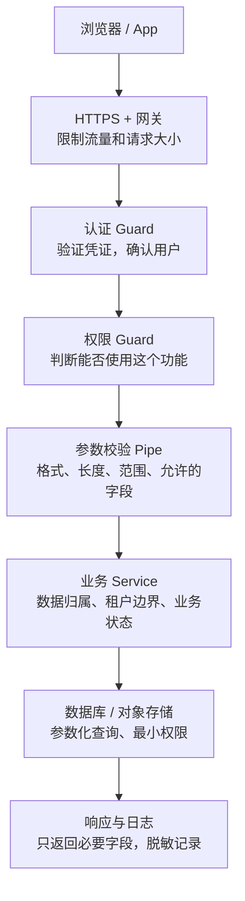
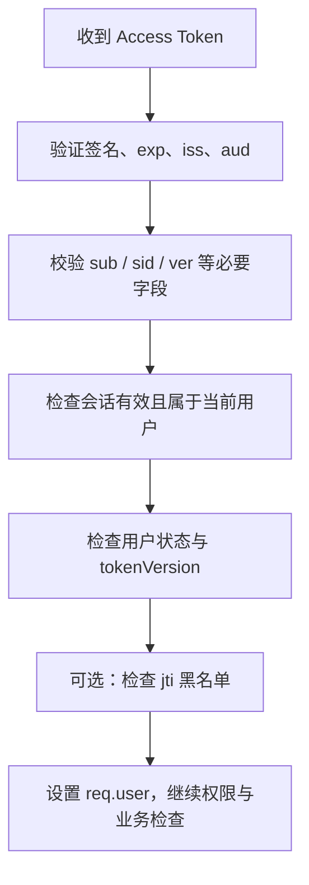
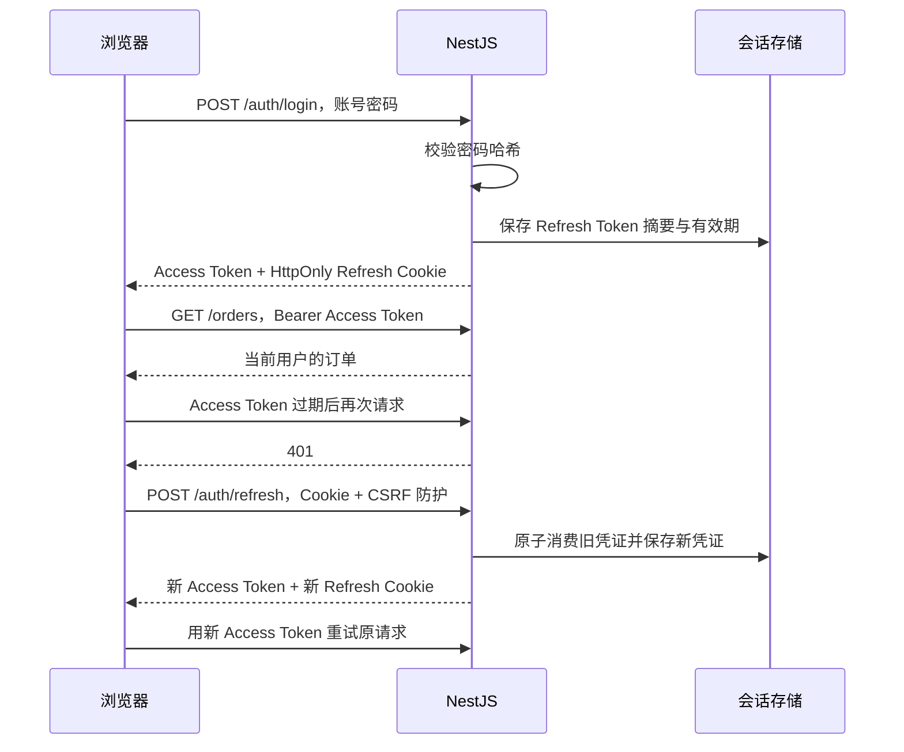
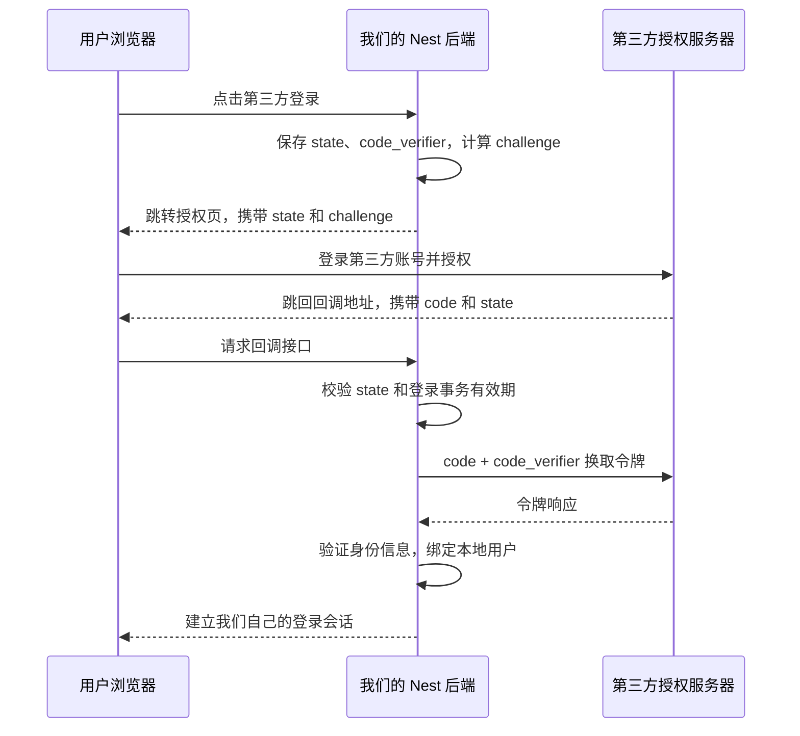
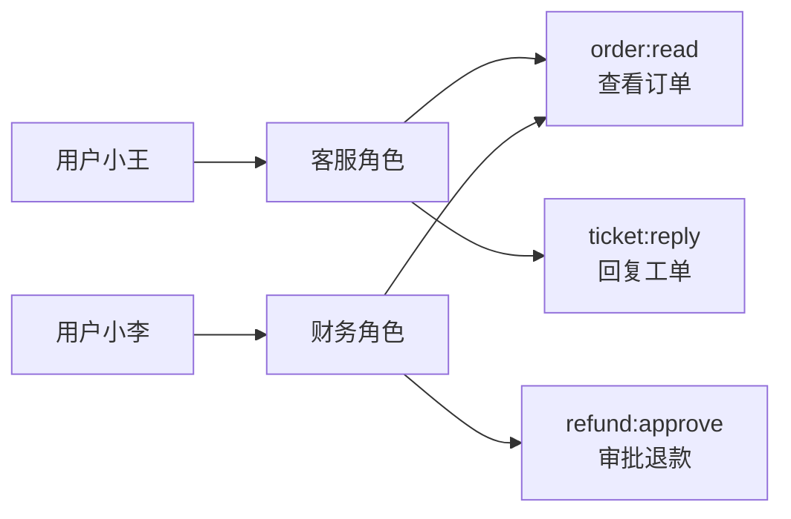
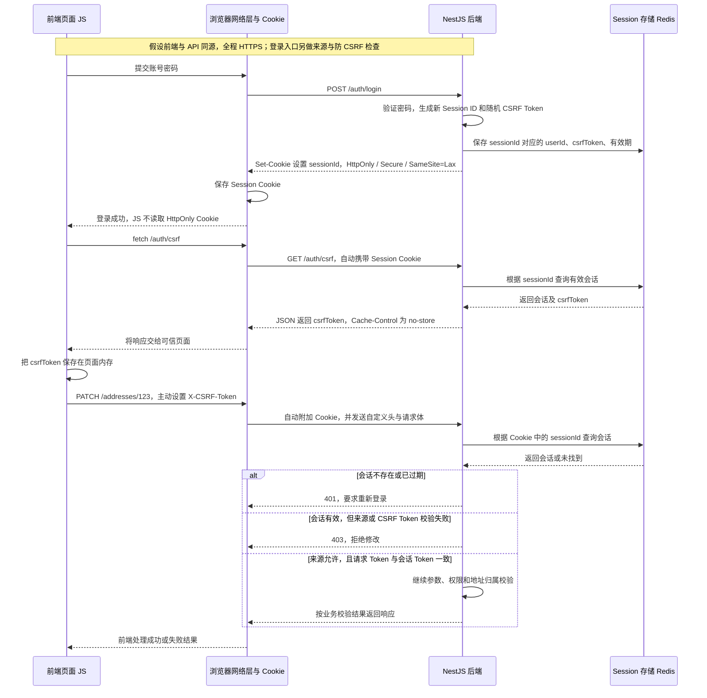
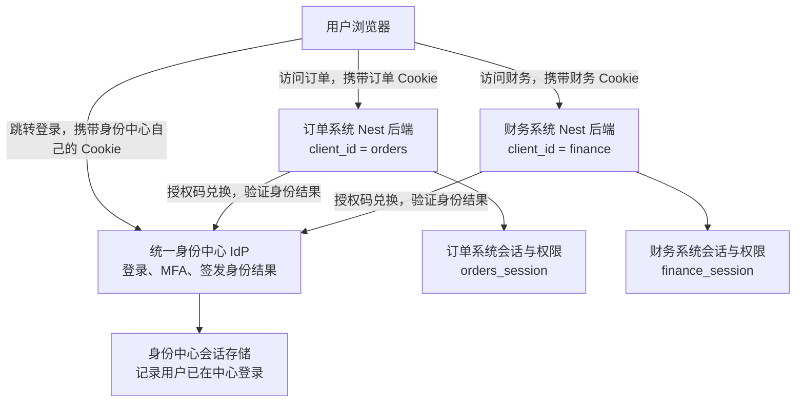
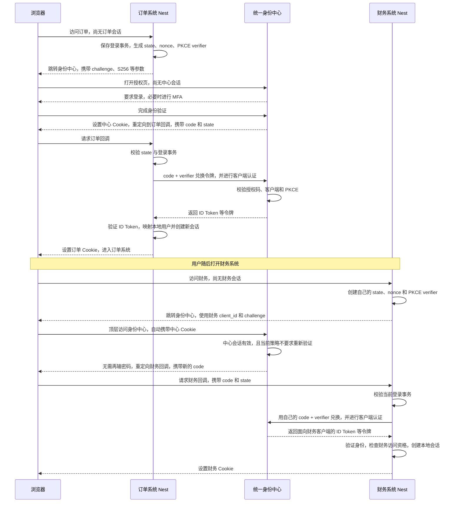
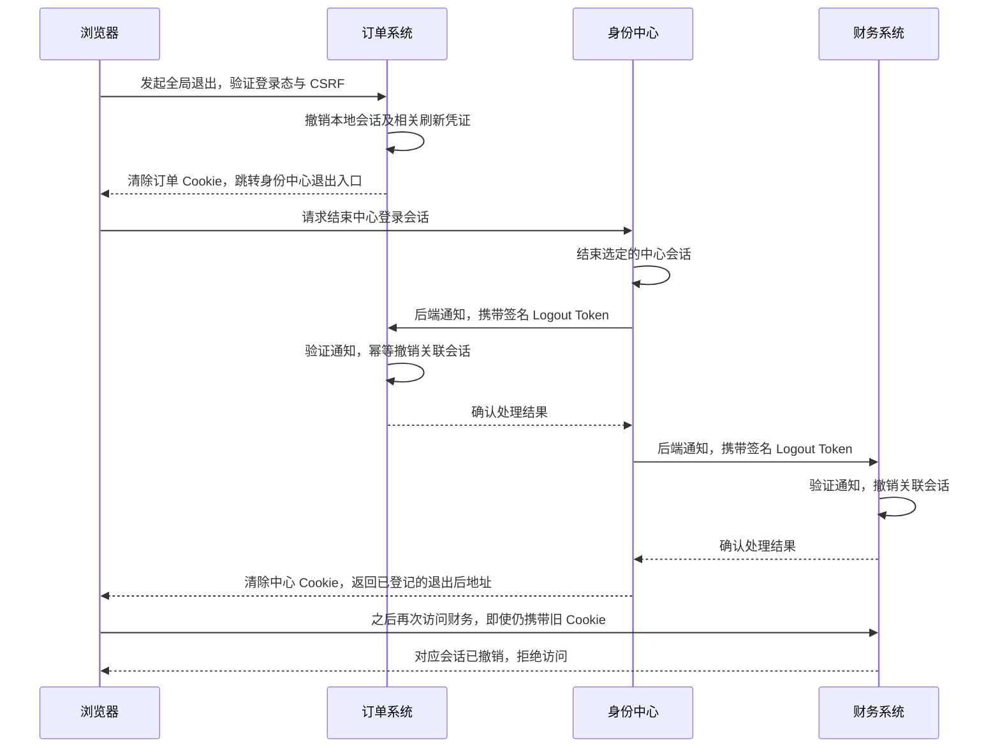

# 身份认证与接口安全：Node.js / NestJS 面试笔记

以一个订单系统为例：用户登录，查看自己的订单，管理员处理退款。目标是能解释每一步为什么需要，而不是只记住 JWT、Guard 等名词。

本文代码以 **NestJS 11 + Express 适配器、TypeScript** 为背景，是按主题拆开的教学片段，不是复制到一个文件就能运行的完整项目。数据库示例使用 Prisma 风格；`UsersService`、`PermissionsService`、`PrismaService` 是需要按项目实现的业务服务。相关 Provider、Controller 必须注册到 Nest 模块中。

## 先建立知识框架

先分清三个问题：

- **认证 Authentication：你是谁？** 例如验证登录凭证后，确认当前用户是小王。
- **授权 Authorization：你能做什么？** 小王有查看订单权限，但没有退款审批权限。
- **数据归属检查：你能操作哪一条？** 有查看订单权限，也不能查看其他人的订单。



这是受保护接口的简化流程，省略了 Nest 的 Middleware、Interceptor 等细节。用户输入合法、Token 有效，都不代表业务操作一定被允许。

**建议顺序：Cookie / Session / JWT → 双 Token → OAuth → [SSO](#十四、单点登录-sso-多个系统复用一次登录) → RBAC 与越权 → 密码存储 → 常见攻击 → 接口防护。**

## 一、Cookie、Session、JWT 的差别

### Cookie：浏览器保存和携带数据的机制

服务器通过 `Set-Cookie` 让浏览器保存一小段数据；后续请求符合域名、路径、SameSite 等条件时，浏览器会携带它。Cookie 可以存语言偏好，也可以存 Session ID 或 Token。**Cookie 本身不是登录方案。**

常见属性：

- `HttpOnly`：前端 JS 无法通过 `document.cookie` 读取；不等于 XSS 无法冒用当前登录态。
- `Secure`：通过 HTTPS 发送，生产环境应开启。
- `SameSite`：控制跨站请求携带 Cookie 的行为，常见 `Lax`、`Strict`、`None`；`None` 需要搭配 `Secure`。
  - lax 允许导航到目标网址的 GET 请求携带 Cookie
- `Max-Age / Expires`：浏览器保存时长；服务端也必须独立检查登录态是否过期。
- `Path / Domain`：控制发送范围。通常不设置宽泛 Domain，避免不必要的子域共享。

跨站和跨源不是一回事：不同端口属于跨源，但未必跨站。不要拿 SameSite 代替 CORS 判断。[Cookie 与会话安全参考](https://cheatsheetseries.owasp.org/cheatsheets/Session_Management_Cheat_Sheet.html)

### Session：登录状态主要保存在服务端

可以理解为“浏览器拿号码牌，服务器根据号码牌查登记表”。

1. 用户提交账号密码，服务器验证成功。
2. 服务器生成不可预测的 Session ID，将 `{ userId, expiresAt }` 存到 Redis 等会话存储。
3. 浏览器通过 Cookie 保存 Session ID。
4. 后续服务器根据 ID 查会话，确认是谁。
5. 退出登录时删除服务端会话，并清除 Cookie。

多实例 Node 服务应共享会话存储，不能只存在某个进程的内存里。登录成功、权限提升后应更新 Session ID，避免沿用攻击者事先设置的号码牌。Session 方案撤销方便，但通常需要查询会话存储。

### JWT：一种可验证的令牌格式

常见签名 JWT 有三段：`Header.Payload.Signature`。Payload 可以包含 `sub`（用户标识）、`exp`（过期时间）、`iss`（签发方）、`aud`（接收方）。

**签名是防篡改，不是加密。** 拿到 JWT 的人通常能解码 Payload，因此不放密码、手机号等不必要的敏感信息。`decode()` 只是在读内容，认证必须 `verify()` 验证签名、有效期和约定的签发方等。

JWT 可以放在 Cookie，也可以通过 `Authorization: Bearer ...` 发送。它不是 Cookie 的对立面。短期 Access Token 用 JWT，也不意味着整个系统完全无状态：Refresh Token、封禁、设备会话仍可能要存 Redis 或数据库。[NestJS 认证参考](https://docs.nestjs.com/v11/security/authentication)

### 面试怎么比较

> Cookie 负责浏览器存储和携带，Session 是服务端管理会话的方案，JWT 是令牌格式。Session 撤销方便，需要共享会话存储；JWT 可以本地验签，但已经签发的令牌要立即失效，通常还需黑名单、会话版本等机制。没有“JWT 一定比 Session 更安全”的结论。

### 已签发的 JWT，怎样立即失效

先理解问题：假设 Access Token 在 10:00 签发，10:15 过期。用户 10:05 点击退出，**JWT 字符串不会自己发生变化，验签服务也不会自动知道用户已经退出**。如果只检查签名和 exp，被复制的 Token 仍可能用到 10:15。

要提前拒绝它，就要让服务器在验签之后，再查一个可以变化的状态。可以理解为：**通行证是真的，但还要查它有没有被挂失。**

这里的“立即”是指：撤销操作成功后，后续请求在检查最新状态时被拒绝。已经通过检查、正在执行的请求不会自动回滚；WebSocket 长连接、后台任务也需要单独设计撤销通知和再校验。

#### 方案一：Token 黑名单，精确撤销一张通行证

签发时给每个 Access Token 分配随机、唯一的 `jti`，类似通行证编号。退出或发现泄露时，把这个编号加入 Redis 黑名单；后续请求先验签，再查黑名单。

```text
JWT：{ sub: "user-1", jti: "token-A", exp: 10:15 }
10:05 撤销：Redis 写入 deny:orders-api:token-A
10:06 请求：签名正确，但编号在黑名单中 → 拒绝
10:15 之后：Token 自然过期，黑名单记录可以自动清理
```

**粒度是一张 Token，不是一台设备。** 同一设备刷新过多次，可能还有其他未过期的 Access Token；只拉黑当前 jti 不会撤销那些 Token，也不会自动撤销 Refresh Token。[OWASP JWT 撤销建议](https://cheatsheetseries.owasp.org/cheatsheets/REST_Security_Cheat_Sheet.html)

NestJS + `ioredis` 的教学示例，`REDIS` 代表项目已注册的共享 Redis 连接 Provider：

```ts
import { Inject, Injectable, UnauthorizedException } from '@nestjs/common';
import type Redis from 'ioredis';

@Injectable()
export class TokenDenylistService {
  constructor(@Inject('REDIS') private readonly redis: Redis) {}

  // jti、exp 必须来自已验证的 Access Token，不能直接相信请求体。
  async revoke(jti: string, exp: number): Promise<void> {
    const ttl = exp - Math.floor(Date.now() / 1000);
    if (ttl <= 0) return;
    await this.redis.set(`deny:orders-api:${jti}`, '1', 'EX', ttl);
  }

  async assertAllowed(jti: string): Promise<void> {
    if (await this.redis.exists(`deny:orders-api:${jti}`)) {
      throw new UnauthorizedException('登录凭证已撤销');
    }
  }
}
```

TTL 按 Token 剩余有效期设置，不必永久保存。如果验签允许过期时间容差，黑名单也应覆盖这段容差。Redis 连接要配置合理超时；撤销状态写入失败时，不能向用户宣称服务端撤销成功。黑名单被淘汰或丢失可能让尚未到期的 Token 再次通过，所以它不是可随便清空的普通缓存。

#### 方案二：用户版本号，一次撤销所有设备的旧凭证

给用户记录增加 `tokenVersion`，例如当前是 7；签发 JWT 时把 7 放进 `ver`。请求时比较“Token 中的版本”与“服务端当前版本”，不一致就拒绝。

```text
手机 JWT：{ sub: "user-1", ver: 7 }
电脑 JWT：{ sub: "user-1", ver: 7 }

用户点击“退出所有设备”：数据库 tokenVersion 从 7 原子递增到 8
手机、电脑下一次请求：7 != 8 → 全部拒绝
重新登录：签发 ver=8 的新凭证
```

适合密码重置、账号风险事件、退出所有设备。**用户级版本号是全局开关，不适合只踢掉某一台设备。**

Nest Service 中使用 Prisma 的核心片段：

```ts
// 退出所有设备：使用数据库原子递增，避免并发“先读再写”丢失更新。
await this.prisma.user.update({
  where: { id: currentUserId },
  data: { tokenVersion: { increment: 1 } },
});
```

这里的 `currentUserId` 来自已验证的登录态；管理员操作另一个用户时，还需管理员权限检查。

```ts
// 在验签并检查 sub、ver 的类型之后调用。
const user = await this.prisma.user.findUnique({
  where: { id: payload.sub },
  select: { tokenVersion: true, disabled: true },
});
if (!user || user.disabled || user.tokenVersion !== payload.ver) {
  throw new UnauthorizedException('登录状态已失效，请重新登录');
}
```

数据库需要相应字段。版本号不能因缓存过期就恢复为 0，也不能在读不到用户时默认放行。版本号变更后，**刷新接口也必须检查原登录会话的版本**；不能拿旧 Refresh Token 直接换到 ver=8，否则相当于允许旧会话自动恢复。

#### 方案三：设备会话 sid，撤销这一台设备的全部凭证

每次独立登录创建一个服务端会话，分配随机 `sid`，可以理解为“本次登录的编号”。它是服务器生成的会话标识，不是前端自报的 deviceId。

```text
手机登录：sid=session-phone，服务器记录 userId、状态、有效期
电脑登录：sid=session-laptop，服务器记录 userId、状态、有效期

手机历次 Access Token 都带 sid=session-phone
手机 Refresh Token 也绑定这个会话

退出手机：将 session-phone 标记为 revoked
手机旧 Access Token 和 Refresh Token 都被拒绝，电脑不受影响
```

Nest Service 的查询思路：

```ts
const session = await this.prisma.loginSession.findUnique({
  where: { id: payload.sid },
});
if (!session || session.userId !== payload.sub || session.revokedAt ||
    session.expiresAt.getTime() <= Date.now()) {
  throw new UnauthorizedException('设备会话已失效');
}
```

需要项目实现 `loginSession` 模型；所有 Access 校验和 Refresh 操作都检查它。新登录生成新 sid，不重新激活已经撤销的旧 sid。会话过期、缺失时拒绝访问；如果放 Redis，保留时间应覆盖该会话允许的访问和续期周期。

“会话版本号”是这一方案的变体：每条 sid 记录再保存 version，JWT 携带对应版本。提升这个会话的版本只影响当前会话；提升用户级 tokenVersion 则影响所有设备。不要把两个粒度混淆。

#### NestJS 中怎样接到现有 Guard

上文方案是可选的设计手段，不要求所有系统都同时使用三套。订单系统可以用 **sid 管单设备退出，用户版本号管全部设备退出**；只有需要单独挂失某一张 Token 时，再增加 jti 黑名单。



采用组合方案后，签发内容也要相应更新：

```ts
import { randomUUID } from 'node:crypto';

const accessToken = await this.jwt.signAsync({
  sub: user.id,
  sid: session.id,
  ver: user.tokenVersion,
  jti: randomUUID(),
});
```

`user`、`session` 来自服务端确认有效的用户和登录会话；不能从前端请求体照抄。原来的基础 Guard 只有 sub 检查，需要扩展字段检查，并在设置 `req.user` **之前**加入状态验证：

```ts
// 此处 payload 已完成 verifyAsync，以及 sub、sid、ver、jti 等类型检查。
await this.tokenState.assertActive(payload); // 查会话、用户版本和封禁状态
await this.denylist.assertAllowed(payload.jti); // 如果启用了单 Token 黑名单
req.user = { id: payload.sub };
```

`tokenState` 是把前面两段数据库检查封装后的业务 Service，并非 Nest 内置方法；需要通过构造器注入。拒绝旧凭证可返回 401；Redis / 数据库不可用则应作为依赖故障处理，例如返回 503，**不要捕获后放行**。状态查询放在基础 Guard 的验签 catch 之外，避免把依赖故障误报成“密码或 Token 错误”。

#### 怎样选择，以及“立即”的实际边界

- **只拉黑某张被盗 Token**：jti 黑名单；相应 Refresh 凭证若可能泄露，也要撤销。
- **退出当前设备**：撤销 sid，刷新接口一起检查该状态。
- **退出所有设备 / 密码重置**：原子提升用户版本，并阻止旧会话刷新续期。
- **封禁账号**：设置禁用状态并检查它，通常同时撤销会话；否则解禁后旧凭证可能恢复使用。
- **只追求实现简单，允许最多几分钟失效延迟**：短期 Access Token + 撤销 Refresh Token。这是延迟失效方案，不能称为立即失效。

多实例必须查共享、足够一致的状态。如果本地缓存“会话有效”60秒，就可能多放行60秒；只查有复制延迟的从库，也可能看到旧版本。严格要求时，应从权威存储读取，或设计可靠的缓存失效与故障策略。

请求检查与业务执行之间仍可能发生撤销。转账等高风险操作若要求更严格的时序，需要在业务提交边界重新校验并结合事务设计。修改全局 JWT 签名密钥也能使旧签名不再被接受，但影响所有使用该密钥的用户，通常用于密钥泄露处置，不用于普通单用户退出。

> 面试表达：JWT 只靠验签无法知道用户已经退出。我按撤销范围选方案：jti 撤销一个 Token，sid 撤销一个设备会话，用户 tokenVersion 撤销全部设备。它们都需要服务端状态检查，刷新接口也必须执行同样的撤销策略；缓存和正在执行的请求决定了“立即”的实际边界。

## 二、Access Token + Refresh Token

### 为什么需要两个 Token

- **Access Token：短期通行证**，用于调用业务接口。例如有效期 15 分钟，这是示例参数，不是统一标准。
- **Refresh Token：续期凭证**，只用于获得新的 Access Token。例如最长 7 天，需要配合撤销和轮换策略。

Access Token 泄露后，攻击者通常只能在剩余有效期内使用。Refresh Token 活得更久，必须保护得更严格。只有短 Access Token，用户要频繁重新登录；只有长期 Access Token，泄露后的影响时间会很长。

### 浏览器端的一种常见选择

Access Token 保存在页面内存，调用接口时主动设置 Authorization；Refresh Token 放在 `HttpOnly + Secure` Cookie。刷新页面后，内存里的 Access Token 消失，可以调用刷新接口重新获取。

这减少长期凭证被 JS 直接读取的机会，但 **XSS 仍可能调用刷新接口并读取响应，或直接代用户操作**。Refresh Cookie 自动携带，所以刷新和退出接口也要做 CSRF 防护。原生 App 则通常使用操作系统提供的安全存储。



### NestJS：配置 JWT 并验证 Access Token

依赖在独立 Nest 项目安装，不要安装到这份 VitePress 文档站点：

```bash
npm install @nestjs/jwt @nestjs/config
```

模块中的配置示例：

```ts
import { Module } from '@nestjs/common';
import { ConfigModule, ConfigService } from '@nestjs/config';
import { JwtModule } from '@nestjs/jwt';

@Module({
  imports: [
    ConfigModule.forRoot({ isGlobal: true }),
    JwtModule.registerAsync({
      inject: [ConfigService],
      useFactory: (config: ConfigService) => ({
        secret: config.getOrThrow<string>('JWT_ACCESS_SECRET'),
        signOptions: {
          algorithm: 'HS256', expiresIn: '15m',
          issuer: 'orders-auth', audience: 'orders-api',
        },
        verifyOptions: {
          algorithms: ['HS256'],
          issuer: 'orders-auth', audience: 'orders-api',
        },
      }),
    }),
  ],
  exports: [JwtModule],
})
export class AuthTokenModule {}
```

`JWT_ACCESS_SECRET` 使用密码学安全随机值，例如至少 32 随机字节，不使用 `123456` 或默认兜底字符串。缺失配置就启动失败。

```ts
// access-token.guard.ts
import {
  CanActivate, ExecutionContext, Injectable, UnauthorizedException,
} from '@nestjs/common';
import { JwtService } from '@nestjs/jwt';
import type { Request } from 'express';

export type AuthRequest = Request & { user: { id: string } };

@Injectable()
export class AccessTokenGuard implements CanActivate {
  constructor(private readonly jwt: JwtService) {}

  async canActivate(context: ExecutionContext): Promise<boolean> {
    const req = context.switchToHttp().getRequest<AuthRequest>();
    const match = /^Bearer ([^\s]+)$/i.exec(req.headers.authorization ?? '');
    if (!match) throw new UnauthorizedException('请先登录');

    try {
      const payload = await this.jwt.verifyAsync<{ sub: string; exp: number }>(match[1]);
      if (typeof payload.sub !== 'string' || !payload.sub ||
          !Number.isInteger(payload.exp)) {
        throw new Error('无效令牌字段');
      }
      req.user = { id: payload.sub }; // 只能来自验证后的内容
      return true;
    } catch {
      throw new UnauthorizedException('登录凭证无效或已过期');
    }
  }
}
```

在完成账号密码检查后签发：`jwt.signAsync({ sub: user.id })`。必须使用数据库查出的 `user.id`，不能直接把登录请求中的 userId 签进去。注册 Guard 为 Provider，并通过 `@UseGuards(AccessTokenGuard)` 应用到需要保护的 Controller。

这里只验证令牌。要求封号立即生效时，还要查账户状态、会话是否撤销或权限版本；这些检查失败时同样拒绝访问。

### Refresh Token 轮换与退出登录

Refresh Token 不必是 JWT，可以是高熵随机字符串：

```ts
import { randomBytes, createHash } from 'node:crypto';

const refreshToken = randomBytes(32).toString('base64url');
const tokenHash = createHash('sha256').update(refreshToken).digest('hex');
// 原文只交给客户端；数据库保存 tokenHash、userId、sessionId、过期/撤销状态。
```

这是随机 Token 摘要，不是用户密码。高熵随机值可用 SHA-256；用户密码可猜测，必须使用后文的专用密码哈希算法。

刷新时的核心步骤是**事务或 Redis 原子操作**，不是普通的“先查再删”：

```text
1. 校验请求来源 / CSRF，取得 Refresh Token，计算摘要。
2. 在事务中锁定对应记录，检查未过期、未使用、未撤销。
3. 标记旧 Token 已使用，保存同一设备会话的新 Token 摘要。
4. 提交事务后返回新的 Access Token 和 Refresh Cookie。
5. 如果发现旧 Token 再次被使用，按策略撤销该会话 Token 家族并要求重新登录。
```

浏览器应合并并发刷新请求，多标签页也需协调；否则合法请求可能重复使用旧 Token，被当成重放。服务端必须设计原子性与失败重试策略，不能以“前端只发一次”为保证。[Refresh Token 安全实践](https://www.rfc-editor.org/rfc/rfc9700.html#section-4.14)

Cookie 设置片段，`res` 是 Express `Response`：

```ts
res.cookie('refresh_token', refreshToken, {
  httpOnly: true,
  secure: true, // 这里假设生产 HTTPS；本地测试应单独配置
  sameSite: 'lax',
  path: '/auth',
  maxAge: 7 * 24 * 60 * 60 * 1000,
});
```

跨站部署不能盲目照搬 `lax`，需要结合实际域名和 CSRF 方案设计。退出时撤销服务端会话，并用匹配的 Path / Domain 清除 Cookie。**删除前端 Token 不会让被窃取的 JWT 立即失效。** 若不查撤销状态，旧 Access Token 可能继续有效到过期。

> 面试表达：我用短期 Access Token 调业务接口，用可撤销、可轮换的 Refresh Token 续期。刷新必须原子消费旧凭证，退出不能只删浏览器数据；是否需要立即撤销 Access Token，要根据业务风险选择会话检查或黑名单。

## 三、OAuth 2.0：第三方授权，不是把密码交给别人

### 四个角色怎么记

以“用第三方账号登录订单系统”为例：

- **资源所有者**：用户本人。
- **客户端**：我们的订单应用，希望获得授权。
- **授权服务器**：第三方负责登录、征求同意和发令牌的服务。
- **资源服务器**：第三方提供用户信息等 API 的服务。

OAuth 2.0 解决“允许某应用访问哪些资源”。**标准化登录身份通常结合 OIDC（OpenID Connect）**：它在 OAuth 之上增加 ID Token 等身份信息。Access Token 用来访问资源 API；ID Token 用来向客户端说明用户身份，二者不能随便互换。[OAuth 2.0 概览](https://oauth.net/2/)

### 授权码 + PKCE 的流程
> **PKCE**：授权码模式的增强，给无后端客户端（纯前端 APP）用，防止授权码劫持。


- `code` 是短期一次性兑换码，不是最终登录凭证。
- `state` 将回调与当前浏览器发起的流程关联，不能只验证“它存在”。
- PKCE：发起方先交一个“校验值”，兑换时再出示对应的原始随机值，降低授权码被截获后的风险。
- 后端机密客户端还按服务商要求提供客户端认证，PKCE 不自动替代它。
- 使用 OIDC 时，库还需验证 ID Token 的签名、签发方、接收方、有效期和所用的 nonce。

Nest 中优先使用成熟的 OAuth / OIDC 客户端库或适配服务商的 Passport Strategy，回调 URL 严格配置；不要自己实现协议验签。第三方身份通常按 `issuer + subject` 绑定本地用户，不能仅凭未验证邮箱就合并账号。

> 面试表达：OAuth 是授权框架，OIDC 补充标准登录身份。用户密码交给第三方，我们拿授权码在后端兑换并验证身份，再签发自己的登录凭证。PKCE 保护授权码兑换，state 绑定这次登录流程。

## 四、RBAC：用户、角色、权限

### 不要把角色名写满 Controller

RBAC 是“基于角色的访问控制”。用户拥有角色，角色包含权限；接口检查具体权限。例如客服可以查订单，财务可以审批退款。这样新增一个角色时，不必改每个接口的判断。



常见关系是 `users → user_roles → roles → role_permissions → permissions`。租户系统中的角色往往还限定在具体租户内。

### NestJS：权限装饰器与 Guard

下面的 `PermissionsService.listForUser(userId)` 代表从可信数据库或缓存查询当前有效权限，不能接受前端传入的 permissions 数组。

```ts
import {
  CanActivate, ExecutionContext, Injectable, SetMetadata,
  UnauthorizedException,
} from '@nestjs/common';
import { Reflector } from '@nestjs/core';
import { PermissionsService } from './permissions.service';
import type { AuthRequest } from './access-token.guard';

export const RequirePermissions = (...values: string[]) =>
  SetMetadata('required-permissions', values);

@Injectable()
export class PermissionsGuard implements CanActivate {
  constructor(
    private readonly reflector: Reflector,
    private readonly permissions: PermissionsService,
  ) {}

  async canActivate(context: ExecutionContext): Promise<boolean> {
    const required = this.reflector.getAllAndOverride<string[]>(
      'required-permissions', [context.getHandler(), context.getClass()],
    );
    if (!required) return false; // 这个 Guard 采用默认拒绝策略
    const req = context.switchToHttp().getRequest<AuthRequest>();
    if (!req.user) throw new UnauthorizedException();
    const actual = await this.permissions.listForUser(req.user.id);
    return required.every((permission) => actual.includes(permission));
  }
}
```

接口上先认证，再授权：

```ts
@UseGuards(AccessTokenGuard, PermissionsGuard)
@RequirePermissions('order:read')
@Get(':id')
getOrder(/* 参数见下一节 */) {
  // 继续检查订单归属，不是有 order:read 就可以看全站订单。
}
```

Guard 返回 false 时，Nest 通常返回 403。401 表示没有有效认证；403 表示认证后没有所需权限。权限变更时应使缓存及时失效；把所有权限长期写进 JWT，会有更新延迟。[NestJS 授权参考](https://docs.nestjs.com/v11/security/authorization)

> 面试表达：RBAC 判断用户有没有某项功能权限，Service 还必须判断数据范围。管理员也不天然有所有租户的数据权限。

## 五、防止越权：不能只相信前端 userId

### 横向越权与纵向越权

- **横向越权**：小王把订单 ID 改成小李的，看到小李的订单。
- **纵向越权**：普通用户直接调用管理员退款接口。

隐藏按钮、使用随机 UUID，只能改善界面或降低猜中概率，不能代替服务端授权。`userId` 即便通过整数格式校验，也没有证明它属于当前登录者。

### NestJS：从认证上下文取身份，在查询中限制归属

```ts
import {
  Controller, Get, Param, ParseUUIDPipe, Req, UseGuards,
} from '@nestjs/common';
import { OrdersService } from './orders.service';
import { AccessTokenGuard, type AuthRequest } from './access-token.guard';
import { PermissionsGuard, RequirePermissions } from './permissions.guard';

@Controller('orders')
@UseGuards(AccessTokenGuard, PermissionsGuard)
export class OrdersController {
  constructor(private readonly orders: OrdersService) {}

  @Get(':id')
  @RequirePermissions('order:read')
  getOne(@Param('id', new ParseUUIDPipe()) id: string, @Req() req: AuthRequest) {
    return this.orders.findMine(id, req.user.id);
  }
}
```

Service 的核心方法（假设已注入 `PrismaService`）：

```ts
async findMine(orderId: string, currentUserId: string) {
  const order = await this.prisma.order.findFirst({
    where: { id: orderId, userId: currentUserId },
    select: { id: true, status: true, total: true },
  });
  if (!order) throw new NotFoundException('订单不存在');
  return order;
}
```

`NotFoundException` 从 `@nestjs/common` 导入。对不存在和不属于自己的订单统一返回 404，可减少数据存在性的泄露。更新、删除、下载文件也要带归属条件；多租户查询还要带**已验证成员关系**的 tenantId。修改操作宜把归属和业务状态放进同一条条件更新，避免检查后状态又发生变化。

> 面试表达：当前用户从服务端验证后的登录态获取，资源 ID 可以由前端传，但查询时必须叠加所有者或租户约束。前端负责体验，后端负责安全边界。[OWASP 授权建议](https://cheatsheetseries.owasp.org/cheatsheets/Authorization_Cheat_Sheet.html)

## 六、密码哈希：bcrypt 与 Argon2

### 哈希与加密有什么区别

加密通常可以用密钥解密；密码哈希用于验证，不需要恢复明文。登录时把输入交给算法验证，不是把数据库里的密码解密出来比较。

**盐 salt** 是每个密码独立的随机值，让相同密码产生不同结果；通常由库生成并编码进哈希字符串。盐不需要保密。哈希参数控制计算成本，让批量猜密码更贵，所以不能用普通 MD5 / SHA-256 直接存用户密码。

新系统可优先考虑 **Argon2id**；已有 bcrypt 系统可以继续合理配置并渐进升级。bcrypt 常见实现有 **72 字节**输入上限，注意是字节而不是字符，不能无声截断密码。[OWASP 密码存储建议](https://cheatsheetseries.owasp.org/cheatsheets/Password_Storage_Cheat_Sheet.html)

### NestJS：用 Argon2id 封装密码服务

```bash
npm install argon2
```

```ts
import { Injectable } from '@nestjs/common';
import * as argon2 from 'argon2';

@Injectable()
export class PasswordService {
  hash(password: string): Promise<string> {
    return argon2.hash(password, {
      type: argon2.argon2id,
      memoryCost: 19456, // KiB，19 MiB；示例基线，需按服务器压测
      timeCost: 2,
      parallelism: 1,
    });
  }

  verify(hash: string, password: string): Promise<boolean> {
    return argon2.verify(hash, password);
  }
}
```

注册时只保存哈希；登录时读取哈希并 verify。使用异步 API，但异步不代表没有 CPU / 内存成本：登录接口仍应限流，避免大量哈希任务占满资源。

bcrypt 对照写法：`await bcrypt.hash(password, 12)`、`await bcrypt.compare(password, hash)`；12 是示例工作因子，需要压测。参数升级可在用户下次成功登录时重新哈希。密码不写日志，用户不存在和密码不正确统一返回“账号或密码错误”；必要时用预生成的虚拟哈希参与验证，减小可观察的时间差。

> 面试表达：密码使用带盐的慢哈希，优先 Argon2id，不可逆存储；登录用 verify。工作因子越高成本越大，要结合延迟、并发和限流一起设计。

## 七、CSRF、XSS、SQL 注入

### CSRF：借用浏览器自动携带的登录态
- Origin：只有协议、主机、端口，没有路径和查询参数。
- Referer：可能包含页面路径和查询参数，
用户已经登录订单系统，又访问了恶意网站。恶意页面诱导浏览器向订单系统发起修改请求；如果 Cookie 被携带且服务端没有校验请求来源，就可能执行非用户本意的操作。攻击者不一定需要读取响应。

防护应结合使用：

- GET 只读，不用 GET 修改密码、转账或退出。
- 合理设置 SameSite，校验 Origin / Referer，并按架构使用 CSRF Token。
- 有状态 Session 可生成随机 CSRF Token 存到会话中，通过同源页面/API 交给前端；修改请求携带自定义头，服务端与会话中的值比较。
- CSRF Token 不等于 Session ID，也不应通过 URL 传递。不要把“Cookie 中有个 Token”直接视为 CSRF 防护。

**核心风险与凭证怎么携带有关，不取决于它是不是 JWT。** JWT 放在自动携带的 Cookie 里，仍要防 CSRF。纯 Bearer 请求由应用显式添加凭证，通常不具备同样的 Cookie 自动认证条件。[OWASP CSRF 防护](https://cheatsheetseries.owasp.org/cheatsheets/Cross-Site_Request_Forgery_Prevention_Cheat_Sheet.html)

### CSRF Token 携带与校验时序：Cookie + Session 方案

下面采用 **Session 中保存 CSRF Token、前端内存保存一份**的方案。Session ID 和 CSRF Token 是两个不同的随机值：前者用于找到登录会话，后者用于额外校验修改请求。这里不需要再叠加 JWT。



修改请求实际携带的是：

```http
PATCH /addresses/123 HTTP/1.1
Host: shop.example.com
Cookie: sessionId=session-abc
X-CSRF-Token: random-xyz
Content-Type: application/json

{"address":"新的收货地址"}
```

- **浏览器自动携带** `Cookie: sessionId=session-abc`；JS 不需要读取 Session ID。
- **前端主动设置** `X-CSRF-Token: random-xyz`，不是把 Session ID 再发一次。
- **服务端查对应会话后比较** CSRF Token；不能只检查请求头里“有一个值”。攻击者自己账号的 Token 也不能用于别人的会话。
- `/auth/csrf` 需要有效登录态，返回已有的会话 Token，并禁止缓存；不要每次 GET 都更换 Token，否则其他标签页可能持有旧值。

页面刷新后，内存中的 Token 消失，再获取一次即可。前端也能用 localStorage 保存，但这只改变客户端存放位置，**不能替代服务端的校验依据**；还需要处理退出、切换账号时的旧值。重新登录或更换会话时应获取新的 CSRF Token。

恶意网站可能诱导浏览器自动携带 Cookie，却通常无法读取可信站点返回的 CSRF Token。这个前提依赖正确的同源/CORS 策略；本站 XSS 仍可能读取 Token 并冒用用户操作。CSRF 校验通过后，也不能省略数据归属与业务权限检查。

### NestJS：给浏览器刷新接口加严格来源检查

下面是同源/指定前端部署中的额外防线，适用于浏览器专用的刷新、退出等 Cookie 接口。这里明确拒绝没有 Origin 的请求；非浏览器客户端应使用另行设计的认证流程。

```ts
import {
  CanActivate, ExecutionContext, ForbiddenException, Injectable,
} from '@nestjs/common';
import { ConfigService } from '@nestjs/config';
import type { Request } from 'express';

@Injectable()
export class BrowserOriginGuard implements CanActivate {
  constructor(private readonly config: ConfigService) {}

  canActivate(context: ExecutionContext): boolean {
    const req = context.switchToHttp().getRequest<Request>();
    const expected = this.config.getOrThrow<string>('FRONTEND_ORIGIN');
    if (req.headers.origin !== expected) {
      throw new ForbiddenException('请求来源不允许');
    }
    return true;
  }
}
```

在 `/auth/refresh`、`/auth/logout` 上使用 `@UseGuards(BrowserOriginGuard)`，同时检查 Refresh Token / 会话。真实部署要覆盖所有状态修改入口，不能只保护一个接口。Origin 是浏览器约束，curl 可以伪造，**所以它不能代替认证**。若引入 CSRF 中间件，仍需正确绑定会话、Token 与允许的方法，不能只在前端生成一个固定字符串。

### XSS：攻击代码在你的页面里运行

比如评论内容被当作 HTML 直接插入页面，攻击者的脚本便以本站身份运行。反射型来自当前请求，存储型被保存后影响其他访问者，DOM 型发生在前端拼接和操作 DOM 的过程中。

- 普通文本用框架默认转义，或 `textContent`；不要随意使用 `innerHTML` / `v-html`。
- 需要富文本时，使用维护良好的 HTML 清洗库，限定标签、属性和 URL 协议。
- CSP、安全响应头是额外防线，不替代转义和清洗。
- HttpOnly 能降低 Cookie 被读取的风险，但 XSS 仍能发起已登录请求。

Nest 可以通过 `helmet()` 设置一组安全头；它不会自动清洗所有用户输入。CSP 应根据真正渲染页面的站点配置，API 服务器的 CSP 不能直接保护另一个域名上的前端页面。[OWASP XSS 防护](https://cheatsheetseries.owasp.org/cheatsheets/Cross_Site_Scripting_Prevention_Cheat_Sheet.html)

### SQL 注入：输入被误当成 SQL 语句

错误做法是把输入直接拼进 SQL。防护重点是**让 SQL 结构和参数分开**，不靠删引号或过滤几个关键词。

```ts
// Node.js mysql2/promise 示例：在 Nest Service 中使用已注入的连接池
const [rows] = await pool.execute(
  'SELECT id, status FROM orders WHERE id = ? AND user_id = ?',
  [orderId, currentUserId],
);
```

ORM 的普通条件查询通常会参数化，但原始 SQL 接口如果自行拼接字符串，一样可能有问题。表名、列名、排序方向一般不能用值占位符替代，要用服务端白名单映射；数据库账号只给业务需要的权限。[OWASP SQL 注入防护](https://cheatsheetseries.owasp.org/cheatsheets/SQL_Injection_Prevention_Cheat_Sheet.html)

> 面试表达：CSRF 是冒用自动携带的凭证，XSS 是让脚本在本站运行，SQL 注入是把数据混入查询结构。三者入口和防护不同，不能靠一个过滤器解决。

## 八、CORS：浏览器是否允许前端读取跨源响应

源由协议、主机、端口共同确定。`https://app.example.com` 调用 `https://api.example.com` 是跨源请求。

浏览器通过响应头判断是否把响应交给前端脚本。带 JSON Content-Type、Authorization 或某些方法的请求通常会先发 OPTIONS 预检。**跨源请求不一定都先预检，不允许读取响应也不代表请求一定没到服务器。**

NestJS 配置片段，放在 `main.ts` 创建 app 之后：

```ts
app.enableCors({
  origin: 'https://app.example.com', // 精确白名单，不能照单反射任意 Origin
  credentials: true, // 需要跨源 Cookie 时才开启
  methods: ['GET', 'POST', 'PATCH', 'DELETE', 'OPTIONS'],
  allowedHeaders: ['Content-Type', 'Authorization', 'X-CSRF-Token'],
});
```

前端跨源请求若需要 Cookie，使用 `credentials: 'include'`；还要满足 Cookie 的 SameSite、Secure 和浏览器策略。携带凭证时，允许源不能写 `*`。CORS 应在认证 Guard 之前正确处理预检，OPTIONS 不是用户已登录的证明。

> 面试表达：CORS 是浏览器跨源读取规则，不是服务端访问权限控制。Postman、curl 不受它约束；接口仍需要认证、授权，Cookie 接口仍需考虑 CSRF。[NestJS CORS](https://docs.nestjs.com/security/cors)、[MDN CORS](https://developer.mozilla.org/en-US/docs/Web/HTTP/Guides/CORS)

## 九、请求参数校验：类型正确还不够

TypeScript 类型在运行时不会自动拦截用户输入。`quantity: number` 不代表客户端一定传数字。服务端还要检查长度、范围、未知字段和业务含义。

### NestJS：ValidationPipe + DTO

```bash
npm install class-validator class-transformer
```

```ts
// main.ts：import { ValidationPipe } from '@nestjs/common';
app.useGlobalPipes(new ValidationPipe({
  transform: true,
  whitelist: true,
  forbidNonWhitelisted: true,
  validationError: { target: false, value: false },
}));
```

- `transform`：把输入转为 DTO 实例；不要理解成任意字符串都能安全转换。
- `whitelist`：仅保留有校验装饰器的字段。
- 配合 `forbidNonWhitelisted`：出现额外字段直接报错，避免悄悄接受 `role: 'admin'`。

```ts
import { IsInt, IsUUID, Max, Min } from 'class-validator';

export class CreateOrderDto {
  @IsUUID()
  productId!: string;

  @IsInt()
  @Min(1)
  @Max(100)
  quantity!: number;
}
```

此例要求 JSON 中 quantity 是数字，字符串 `"2"` 会被拒绝。Controller 用 `@Body() dto: CreateOrderDto`，不要使用运行时已消失的 interface 来承载验证规则。

DTO 不开放 `userId`、`price`、`isPaid` 等由服务器决定的字段。Service 从 `req.user.id` 取得用户，从数据库取得价格，再检查库存、商品状态和购买资格。库存扣减还需事务或条件更新，防止并发超卖。

> 面试表达：Pipe 做格式和范围校验，Service 做业务规则和归属校验，数据库约束兜底。白名单防止越界赋值，但不能替代鉴权。[NestJS 参数校验](https://docs.nestjs.com/v11/techniques/validation)

## 十、接口限流：避免单个来源耗尽资源

限流是在一定时间内限制请求数量。常见策略包括固定窗口、滑动窗口、令牌桶；面试先讲清“按谁限制、限制多少、超限怎么办”。

- 登录：IP + 账号维度，抑制爆破；避免恶意锁死他人账号。
- 短信：手机号 + IP + 每日配额，防止刷费用。
- 导出、PDF、上传：用户配额 + 并发限制 + 队列，保护 CPU / 内存。
- 超限通常返回 429；客户端按 Retry-After 或退避策略重试。

### NestJS：注册全局限流 Guard

以下使用 `@nestjs/throttler` 6.x 的配置形式，`ttl` 单位是毫秒：

```bash
npm install @nestjs/throttler@^6
```

```ts
import { Module } from '@nestjs/common';
import { APP_GUARD } from '@nestjs/core';
import { ThrottlerGuard, ThrottlerModule } from '@nestjs/throttler';

@Module({
  imports: [ThrottlerModule.forRoot([{ name: 'default', ttl: 60_000, limit: 60 }])],
  providers: [{ provide: APP_GUARD, useClass: ThrottlerGuard }],
})
export class RateLimitModule {}
```

登录接口可用 `@Throttle({ default: { limit: 5, ttl: 60_000 } })` 覆盖规则，装饰器从 `@nestjs/throttler` 导入。默认一般按请求 IP 追踪，这并没有实现账号维度限流。

多实例服务要使用共享计数存储或网关统一限制，否则每个实例各算各的。Redis 实现需要原子计数与过期处理，不是两条随意执行的 GET / SET。经过代理时，只信任已知代理转发的客户端 IP，不能相信任意 X-Forwarded-For。

**每分钟 60 次不等于最多并发 60 个。** 每个任务耗时很久时，仍可能堆积，所以还需并发限制、超时、队列或背压。[NestJS 限流参考](https://docs.nestjs.com/v11/security/rate-limiting)

> 面试表达：网关挡粗粒度流量，应用按用户和业务资源做细粒度配额；多实例共享计数。限流控制请求速率，并发限制保护正在执行的资源，两者配合。

## 十一、文件上传安全

### 不只检查文件名后缀

上传文件同时涉及鉴权、资源消耗、文件内容和访问权限：

- 限大小、文件数量、用户配额和请求时长。
- 后缀和客户端 MIME 都可伪造，结合实际内容识别；识别类型也不等于文件完全安全。
- 使用服务端生成的对象 key，不拿原始文件名拼本地路径，防止路径穿越或覆盖。
- 上传到私有隔离区，按需要做病毒扫描、图片解码重编码，合格后才允许分发。
- 下载同样检查归属，使用短期签名 URL；不要把私人文件永久公开。
- SVG、HTML 等可能携带主动内容；公开用户文件宜使用隔离域名，设置正确 Content-Type，必要时强制附件下载。

### NestJS：限制上传并检查文件类型

下面是 NestJS 11 Express + Multer 的**入口验证示例**，仅接受小图片。`FileTypeValidator` 使用支持内容识别的版本，不开启跳过魔数检查的选项。上线前核对锁定版本行为并测试伪造 MIME 的文件。

```ts
import {
  Controller, FileTypeValidator, MaxFileSizeValidator, ParseFilePipe,
  Post, UploadedFile, UseGuards, UseInterceptors,
} from '@nestjs/common';
import { FileInterceptor } from '@nestjs/platform-express';
import { memoryStorage } from 'multer';
import { AccessTokenGuard } from './access-token.guard';

@Controller('uploads')
@UseGuards(AccessTokenGuard)
export class UploadsController {
  @Post('avatar/check')
  @UseInterceptors(FileInterceptor('file', {
    storage: memoryStorage(),
    limits: { fileSize: 2 * 1024 * 1024, files: 1, fields: 0, parts: 1 },
  }))
  checkAvatar(@UploadedFile(new ParseFilePipe({
    validators: [
      new MaxFileSizeValidator({ maxSize: 2 * 1024 * 1024 }),
      new FileTypeValidator({ fileType: /^image\/(png|jpeg)$/ }),
    ],
  })) file: Express.Multer.File) {
    return { accepted: true, size: file.size }; // 此示例只验证，不保存
  }
}
```

需要 `multer` 和 `@types/multer`。Multer 在接收过程中限制大小，Pipe 在进入方法前验证，两层目的不同。内存上传仍有并发内存风险，大文件应使用流式上传或对象存储直传；直传凭证也应限制 key、大小、有效期，上传后仍要验证内容。[NestJS 11 上传](https://docs.nestjs.com/v11/techniques/file-upload)、[OWASP 上传防护](https://cheatsheetseries.owasp.org/cheatsheets/File_Upload_Cheat_Sheet.html)

> 面试表达：文件上传安全是从接收、检查、存储到下载的一整条链路。随机文件名不能代替内容检查，上传时鉴权也不能代替下载时授权。

## 十二、敏感信息脱敏：响应和日志都要管

### 脱敏不等于加密

`138****1234` 是显示脱敏；加密用于保护保存的数据；哈希用于不可逆验证。三者用途不同。

响应优先使用字段白名单，不要把整个数据库用户对象返回后再逐个删字段。新增数据库字段时，白名单更不容易误暴露。

```ts
// Nest Service 中的 Prisma 查询示例
const user = await this.prisma.user.findUnique({
  where: { id: currentUserId },
  select: { id: true, nickname: true, phone: true },
});
if (!user) throw new NotFoundException();

return {
  id: user.id,
  nickname: user.nickname,
  // 只适用于中国大陆 11 位手机号；其他格式按业务规则处理。
  phone: !user.phone ? null : /^\d{11}$/.test(user.phone)
    ? user.phone.replace(/^(\d{3})\d{4}(\d{4})$/, '$1****$2')
    : '[已隐藏]',
};
```

后台确需看完整手机号时，应单独授权并审计，而不是只靠前端决定要不要显示星号。日志默认不记录密码、Authorization、Cookie、Refresh Token 或完整请求体。错误日志记录 requestId、错误类型等必要线索，不向用户暴露数据库 SQL、堆栈和内部地址。

> 面试表达：敏感信息从查询字段、响应 DTO、日志三个位置控制。脱敏只是展示策略，不能代替字段权限、加密和审计。

## 十三、密钥和环境变量管理

### 开发环境与生产环境

- 本地 `.env` 加入 `.gitignore`；`.env.example` 只放字段名和非敏感示例。
- 生产用部署平台的 Secret、密钥管理服务等注入，应用只拿所需权限。
- 环境变量是一种配置传递方式，本身不会自动加密或防止日志泄露。
- 测试、生产使用不同密钥；支持轮换、审计和撤销，泄露后立即更换。
- 前端构建中的 `VITE_*` 等公开变量会进入客户端资源，不能放 JWT 签名密钥、数据库密码。

Nest 在启动时检查关键变量，避免缺配置仍继续运行：

```ts
ConfigModule.forRoot({
  isGlobal: true,
  validate(env: Record<string, unknown>) {
    for (const name of ['JWT_ACCESS_SECRET', 'DATABASE_URL', 'FRONTEND_ORIGIN']) {
      if (typeof env[name] !== 'string' || !(env[name] as string).trim()) {
        throw new Error(`缺少必要配置：${name}`); // 不打印配置值
      }
    }
    return env;
  },
});
```

这段替换前面简单的 `ConfigModule.forRoot`，不要重复初始化。真实项目再校验 Origin 格式、数据库地址和密钥要求。更换签名密钥时，要考虑旧 Token 的验证窗口；删除 Git 文件也不会自动清除历史中的密钥，更不等于密钥已安全。

> 面试表达：密钥不进仓库、不进前端、不进日志；生产按最小权限注入，启动时校验，泄露后轮换。环境变量是入口，安全还依赖部署权限和密钥生命周期管理。[OWASP 密钥管理](https://cheatsheetseries.owasp.org/cheatsheets/Secrets_Management_Cheat_Sheet.html)

## 十四、单点登录 SSO：多个系统复用一次登录

### 是什么，解决什么问题

SSO（Single Sign-On）指用户在统一身份中心完成登录后，访问接入的其他应用时，通常不需要再次输入账号密码。

例如公司有订单后台、财务后台和工单系统。小王先登录订单后台，再打开财务后台：财务后台可以通过身份中心确认“小王已经登录”，随后建立自己的登录会话。

**复用的是身份中心的登录结果，各应用仍可以有独立的会话和权限。** 财务系统知道你是谁，并不意味着你有审批付款的权限；身份中心也可能因为会话过期、风险策略或 MFA 要求，再次让你验证身份。

### SSO、OAuth、OIDC、JWT 有什么关系

- **SSO 是目标和使用体验**：一次登录，多个应用认可身份。
- **OAuth 2.0 是授权框架**：允许客户端访问哪些资源。
- **OIDC 是身份认证协议**：在 OAuth 2.0 之上提供标准身份信息，常用于实现 SSO。
- **JWT 是令牌格式**：OIDC 的 ID Token 使用 JWT，但“发一个 JWT”不等于实现 SSO。
- **SAML 是另一类常见企业身份联合协议**：也可以实现 SSO，不必和 OIDC 混在一起使用。
- **授权码code**:一次性兑换券，用来换 Token。
- **ID Token**:身份声明，告诉应用“这次认证的用户是谁”
- **Access Token**:访问凭证，用来调用允许访问的资源 API。
- 订单系统 Session：订单应用建立的本地登录态。

以下选择 **OIDC 授权码 + PKCE、Nest 后端建立本地 Session** 的架构。应用是 RP（依赖方 / OAuth 客户端），统一身份中心是 OP / IdP（身份提供方）。[OIDC 标准](https://openid.net/specs/openid-connect-core-1_0.html)

### 架构图：身份中心与应用分别保存会话



可以把身份中心想成统一接待处：确认过你的身份后，各业务系统按标准协议获取确认结果，再给你发自己的“入场凭证”。上图的兑换是后端通信，浏览器负责授权页和回调地址之间的跳转。

### 为什么跨域也能免重复登录

假设三个站点分别是：

```text
身份中心： https://login.example.com
订单系统： https://orders.example.com
财务系统： https://finance.example.net
```

订单 Cookie 不需要发送给财务系统，财务系统也不读取订单 Cookie。**浏览器跳转到身份中心时，会按规则携带身份中心自己的 Cookie**。身份中心据此识别用户，再向财务系统返回一次性的授权码。

即使订单和财务属于完全不同的主域，也可以通过这种方式建立各自的登录态。通常采用顶层页面跳转，不把免登录完全建立在隐藏 iframe 和第三方 Cookie 可用的前提上。这里讨论的是浏览器在同一浏览器环境中仍保有身份中心会话的情况，不意味着另一台电脑自动登录。

### 登录时序：第二个系统为什么不需要再输密码



两个系统使用不同的 client_id、回调地址和授权码。财务不能拿订单的授权码来兑换，也不能把接收方是订单应用的 ID Token 当成自己的登录结果。PKCE 的 verifier 由各自的 Nest 后端保存，不经过 URL 传递。

### NestJS 实际接入时负责什么

使用维护良好的 OIDC 客户端库接入身份中心，不自己实现身份中心和协议密码学。后端可以划分为：

- `GET /auth/sso/login`：生成并保存短期登录事务，绑定当前浏览器；重定向到已配置的身份中心。
- `GET /auth/sso/callback`：检查 state、事务有效期，完成授权码兑换与 PKCE 验证，验证 ID Token，映射本地用户并创建新 Session。
- 业务 `AuthGuard`：检查应用自己的会话；业务 Service / 权限 Guard 继续执行 RBAC 和数据归属检查。
- `POST /auth/logout`：执行本地退出，并根据产品语义决定是否发起全局退出。浏览器主动退出入口需要防 CSRF。
- `POST /auth/sso/backchannel-logout`：接收身份中心的后端退出通知，验证 Logout Token 后撤销对应本地会话。

回调处理不是“拿到一个邮箱就登录”：使用可信 issuer 和 subject 映射本地账号，校验签名、iss、aud、有效期以及本流程使用的 nonce。重定向地址使用已注册的精确地址，登录后的 returnTo 也应限制为安全站内地址，避免开放重定向。

身份中心可能为不同客户端生成不同的 subject。跨应用统一员工映射应使用身份中心明确约定的可信标识，不能假设两个应用拿到的 sub 必然相同，也不要凭同名或未验证邮箱自动合并账户。

### 单点退出：比单点登录多一步协调

**本地退出**只撤销当前应用会话。身份中心仍然登录时，用户再次点登录，可能通过跳转立刻重新进入，这是需要明确的产品行为。

**全局退出**希望清除身份中心会话，并让相关应用的会话都失效。仅删除身份中心 Cookie，不会自动删除订单、财务各自的服务端会话；身份中心也不能直接清除其他域名的 Cookie。

一种常见设计是应用发起身份中心退出，再由身份中心通过 Back-Channel Logout 通知应用。通知通过服务器之间的通信完成，不依赖用户还打开着各个页面。[RP 发起退出](https://openid.net/specs/openid-connect-rpinitiated-1_0.html)、[后端退出通知](https://openid.net/specs/openid-connect-backchannel-1_0.html)



这张图表示成功路径，具体产品是否支持这些退出协议需要确认。后端通知必须验证签名、issuer、audience、时间、事件类型和会话标识，处理重放与幂等；不能接受任意请求体里的 userId 就踢人。按规范使用中心会话 sid 或 subject 匹配本地会话，不把中心 sid 与应用自己生成的 Session ID 混为一谈。

生产系统还要考虑通知超时、重试、审计和失效窗口。“全局退出”默认针对哪个中心会话、是否跨全部设备，应明确约定。应用若使用可离线验签的 JWT，还需前文的会话撤销或版本号机制，否则旧 JWT 可能继续有效到过期。

### 面试高频问答

**1. SSO 是不是多个系统共享一个 Cookie？**

不是必须。通用跨域方案是身份中心保存统一会话，各应用通过授权码流程分别建立本地会话。同一父域共享 Cookie 是另一种有使用边界的方案，不能覆盖任意主域，也会扩大对子域的信任范围。

**2. SSO 是不是所有系统用同一个 JWT 密钥？**

不是。应用应只信任约定的签发方和接收方。OIDC 中通常用身份中心公钥验证其签名，不需要把中心私钥或某个共享 HMAC 密钥交给所有应用。共享签名秘密会让一个应用泄露影响其他应用。

**3. 第二个系统为什么不用再输密码？**

它仍然走认证流程，只是身份中心通过自己的 Cookie 识别到已有会话，通常省略再次输入密码，不是第二个系统跳过认证。

**4. 身份中心宕机，所有业务都会立即不可用吗？**

取决于架构。已有本地会话可能继续工作；新登录、令牌续期、全局退出可能受影响。若每次请求都依赖中心实时校验，影响就更大，所以要明确可用性与撤销及时性的取舍。

**5. SSO 登录成功，为什么还会返回 403？**

身份确认不等于有应用访问资格。财务系统仍检查本地账号状态、角色、租户和具体功能权限。

**6. 如何撤销权限、封禁或强制下线？**

通过身份事件、会话撤销或版本号等方式同步变化，并明确缓存时效；仅停用中心账户，不一定马上终止已经存在的所有本地会话。

**7. 和“同一个账号只能登录一台设备”是一回事吗？**

不是。SSO 说的是跨应用复用认证；单设备登录说的是并发会话数量策略，可以独立选择允许多设备或踢掉旧设备。

> 面试表达：SSO 是多个应用复用统一身份中心的认证结果。我用 OIDC 授权码加 PKCE 接入，用户跳到中心时携带中心自己的 Cookie；应用完成兑换和身份校验后，建立各自的本地会话。业务权限仍由应用控制。退出要区分本地和全局，全局退出需要通知并撤销各应用会话，不能只删一个 Cookie。

## 十五、把知识串成一个面试回答

### “你怎么设计一个安全的登录和订单接口？”

> 我先区分认证和授权。登录接口校验输入并限流，密码用 Argon2id 验证。成功后返回短期 Access Token，把可轮换的 Refresh Token 放在 HttpOnly Cookie，并在服务端保存它的摘要和会话状态。
>
> 业务请求先验证 Token，再检查功能权限。查询订单时，用认证后的 userId 加上订单 ID 一起查询，防止横向越权。DTO 只接收允许修改的字段，SQL 使用参数化查询。
>
> 浏览器端限制可信跨源访问，Cookie 认证入口防 CSRF，页面输出防 XSS。上传限制大小和内容类型，敏感字段不直接返回、Token 不写日志，密钥由部署环境注入。多实例共享会话和限流计数，退出或封禁要明确凭证多久失效。

### 常见追问的简短回答

- **JWT 能直接解码，安全吗？** Payload 可以读取，签名用于防篡改；保密靠 HTTPS，敏感数据不要放 Payload。
- **Token 签名有效就是永远可以访问？** 还要校验有效期、接收方、权限、账户状态以及资源归属。
- **后端开了 CORS，还需要鉴权吗？** 需要，CORS 不能阻止非浏览器客户端访问。
- **角色存在 JWT 里，撤销权限会立即生效吗？** 不一定，要看 Token 有效期、权限查询和缓存失效策略。
- **用户换了订单 ID，但是 UUID 不容易猜，还要校验吗？** 要，资源 ID 不构成授权。
- **密码加盐后为什么还需要慢哈希？** 盐主要阻止复用预计算结果，慢哈希增加每次猜测的计算成本。
- **退出时删 Cookie 就够了吗？** 不够，服务端会话或刷新凭证要撤销，旧 Access Token 的处理也要明确。

### 练习到什么程度算掌握

在独立 Nest 练习项目中验证以下场景；不要只测试正常登录：

1. 无 Token、过期 Token、被改动的 Token 访问订单接口，均被拒绝。
2. 用户 A 使用用户 B 的订单 ID，不能读、改、删或下载关联文件。
3. 普通用户提交 `role: 'admin'`、`userId`、`isPaid` 等额外字段，被 DTO 拒绝。
4. 同一个 Refresh Token 并发刷新，不能成功生成两条独立有效的后续凭证链。
5. 从未允许的浏览器 Origin 调用刷新/退出接口，被来源或 CSRF 校验拒绝。
6. 连续登录请求触发 429；多实例部署下限额仍符合预期。
7. 上传超大文件或伪造图片类型的文件被拒绝；私有文件不能越权下载。
8. 检查响应和日志，没有密码哈希、Token、Cookie、密钥泄露。

能说明每个失败场景由哪一层拒绝、返回什么状态、如何记录审计，就比只背概念更接近实际开发。
